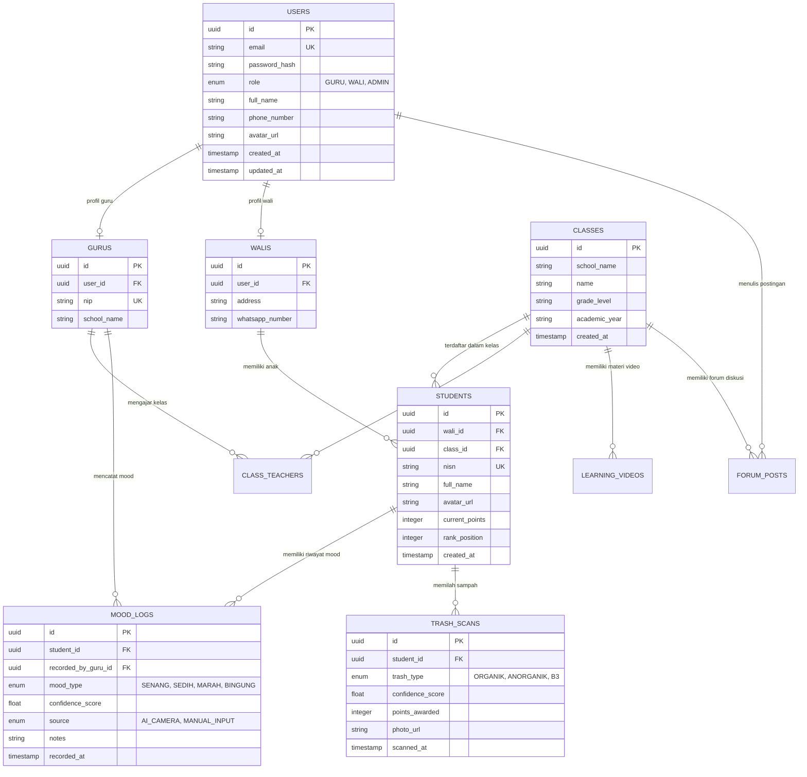

# Spesifikasi Teknis Backend: Arsitektur API dan Basis Data Kibooz

Panduan ini memuat diagram relasi entitas, DDL skema database, kontrak RESTful API, dan rincian tugas backend dari fase MVP hingga produksi penuh.

---

## 1. Arsitektur Layanan Backend

- **Runtime:** Node.js (TypeScript dengan NestJS / Express) atau Kotlin Ktor / Python FastAPI.
- **Basis Data Utama:** PostgreSQL 15+ (Relasional, ACID compliant untuk pencatatan poin dan log mood).
- **In-Memory Caching:** Redis 7+ (Session token, rate-limiting, dan live ranking leaderboard).
- **Penyimpanan Berkas (Object Storage):** AWS S3 / Cloudflare R2 / Firebase Cloud Storage untuk menyimpan foto profil, thumbnail video edukasi, dan arsip bukti scan sampah.
- **Protokol Komunikasi:** RESTful JSON melalui HTTPS dengan standar header `Authorization: Bearer <JWT>`.

---

## 2. Diagram Relasi Entitas (ERD)



---

## 3. Skema Basis Data Relasional (PostgreSQL DDL)

```sql
-- Ekstensi UUID
CREATE EXTENSION IF NOT EXISTS "uuid-ossp";

-- 1. Tabel Users
CREATE TYPE user_role AS ENUM ('GURU', 'WALI', 'ADMIN');

CREATE TABLE users (
    id UUID PRIMARY KEY DEFAULT uuid_generate_v4(),
    email VARCHAR(255) UNIQUE NOT NULL,
    password_hash VARCHAR(255) NOT NULL,
    role user_role NOT NULL,
    full_name VARCHAR(150) NOT NULL,
    phone_number VARCHAR(30),
    avatar_url TEXT,
    created_at TIMESTAMP WITH TIME ZONE DEFAULT CURRENT_TIMESTAMP,
    updated_at TIMESTAMP WITH TIME ZONE DEFAULT CURRENT_TIMESTAMP
);

-- 2. Profil Khusus Guru
CREATE TABLE gurus (
    id UUID PRIMARY KEY DEFAULT uuid_generate_v4(),
    user_id UUID NOT NULL REFERENCES users(id) ON DELETE CASCADE,
    nip VARCHAR(50) UNIQUE,
    school_name VARCHAR(150) NOT NULL DEFAULT 'TK Pertiwi Harapan Bangsa'
);

-- 3. Profil Khusus Wali
CREATE TABLE walis (
    id UUID PRIMARY KEY DEFAULT uuid_generate_v4(),
    user_id UUID NOT NULL REFERENCES users(id) ON DELETE CASCADE,
    address TEXT,
    whatsapp_number VARCHAR(30)
);

-- 4. Tabel Kelas
CREATE TABLE classes (
    id UUID PRIMARY KEY DEFAULT uuid_generate_v4(),
    school_name VARCHAR(150) NOT NULL DEFAULT 'TK Pertiwi Harapan Bangsa',
    name VARCHAR(50) NOT NULL,
    grade_level VARCHAR(20) NOT NULL DEFAULT 'Kelas A',
    academic_year VARCHAR(20) NOT NULL DEFAULT '2026/2027',
    created_at TIMESTAMP WITH TIME ZONE DEFAULT CURRENT_TIMESTAMP
);

-- 5. Tabel Siswa
CREATE TABLE students (
    id UUID PRIMARY KEY DEFAULT uuid_generate_v4(),
    wali_id UUID NOT NULL REFERENCES walis(id) ON DELETE RESTRICT,
    class_id UUID NOT NULL REFERENCES classes(id) ON DELETE RESTRICT,
    nisn VARCHAR(30) UNIQUE NOT NULL,
    full_name VARCHAR(150) NOT NULL,
    avatar_url TEXT,
    current_points INTEGER NOT NULL DEFAULT 0,
    rank_position INTEGER DEFAULT 0,
    created_at TIMESTAMP WITH TIME ZONE DEFAULT CURRENT_TIMESTAMP
);

-- 6. Tabel Riwayat Mood
CREATE TYPE mood_enum AS ENUM ('SENANG', 'SEDIH', 'MARAH', 'BINGUNG');
CREATE TYPE input_source_enum AS ENUM ('AI_CAMERA', 'MANUAL_INPUT');

CREATE TABLE mood_logs (
    id UUID PRIMARY KEY DEFAULT uuid_generate_v4(),
    student_id UUID NOT NULL REFERENCES students(id) ON DELETE CASCADE,
    recorded_by_guru_id UUID NOT NULL REFERENCES gurus(id) ON DELETE RESTRICT,
    mood_type mood_enum NOT NULL,
    confidence_score REAL NOT NULL DEFAULT 1.0,
    source input_source_enum NOT NULL DEFAULT 'MANUAL_INPUT',
    notes TEXT,
    recorded_at TIMESTAMP WITH TIME ZONE DEFAULT CURRENT_TIMESTAMP
);

-- Index untuk percepatan query agregasi grafik
CREATE INDEX idx_mood_logs_student_date ON mood_logs(student_id, recorded_at);
CREATE INDEX idx_mood_logs_date ON mood_logs(recorded_at);

-- 7. Tabel Transaksi Pemilahan Sampah
CREATE TYPE trash_category_enum AS ENUM ('ORGANIK', 'ANORGANIK', 'B3');

CREATE TABLE trash_scans (
    id UUID PRIMARY KEY DEFAULT uuid_generate_v4(),
    student_id UUID NOT NULL REFERENCES students(id) ON DELETE CASCADE,
    trash_type trash_category_enum NOT NULL,
    confidence_score REAL NOT NULL DEFAULT 1.0,
    points_awarded INTEGER NOT NULL,
    photo_url TEXT,
    scanned_at TIMESTAMP WITH TIME ZONE DEFAULT CURRENT_TIMESTAMP
);

CREATE INDEX idx_trash_scans_student_date ON trash_scans(student_id, scanned_at);
```

---

## 4. Spesifikasi Kontrak RESTful API

### 4.1 Autentikasi (`/api/v1/auth`)

#### `POST /api/v1/auth/login`
- **Deskripsi:** Masuk ke akun sebagai Guru atau Wali Murid.
- **Request Body:**
```json
{
  "email": "sarah.kartika@gmail.com",
  "password": "PasswordRahasia123!",
  "role": "WALI"
}
```
- **Response 200 OK:**
```json
{
  "success": true,
  "message": "Login berhasil",
  "data": {
    "token": "eyJhbGciOiJIUzI1NiIsInR5cCI6IkpXVCJ9...",
    "refreshToken": "d8f8a123-bc42-4b21-8931...",
    "user": {
      "id": "7c9e6679-7425-40de-944b-e07fc1f90ae7",
      "email": "sarah.kartika@gmail.com",
      "fullName": "Sarah Kartika, S.Pd.",
      "role": "WALI",
      "avatarUrl": "https://storage.kibooz.id/avatars/wali_sarah.png"
    }
  }
}
```
- **Response 401 Unauthorized:**
```json
{
  "success": false,
  "message": "Email atau kata sandi tidak cocok untuk peran yang dipilih",
  "errorCode": "AUTH_INVALID_CREDENTIALS"
}
```

---

### 4.2 Portal Wali Murid (`/api/v1/wali`)

#### `GET /api/v1/wali/dashboard`
- **Header:** `Authorization: Bearer <token>`
- **Response 200 OK:**
```json
{
  "success": true,
  "data": {
    "student": {
      "id": "c4b3a981-5502-4f32-8231-10c970a03bd7",
      "fullName": "Amelia Siti Zahra",
      "className": "Kelas A • TK Pertiwi Harapan Bangsa",
      "avatarUrl": "https://storage.kibooz.id/avatars/amelia.png",
      "nisn": "3124567890"
    },
    "todayMood": {
      "moodType": "BINGUNG",
      "label": "Ragu / Perlu Pendampingan",
      "confidence": 0.88,
      "recordedAt": "2026-10-04T08:15:00Z",
      "teacherNotes": "Amelia sempat ragu saat berpisah di gerbang, namun ceria saat sesi mewarnai."
    },
    "pointsSummary": {
      "totalPoints": 340,
      "classRank": 2,
      "organicCount": 28,
      "anorganicCount": 20
    },
    "recommendedGuidance": {
      "id": "guidance-bingung-4step",
      "title": "Berikan Rasa Aman Pada Anak",
      "category": "Bingung / Ragu",
      "bannerUrl": "https://storage.kibooz.id/guidance/banner_aman.png"
    }
  }
}
```

#### `POST /api/v1/wali/guidance/apply`
- **Deskripsi:** Konfirmasi penerapan panduan penanganan emosi oleh wali.
- **Request Body:**
```json
{
  "guidanceId": "guidance-bingung-4step",
  "studentId": "c4b3a981-5502-4f32-8231-10c970a03bd7",
  "parentNotes": "Sudah diajak berbicara pelan di rumah, Amelia sudah tenang dan siap sekolah besok."
}
```
- **Response 200 OK:**
```json
{
  "success": true,
  "message": "Status penanganan berhasil diteruskan ke guru kelas"
}
```

---

### 4.3 Portal Guru (`/api/v1/guru`)

#### `GET /api/v1/guru/dashboard`
- **Header:** `Authorization: Bearer <token>`
- **Response 200 OK:**
```json
{
  "success": true,
  "data": {
    "teacher": {
      "fullName": "Siti Rahayu, S.Pd.",
      "nip": "198507152010032005",
      "avatarUrl": "https://storage.kibooz.id/avatars/guru_siti.png"
    },
    "classOverview": {
      "classId": "a1b2c3d4-e5f6-7a8b-9c0d-1e2f3a4b5c6d",
      "className": "Kelas A (Mawar)",
      "totalStudents": 24,
      "presentStudents": 22,
      "dominantMood": "SENANG"
    },
    "dailyMoodDistribution": {
      "senang": 14,
      "sedih": 3,
      "marah": 1,
      "bingung": 4
    }
  }
}
```

#### `POST /api/v1/guru/mood/log`
- **Deskripsi:** Guru menginputkan atau mengonfirmasi hasil deteksi mood siswa.
- **Request Body:**
```json
{
  "studentId": "c4b3a981-5502-4f32-8231-10c970a03bd7",
  "moodType": "SENANG",
  "source": "AI_CAMERA",
  "confidenceScore": 0.94,
  "notes": "Anak tersenyum lepas saat menyanyikan lagu pembuka."
}
```
- **Response 201 Created:**
```json
{
  "success": true,
  "message": "Catatan emosi siswa berhasil disimpan",
  "data": {
    "logId": "e1f2a3b4-5678-90ab-cdef-1234567890ab",
    "recordedAt": "2026-10-04T08:30:00Z"
  }
}
```

#### `GET /api/v1/guru/mood/analytics`
- **Query Params:** `classId=<uuid>&range=weekly`
- **Response 200 OK:**
```json
{
  "success": true,
  "data": {
    "donutSummary": [
      { "mood": "SENANG", "percentage": 58, "colorHex": "#34C759" },
      { "mood": "BINGUNG", "percentage": 20, "colorHex": "#FF9500" },
      { "mood": "SEDIH", "percentage": 14, "colorHex": "#5856D6" },
      { "mood": "MARAH", "percentage": 8, "colorHex": "#FF3B30" }
    ],
    "weeklyTrend": [
      { "day": "Senin", "averageHappyScore": 72 },
      { "day": "Selasa", "averageHappyScore": 78 },
      { "day": "Rabu", "averageHappyScore": 65 },
      { "day": "Kamis", "averageHappyScore": 82 },
      { "day": "Jumat", "averageHappyScore": 90 }
    ]
  }
}
```

---

### 4.4 Gamifikasi dan Poin Sampah (`/api/v1/trash` & `/api/v1/leaderboard`)

#### `POST /api/v1/trash/scan-claim`
- **Deskripsi:** Klaim poin setelah melakukan pemindaian objek sampah.
- **Request Body:**
```json
{
  "studentId": "c4b3a981-5502-4f32-8231-10c970a03bd7",
  "trashType": "ANORGANIK",
  "confidenceScore": 0.91,
  "photoBase64": "data:image/jpeg;base64,..."
}
```
- **Response 200 OK:**
```json
{
  "success": true,
  "message": "Poin pilah sampah berhasil diklaim!",
  "data": {
    "pointsAdded": 15,
    "totalPoints": 355,
    "newRank": 2,
    "remainingDailyScans": 4
  }
}
```

#### `GET /api/v1/leaderboard?classId={classId}`
- **Response 200 OK:**
```json
{
  "success": true,
  "data": {
    "podium": [
      { "rank": 1, "studentName": "Farhan Al-Fatih", "points": 420, "avatarUrl": "..." },
      { "rank": 2, "studentName": "Amelia Siti Zahra", "points": 355, "avatarUrl": "..." },
      { "rank": 3, "studentName": "Kenzo Putra", "points": 310, "avatarUrl": "..." }
    ],
    "rankings": [
      { "rank": 4, "studentName": "Zhafira Bilqis", "points": 290, "avatarUrl": "..." },
      { "rank": 5, "studentName": "Rizky Ramadhan", "points": 275, "avatarUrl": "..." }
    ]
  }
}
```

---

## 5. Daftar Tugas Tim Backend (Work Breakdown)

- [ ] **BE-01:** Setup environment backend dan konfigurasi Docker Compose untuk PostgreSQL 15 & Redis 7.
- [ ] **BE-02:** Migrasi skema database relasional (Prisma / TypeORM / Liquibase DDL).
- [ ] **BE-03:** Pembuatan modul autentikasi JWT (Login multi-peran, token refresh, bcrypt password hash).
- [ ] **BE-04:** Pembuatan endpoint Dashboard Wali Murid dan pemantauan mood harian anak.
- [ ] **BE-05:** Pembuatan endpoint Dashboard Guru dan agregasi grafik analitik mood (Donut, Weekly Trend).
- [ ] **BE-06:** Pembuatan endpoint pencatatan mood anak (verifikasi peran guru dan validasi enum).
- [ ] **BE-07:** Pembuatan endpoint transaksi pilah sampah, kalkulasi poin reward, dan limit 5x per hari.
- [ ] **BE-08:** Optimasi query leaderboard terindeks dengan cache Redis untuk respons di bawah 50ms.
- [ ] **BE-09:** Integrasi penyimpanan cloud (S3 / R2) untuk unggah avatar dan foto sampah.
- [ ] **BE-10:** Pengujian endpoint otomatis menggunakan Postman atau automated Jest e2e test suite.
