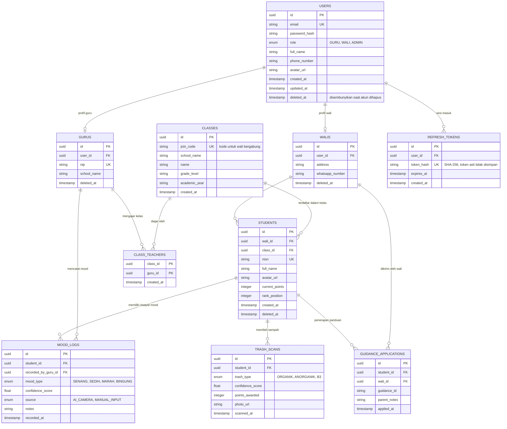

# Spesifikasi Teknis Backend: Arsitektur API dan Basis Data Kibooz

Panduan ini memuat diagram relasi entitas, DDL skema database, kontrak RESTful API, dan rincian tugas backend dari fase MVP hingga produksi penuh.

---

## 1. Arsitektur Layanan Backend

- **Runtime:** Go dengan Fiber v3 dan GORM. Satu binary menjalankan API dan menerapkan migrasi SQL yang tertanam saat mulai.
- **Basis Data Utama:** PostgreSQL 15 (relasional, ACID untuk pencatatan poin dan log mood). Token refresh juga disimpan di sini dalam bentuk hash SHA-256.
- **In-Memory Caching:** Redis 7 bersifat opsional. Redis mempercepat penolakan token yang dipakai ulang, batas laju yang dipakai bersama dan cache leaderboard. API tetap berjalan tanpa Redis dan `GET /healthz` melaporkan status `degraded`.
- **Penyimpanan Berkas (Object Storage):** Bucket yang kompatibel dengan S3 (Cloudflare R2 secara bawaan) untuk foto profil dan foto bukti scan sampah. Unggahan nonaktif sampai konfigurasi S3 lengkap.
- **Protokol Komunikasi:** RESTful JSON melalui HTTPS dengan header `Authorization: Bearer <JWT>`. Semua respons memakai satu amplop dan semua pesan berbahasa Inggris, sehingga klien bercabang pada `errorCode` dan tidak pada teks pesan.
- **Alamat Layanan:** `https://kibooz-api.syafahadyan.com/api/v1`. Dokumentasi interaktif ada di `https://docs.kibooz.syafahadyan.com` dan dibangun dari `openapi.yaml` di repositori backend (`SyafaHadyan/kibooz-backend`), yang menjadi acuan jika ada perbedaan dengan dokumen ini.
- **Cakupan:** kontrak MVP di dokumen ini ditambah registrasi, token refresh, logout, unggah foto dan hapus akun. Materi video dan forum diskusi belum ada di backend.

## 2. Diagram Relasi Entitas (ERD)



Tabel `class_teachers` sudah ada di ERD awal tetapi belum ada di DDL awal, sedangkan `guidance_applications` dan `refresh_tokens` ditambahkan oleh implementasi. Tabel `learning_videos` dan `forum_posts` dari rancangan awal belum dibuat karena video dan forum di luar kontrak MVP backend.

---

## 3. Skema Basis Data Relasional (PostgreSQL DDL)

DDL di bawah ini adalah gabungan migrasi `000001` sampai `000004` dari `internal/infra/db/migrations` di repositori backend. Migrasi tertanam di binary dan dijalankan otomatis saat API mulai. Dibanding rancangan awal, `gen_random_uuid()` menggantikan `uuid_generate_v4()` sehingga tidak perlu ekstensi, dan ada tabel serta kolom tambahan yang dijelaskan di bagian 2.

```sql
-- Initial Kibooz schema following 02_BACKEND_API_AND_DATABASE.md with the addition of
-- class_teachers, class join codes, and guidance_applications.

CREATE TYPE user_role AS ENUM ('GURU', 'WALI', 'ADMIN');
CREATE TYPE mood_enum AS ENUM ('SENANG', 'SEDIH', 'MARAH', 'BINGUNG');
CREATE TYPE input_source_enum AS ENUM ('AI_CAMERA', 'MANUAL_INPUT');
CREATE TYPE trash_category_enum AS ENUM ('ORGANIK', 'ANORGANIK', 'B3');

CREATE TABLE users (
    id UUID PRIMARY KEY DEFAULT gen_random_uuid(),
    email VARCHAR(255) UNIQUE NOT NULL,
    password_hash VARCHAR(255) NOT NULL,
    role user_role NOT NULL,
    full_name VARCHAR(150) NOT NULL,
    phone_number VARCHAR(30),
    avatar_url TEXT,
    created_at TIMESTAMP WITH TIME ZONE NOT NULL DEFAULT CURRENT_TIMESTAMP,
    updated_at TIMESTAMP WITH TIME ZONE NOT NULL DEFAULT CURRENT_TIMESTAMP
);

CREATE TABLE gurus (
    id UUID PRIMARY KEY DEFAULT gen_random_uuid(),
    user_id UUID NOT NULL UNIQUE REFERENCES users(id) ON DELETE CASCADE,
    nip VARCHAR(50) UNIQUE,
    school_name VARCHAR(150) NOT NULL DEFAULT 'TK Pertiwi Harapan Bangsa'
);

CREATE TABLE walis (
    id UUID PRIMARY KEY DEFAULT gen_random_uuid(),
    user_id UUID NOT NULL UNIQUE REFERENCES users(id) ON DELETE CASCADE,
    address TEXT,
    whatsapp_number VARCHAR(30)
);

CREATE TABLE classes (
    id UUID PRIMARY KEY DEFAULT gen_random_uuid(),
    join_code VARCHAR(12) NOT NULL UNIQUE,
    school_name VARCHAR(150) NOT NULL DEFAULT 'TK Pertiwi Harapan Bangsa',
    name VARCHAR(50) NOT NULL,
    grade_level VARCHAR(20) NOT NULL DEFAULT 'Kelas A',
    academic_year VARCHAR(20) NOT NULL DEFAULT '2026/2027',
    created_at TIMESTAMP WITH TIME ZONE NOT NULL DEFAULT CURRENT_TIMESTAMP
);

CREATE TABLE class_teachers (
    class_id UUID NOT NULL REFERENCES classes(id) ON DELETE CASCADE,
    guru_id UUID NOT NULL REFERENCES gurus(id) ON DELETE CASCADE,
    created_at TIMESTAMP WITH TIME ZONE NOT NULL DEFAULT CURRENT_TIMESTAMP,
    PRIMARY KEY (class_id, guru_id)
);

CREATE INDEX idx_class_teachers_guru ON class_teachers(guru_id);

CREATE TABLE students (
    id UUID PRIMARY KEY DEFAULT gen_random_uuid(),
    wali_id UUID NOT NULL REFERENCES walis(id) ON DELETE RESTRICT,
    class_id UUID NOT NULL REFERENCES classes(id) ON DELETE RESTRICT,
    nisn VARCHAR(30) UNIQUE NOT NULL,
    full_name VARCHAR(150) NOT NULL,
    avatar_url TEXT,
    current_points INTEGER NOT NULL DEFAULT 0 CHECK (current_points >= 0),
    rank_position INTEGER NOT NULL DEFAULT 0,
    created_at TIMESTAMP WITH TIME ZONE NOT NULL DEFAULT CURRENT_TIMESTAMP
);

CREATE INDEX idx_students_wali ON students(wali_id);
CREATE INDEX idx_students_class_points ON students(class_id, current_points DESC, full_name, id);

CREATE TABLE mood_logs (
    id UUID PRIMARY KEY DEFAULT gen_random_uuid(),
    student_id UUID NOT NULL REFERENCES students(id) ON DELETE CASCADE,
    recorded_by_guru_id UUID NOT NULL REFERENCES gurus(id) ON DELETE RESTRICT,
    mood_type mood_enum NOT NULL,
    confidence_score REAL NOT NULL DEFAULT 1.0 CHECK (confidence_score >= 0 AND confidence_score <= 1),
    source input_source_enum NOT NULL DEFAULT 'MANUAL_INPUT',
    notes TEXT,
    recorded_at TIMESTAMP WITH TIME ZONE NOT NULL DEFAULT CURRENT_TIMESTAMP
);

CREATE INDEX idx_mood_logs_student_date ON mood_logs(student_id, recorded_at);
CREATE INDEX idx_mood_logs_date ON mood_logs(recorded_at);

CREATE TABLE trash_scans (
    id UUID PRIMARY KEY DEFAULT gen_random_uuid(),
    student_id UUID NOT NULL REFERENCES students(id) ON DELETE CASCADE,
    trash_type trash_category_enum NOT NULL,
    confidence_score REAL NOT NULL DEFAULT 1.0 CHECK (confidence_score >= 0 AND confidence_score <= 1),
    points_awarded INTEGER NOT NULL CHECK (points_awarded >= 0),
    photo_url TEXT,
    scanned_at TIMESTAMP WITH TIME ZONE NOT NULL DEFAULT CURRENT_TIMESTAMP
);

CREATE INDEX idx_trash_scans_student_date ON trash_scans(student_id, scanned_at);

CREATE TABLE guidance_applications (
    id UUID PRIMARY KEY DEFAULT gen_random_uuid(),
    student_id UUID NOT NULL REFERENCES students(id) ON DELETE CASCADE,
    wali_id UUID NOT NULL REFERENCES walis(id) ON DELETE CASCADE,
    guidance_id VARCHAR(64) NOT NULL,
    parent_notes TEXT,
    applied_at TIMESTAMP WITH TIME ZONE NOT NULL DEFAULT CURRENT_TIMESTAMP
);

CREATE INDEX idx_guidance_applications_student ON guidance_applications(student_id, applied_at);

-- 000002 refresh tokens
CREATE TABLE refresh_tokens (
    id UUID PRIMARY KEY DEFAULT gen_random_uuid(),
    user_id UUID NOT NULL REFERENCES users(id) ON DELETE CASCADE,
    token_hash CHAR(64) NOT NULL UNIQUE,
    expires_at TIMESTAMP WITH TIME ZONE NOT NULL,
    created_at TIMESTAMP WITH TIME ZONE NOT NULL DEFAULT CURRENT_TIMESTAMP
);

CREATE INDEX idx_refresh_tokens_user_expiry ON refresh_tokens(user_id, expires_at);

-- 000003 soft delete
-- The unique rules only apply to rows that are still active, so an email, NIP or NISN can be used again after deletion.
ALTER TABLE users ADD COLUMN deleted_at TIMESTAMPTZ;
ALTER TABLE gurus ADD COLUMN deleted_at TIMESTAMPTZ;
ALTER TABLE walis ADD COLUMN deleted_at TIMESTAMPTZ;
ALTER TABLE students ADD COLUMN deleted_at TIMESTAMPTZ;

ALTER TABLE users DROP CONSTRAINT users_email_key;
ALTER TABLE gurus DROP CONSTRAINT gurus_nip_key;
ALTER TABLE students DROP CONSTRAINT students_nisn_key;

-- the index names stay the same as the old constraints, the API maps them to friendly errors
CREATE UNIQUE INDEX users_email_key ON users (email) WHERE deleted_at IS NULL;
CREATE UNIQUE INDEX gurus_nip_key ON gurus (nip) WHERE deleted_at IS NULL;
CREATE UNIQUE INDEX students_nisn_key ON students (nisn) WHERE deleted_at IS NULL;

-- 000004 default grade level
ALTER TABLE classes ALTER COLUMN grade_level SET DEFAULT 'Class A';
```

---

## 4. Spesifikasi Kontrak RESTful API

### 4.0 Aturan Umum

Semua alamat di bawah ini relatif terhadap `https://kibooz-api.syafahadyan.com/api/v1`, kecuali `GET /healthz` yang berada di akar.

**Amplop respons.** Respons sukses berbentuk `{ "success": true, "message": "...", "data": { ... } }` dengan `message` dan `data` yang opsional. Respons gagal berbentuk `{ "success": false, "message": "...", "errorCode": "...", "details": { ... } }`. Kolom `details` hanya muncul pada kegagalan validasi dan berisi satu pesan untuk setiap kolom yang salah.

**Bahasa.** Pesan dan nama hari dalam respons memakai bahasa Inggris (`Monday` sampai `Friday`), dan nilai bawaan `gradeLevel` kelas baru adalah `Class A`. Aplikasi menerjemahkan teks tampilan di sisi klien.

**Batas laju.** Rute untuk pengguna yang sudah masuk dibatasi per pengguna (120 permintaan per 60 detik). Registrasi, login, token refresh dan logout dibatasi per akun (10 permintaan per 60 detik). Tidak ada batas yang memakai alamat IP. Permintaan yang melewati batas mendapat `429` dengan `errorCode` `RATE_LIMITED` dan header `Retry-After`.

**Kode kesalahan.**

| `errorCode` | Arti |
|:---|:---|
| `VALIDATION_ERROR` | Masukan tidak valid, rincian per kolom ada di `details` |
| `AUTH_INVALID_CREDENTIALS` | Email atau kata sandi tidak cocok untuk peran yang dipilih |
| `AUTH_TOKEN_MISSING`, `AUTH_TOKEN_INVALID` | Token akses tidak dikirim atau tidak valid |
| `AUTH_REFRESH_INVALID` | Sesi sudah berakhir dan pengguna harus masuk lagi |
| `AUTH_FORBIDDEN` | Peran tidak boleh melakukan aksi ini |
| `AUTH_PASSWORD_INCORRECT` | Kata sandi salah saat menghapus akun |
| `EMAIL_ALREADY_REGISTERED`, `NIP_ALREADY_REGISTERED`, `NISN_ALREADY_REGISTERED` | Data sudah terdaftar |
| `CLASS_CODE_NOT_FOUND`, `CLASS_NOT_FOUND`, `CLASS_NO_ACTIVE_TEACHER` | Masalah pada kode atau data kelas |
| `STUDENT_NOT_FOUND`, `PROFILE_NOT_FOUND`, `GUIDANCE_NOT_FOUND` | Data yang dicari tidak ada |
| `TRASH_DAILY_LIMIT_REACHED` | Batas klaim harian anak sudah tercapai |
| `INVALID_IMAGE`, `FILE_TOO_LARGE` | Berkas bukan gambar atau terlalu besar |
| `STORAGE_UNAVAILABLE`, `STORAGE_ERROR` | Penyimpanan berkas belum diatur atau gagal |
| `RATE_LIMITED` | Batas laju terlewati |

---

### 4.1 Autentikasi (`/auth`)

#### `POST /auth/register`
- **Deskripsi:** Membuat akun. Seorang GURU mendaftar dengan kelas baru dan seorang WALI bergabung dengan kode kelas. Mengetahui kode kelas tidak pernah memberi akses sebagai guru.
- **Request Body (WALI):**
```json
{
  "email": "sarah.kartika@gmail.com",
  "password": "PasswordRahasia123!",
  "fullName": "Sarah Kartika, S.Pd.",
  "role": "WALI",
  "classCode": "KBZ4829",
  "student": { "nisn": "3124567890", "fullName": "Amelia Siti Zahra" }
}
```
- **Request Body (GURU):** `email`, `password`, `fullName`, `role: "GURU"`, `nip` dan `schoolName` yang opsional, serta `class` berisi `name` (wajib), `gradeLevel`, `academicYear` dan `schoolName`.
- **Response 201 Created:** sama dengan respons login di bawah, dengan `message` `Registration successful`.
- **Kegagalan:** `400` `VALIDATION_ERROR`, `404` `CLASS_CODE_NOT_FOUND` atau `CLASS_NO_ACTIVE_TEACHER`, `409` untuk email, NIP atau NISN yang sudah terdaftar.

#### `POST /auth/login`
- **Deskripsi:** Masuk ke akun sebagai Guru atau Wali Murid.
- **Request Body:** `deviceToken` bersifat opsional dan diisi dengan token perangkat dari login atau registrasi sebelumnya untuk email yang sama.
```json
{
  "email": "sarah.kartika@gmail.com",
  "password": "PasswordRahasia123!",
  "role": "WALI",
  "deviceToken": "..."
}
```
- **Response 200 OK:**
```json
{
  "success": true,
  "message": "Login successful",
  "data": {
    "token": "eyJhbGciOiJIUzI1NiIsInR5cCI6IkpXVCJ9...",
    "refreshToken": "d8f8a123-bc42-4b21-8931...",
    "deviceToken": "...",
    "user": {
      "id": "7c9e6679-7425-40de-944b-e07fc1f90ae7",
      "email": "sarah.kartika@gmail.com",
      "fullName": "Sarah Kartika, S.Pd.",
      "role": "WALI",
      "avatarUrl": "https://kibooz-media.syafahadyan.com/avatars/wali_sarah.png"
    }
  }
}
```
- **Response 401 Unauthorized:**
```json
{
  "success": false,
  "message": "The email or password does not match the selected role",
  "errorCode": "AUTH_INVALID_CREDENTIALS"
}
```
- `deviceToken` bukan kredensial. Token ini hanya memberi perangkat anggaran login sendiri untuk email tersebut, dan aplikasi menyimpannya serta mengirimkannya pada login berikutnya.

#### `POST /auth/refresh-token`
- **Deskripsi:** Menukar token refresh dengan pasangan token baru. Setiap token refresh hanya berlaku sekali, jadi aplikasi harus mengganti yang tersimpan dengan yang baru pada setiap panggilan yang berhasil.
- **Request Body:** `{ "refreshToken": "d8f8a123-bc42-4b21-8931..." }`
- **Response 200 OK:** `message` `Token refreshed` dan `data` yang sama dengan respons login.
- **Response 401 Unauthorized:** `AUTH_REFRESH_INVALID`, artinya sesi berakhir dan pengguna harus masuk lagi.

#### `POST /auth/logout`
- **Deskripsi:** Mencabut sebuah token refresh.
- **Request Body:** `{ "refreshToken": "d8f8a123-bc42-4b21-8931..." }`
- **Response 200 OK:** `{ "success": true, "message": "Logout successful" }`

---

### 4.2 Portal Wali Murid (`/wali`)

#### `GET /wali/dashboard`
- **Header:** `Authorization: Bearer <token>`
- **Query Params:** `studentId=<uuid>` opsional, untuk wali yang memiliki lebih dari satu anak. Tanpa parameter ini, yang dikembalikan adalah anak yang terdaftar paling awal.
- **Response 200 OK:** `label`, `title` dan `category` berasal dari katalog tetap di backend dan berbahasa Inggris. Ada empat panduan, satu untuk setiap mood (`guidance-senang-4step`, `guidance-sedih-4step`, `guidance-marah-4step` dan `guidance-bingung-4step`), dan `bannerUrl` dibentuk dari alamat publik bucket ditambah `guidance/banner_ceria.png`, `banner_temani.png`, `banner_tenang.png` atau `banner_aman.png`. `className` berbentuk `<jenjang> • <nama sekolah>`.
```json
{
  "success": true,
  "data": {
    "student": {
      "id": "c4b3a981-5502-4f32-8231-10c970a03bd7",
      "fullName": "Amelia Siti Zahra",
      "className": "Class A • TK Pertiwi Harapan Bangsa",
      "avatarUrl": "https://kibooz-media.syafahadyan.com/avatars/amelia.png",
      "nisn": "3124567890"
    },
    "todayMood": {
      "moodType": "BINGUNG",
      "label": "Unsure / Needs Support",
      "confidence": 0.88,
      "recordedAt": "2026-10-04T08:15:00Z",
      "teacherNotes": "Amelia sempat ragu saat berpisah di gerbang, namun ceria saat sesi mewarnai."
    },
    "pointsSummary": {
      "totalPoints": 340,
      "classRank": 2,
      "organicCount": 28,
      "anorganicCount": 20
    },
    "recommendedGuidance": {
      "id": "guidance-bingung-4step",
      "title": "Give Your Child a Sense of Safety",
      "category": "Confused / Unsure",
      "bannerUrl": "https://kibooz-media.syafahadyan.com/guidance/banner_aman.png"
    }
  }
}
```

#### `POST /wali/guidance/apply`
- **Deskripsi:** Konfirmasi penerapan panduan penanganan emosi oleh wali. Penerapan disimpan di tabel `guidance_applications` dan diteruskan ke guru kelas.
- **Request Body:**
```json
{
  "guidanceId": "guidance-bingung-4step",
  "studentId": "c4b3a981-5502-4f32-8231-10c970a03bd7",
  "parentNotes": "Sudah diajak berbicara pelan di rumah, Amelia sudah tenang dan siap sekolah besok."
}
```
- **Response 200 OK:**
```json
{
  "success": true,
  "message": "Handling status forwarded to the class teacher"
}
```
- **Kegagalan:** `404` `STUDENT_NOT_FOUND` atau `GUIDANCE_NOT_FOUND`.

---

### 4.3 Portal Guru (`/guru`)

#### `GET /guru/dashboard`
- **Header:** `Authorization: Bearer <token>`
- **Query Params:** `classId=<uuid>` opsional, untuk guru yang mengajar lebih dari satu kelas.
- **Response 200 OK:** `joinCode` adalah kode yang dibagikan guru kepada wali, dan `dominantMood` bernilai `null` selama belum ada catatan emosi hari itu.
```json
{
  "success": true,
  "data": {
    "teacher": {
      "fullName": "Siti Rahayu, S.Pd.",
      "nip": "198507152010032005",
      "avatarUrl": "https://kibooz-media.syafahadyan.com/avatars/guru_siti.png"
    },
    "classOverview": {
      "classId": "a1b2c3d4-e5f6-7a8b-9c0d-1e2f3a4b5c6d",
      "className": "Class A (Mawar)",
      "joinCode": "KBZ4829",
      "totalStudents": 24,
      "presentStudents": 22,
      "dominantMood": "SENANG"
    },
    "dailyMoodDistribution": {
      "senang": 14,
      "sedih": 3,
      "marah": 1,
      "bingung": 4
    }
  }
}
```

#### `POST /guru/mood/log`
- **Deskripsi:** Guru menginputkan atau mengonfirmasi hasil deteksi mood siswa. Server menyimpan nilai `confidenceScore` apa adanya, sedangkan dialog konfirmasi untuk hasil AI di bawah 75% (BR-04) dikerjakan oleh aplikasi.
- **Request Body:**
```json
{
  "studentId": "c4b3a981-5502-4f32-8231-10c970a03bd7",
  "moodType": "SENANG",
  "source": "AI_CAMERA",
  "confidenceScore": 0.94,
  "notes": "Anak tersenyum lepas saat menyanyikan lagu pembuka."
}
```
- **Response 201 Created:**
```json
{
  "success": true,
  "message": "Student mood log saved",
  "data": {
    "logId": "e1f2a3b4-5678-90ab-cdef-1234567890ab",
    "recordedAt": "2026-10-04T08:30:00Z"
  }
}
```

#### `GET /guru/mood/analytics`
- **Query Params:** `classId=<uuid>` dan `range=weekly|monthly` (bawaan `weekly`). Keduanya opsional.
- **Response 200 OK:** `donutSummary` mengikuti rentang yang diminta, yaitu minggu berjalan atau bulan berjalan. `averageHappyScore` adalah persentase siswa pada hari itu yang catatan terakhirnya `SENANG`. `weeklyTrend` hanya berisi hari Senin sampai Jumat dengan nama hari berbahasa Inggris. `monthlyDistribution` hanya muncul pada `range=monthly` dan contohnya ada di bawah ini.
```json
{
  "success": true,
  "data": {
    "donutSummary": [
      { "mood": "SENANG", "percentage": 58, "colorHex": "#34C759" },
      { "mood": "BINGUNG", "percentage": 20, "colorHex": "#FF9500" },
      { "mood": "SEDIH", "percentage": 14, "colorHex": "#5856D6" },
      { "mood": "MARAH", "percentage": 8, "colorHex": "#FF3B30" }
    ],
    "weeklyTrend": [
      { "day": "Monday", "averageHappyScore": 72 },
      { "day": "Tuesday", "averageHappyScore": 78 },
      { "day": "Wednesday", "averageHappyScore": 65 },
      { "day": "Thursday", "averageHappyScore": 82 },
      { "day": "Friday", "averageHappyScore": 90 }
    ],
    "monthlyDistribution": [
      { "mood": "SENANG", "count": 120 },
      { "mood": "BINGUNG", "count": 41 },
      { "mood": "SEDIH", "count": 27 },
      { "mood": "MARAH", "count": 12 }
    ]
  }
}
```

---

### 4.4 Gamifikasi dan Poin Sampah (`/trash` dan `/leaderboard`)

#### `POST /trash/scan-claim`
- **Deskripsi:** Klaim poin setelah melakukan pemindaian objek sampah. Poin per klaim adalah 10 untuk ORGANIK, 15 untuk ANORGANIK dan 0 untuk B3 (nilai bawaan yang dapat diatur), dengan batas 5 klaim per anak per hari. `photoBase64` bersifat opsional (base64 atau data URI, paling besar 4 MiB setelah didekode).
- **Request Body:**
```json
{
  "studentId": "c4b3a981-5502-4f32-8231-10c970a03bd7",
  "trashType": "ANORGANIK",
  "confidenceScore": 0.91,
  "photoBase64": "data:image/jpeg;base64,..."
}
```
- **Response 200 OK:**
```json
{
  "success": true,
  "message": "Trash sorting points claimed!",
  "data": {
    "pointsAdded": 15,
    "totalPoints": 355,
    "newRank": 2,
    "remainingDailyScans": 4
  }
}
```
- **Kegagalan:** `429` `TRASH_DAILY_LIMIT_REACHED` ketika batas harian anak sudah tercapai.

#### `GET /leaderboard`
- **Query Params:** `classId=<uuid>` opsional.
- **Response 200 OK:**
```json
{
  "success": true,
  "data": {
    "podium": [
      { "rank": 1, "studentName": "Farhan Al-Fatih", "points": 420, "avatarUrl": "..." },
      { "rank": 2, "studentName": "Amelia Siti Zahra", "points": 355, "avatarUrl": "..." },
      { "rank": 3, "studentName": "Kenzo Putra", "points": 310, "avatarUrl": "..." }
    ],
    "rankings": [
      { "rank": 4, "studentName": "Zhafira Bilqis", "points": 290, "avatarUrl": "..." },
      { "rank": 5, "studentName": "Rizky Ramadhan", "points": 275, "avatarUrl": "..." }
    ]
  }
}
```
- Hasil disimpan di cache selama `LEADERBOARD_CACHE_SECONDS` (300 detik) dan cache dihapus setiap kali peringkat berubah. Reset peringkat di awal semester (BR-03) belum otomatis.

---

### 4.5 Akun dan Foto (`/users`)

#### `POST /users/avatar`
- **Deskripsi:** Mengunggah foto profil pengguna, atau foto seorang anak jika `studentId` diisi oleh wali pemiliknya.
- **Request:** `multipart/form-data` dengan kolom `file` (gambar) dan `studentId` (opsional).
- **Response 200 OK:** `{ "success": true, "message": "Profile photo updated", "data": { "avatarUrl": "https://kibooz-media.syafahadyan.com/avatars/..." } }`
- **Kegagalan:** `400` `INVALID_IMAGE`, `413` `FILE_TOO_LARGE`, `503` `STORAGE_UNAVAILABLE`.

#### `DELETE /users/me`
- **Deskripsi:** Menghapus akun sendiri. Akun dan data anak disembunyikan dengan `deleted_at`, sehingga email, NIP dan NISN dapat dipakai lagi setelahnya.
- **Request Body:** `{ "password": "PasswordRahasia123!" }`
- **Response 200 OK:** `{ "success": true, "message": "Account deleted" }`
- **Kegagalan:** `403` `AUTH_PASSWORD_INCORRECT` atau `AUTH_FORBIDDEN`.

---

### 4.6 Kesehatan Layanan

#### `GET /healthz` (di akar, tanpa `/api/v1` dan tanpa token)
- **Response 200 OK:** `{ "success": true, "status": "ok", "version": "0.4.0", "checks": { "database": "ok", "redis": "ok", "storage": "disabled" } }`
- `status` bernilai `degraded` jika hanya Redis yang mati (tetap `200`) dan `down` dengan `503` jika basis data mati. Nilai `storage` `disabled` berarti konfigurasi S3 belum lengkap dan tidak memengaruhi `status`.

---

## 5. Daftar Tugas Tim Backend (Work Breakdown)

- [x] **BE-01:** Setup environment backend dan konfigurasi Docker Compose untuk PostgreSQL 15 & Redis 7.
- [x] **BE-02:** Migrasi skema database relasional (migrasi SQL tertanam di binary Go).
- [x] **BE-03:** Pembuatan modul autentikasi JWT (login multi-peran, registrasi, token refresh sekali pakai, logout, bcrypt password hash).
- [x] **BE-04:** Pembuatan endpoint Dashboard Wali Murid dan pemantauan mood harian anak.
- [x] **BE-05:** Pembuatan endpoint Dashboard Guru dan agregasi grafik analitik mood (Donut, Weekly Trend, Monthly Distribution).
- [x] **BE-06:** Pembuatan endpoint pencatatan mood anak (verifikasi peran guru dan validasi enum).
- [x] **BE-07:** Pembuatan endpoint transaksi pilah sampah, kalkulasi poin reward, dan limit 5x per hari.
- [x] **BE-08:** Optimasi query leaderboard terindeks dengan cache Redis opsional.
- [x] **BE-09:** Integrasi penyimpanan cloud (S3 / R2) untuk unggah avatar dan foto sampah.
- [x] **BE-10:** Pengujian otomatis dengan rangkaian uji Go (unit dan end to end) yang memeriksa setiap respons terhadap `openapi.yaml`.
