# Spesifikasi Teknis Backend: Arsitektur API dan Basis Data Kibooz

Panduan ini memuat diagram relasi entitas, DDL skema database, kontrak RESTful API, dan rincian tugas backend dari fase MVP hingga produksi penuh.

---

## 1. Arsitektur Layanan Backend

- **Runtime:** Go dengan Fiber v3 dan GORM. Satu binary menjalankan API dan menerapkan migrasi SQL yang tertanam saat mulai.
- **Basis Data Utama:** PostgreSQL 15 (relasional, ACID untuk pencatatan poin dan log mood). Token refresh juga disimpan di sini dalam bentuk hash SHA-256.
- **In-Memory Caching:** Redis 7 bersifat opsional. Redis mempercepat penolakan token yang dipakai ulang, batas laju yang dipakai bersama dan cache leaderboard. API tetap berjalan tanpa Redis dan `GET /healthz` melaporkan status `degraded`.
- **Penyimpanan Berkas (Object Storage):** Bucket yang kompatibel dengan S3 (Cloudflare R2 secara bawaan) untuk foto profil, foto bukti scan sampah dan video kelas. Video diunggah langsung ke bucket lewat alamat bertanda tangan, bukan melalui API. Unggahan nonaktif sampai konfigurasi S3 lengkap.
- **Protokol Komunikasi:** RESTful JSON melalui HTTPS dengan header `Authorization: Bearer <JWT>`. Semua respons memakai satu amplop dan semua pesan berbahasa Inggris, sehingga klien bercabang pada `errorCode` dan tidak pada teks pesan.
- **Alamat Layanan:** `https://kibooz-api.syafahadyan.com/api/v1`. Dokumentasi interaktif ada di `https://docs.kibooz.syafahadyan.com` dan dibangun dari `openapi.yaml` di repositori backend (`SyafaHadyan/kibooz-backend`), yang menjadi acuan jika ada perbedaan dengan dokumen ini.
- **Cakupan:** kontrak MVP di dokumen ini ditambah registrasi, token refresh, logout, unggah foto, hapus akun, video pembelajaran, forum diskusi kelas, pengelolaan kelas oleh guru, profil guru, profil anak dan statistik sampah. Video ditambahkan guru sebagai alamat https, baik tautan ke tempat lain maupun berkas yang diunggah langsung ke bucket lewat alamat bertanda tangan. Guru kelas dapat mengubah dan menghapus video, dan pembuat postingan forum dapat mengubah postingannya sendiri. Berkas video yang diunggah menunggu di folder sementara sampai videonya ditambahkan, dan postingan forum yang diubah penulisnya ditandai dengan `editedAt`. Guru dan wali yang berbagi kelas aktif dapat saling berkirim pesan teks pribadi lewat percakapan langsung, dan daftar orang yang dapat dihubungi dihitung dari kelas.

## 2. Diagram Relasi Entitas (ERD)

```mermaid
erDiagram
    USERS ||--o| GURUS : "profil guru"
    USERS ||--o| WALIS : "profil wali"
    WALIS ||--o{ STUDENTS : "memiliki anak"
    CLASSES ||--o{ STUDENTS : "terdaftar dalam kelas"
    GURUS ||--o{ CLASS_TEACHERS : "mengajar kelas"
    CLASSES ||--o{ CLASS_TEACHERS : "diajar oleh"
    STUDENTS ||--o{ MOOD_LOGS : "memiliki riwayat mood"
    GURUS ||--o{ MOOD_LOGS : "mencatat mood"
    STUDENTS ||--o{ TRASH_SCANS : "memilah sampah"
    STUDENTS ||--o{ GUIDANCE_APPLICATIONS : "penerapan panduan"
    WALIS ||--o{ GUIDANCE_APPLICATIONS : "dikirim oleh wali"
    USERS ||--o{ REFRESH_TOKENS : "sesi masuk"
    CLASSES ||--o{ LEARNING_VIDEOS : "memiliki materi video"
    GURUS ||--o{ LEARNING_VIDEOS : "menambahkan video"
    CLASSES ||--o{ FORUM_POSTS : "memiliki forum diskusi"
    USERS ||--o{ FORUM_POSTS : "menulis postingan"
    FORUM_POSTS ||--o{ FORUM_POSTS : "dibalas oleh"
    USERS ||--o{ CHAT_CONVERSATIONS : "berada dalam percakapan"
    CHAT_CONVERSATIONS ||--o{ CHAT_MESSAGES : "berisi pesan"
    USERS ||--o{ CHAT_MESSAGES : "mengirim pesan"
    CHAT_CONVERSATIONS ||--o{ CHAT_READS : "tanda baca"

    USERS {
        uuid id PK
        string email UK
        string password_hash
        enum role "GURU, WALI, ADMIN"
        string full_name
        string phone_number
        string avatar_url
        timestamp created_at
        timestamp updated_at
        timestamp deleted_at "disembunyikan saat akun dihapus"
    }

    GURUS {
        uuid id PK
        uuid user_id FK
        string nip UK
        string school_name
        string address "alamat dinas"
        timestamp deleted_at
    }

    WALIS {
        uuid id PK
        uuid user_id FK
        string address
        string whatsapp_number
        timestamp deleted_at
    }

    CLASSES {
        uuid id PK
        string join_code UK "kode untuk wali bergabung"
        string school_name
        string name
        string grade_level
        string academic_year
        timestamp created_at
    }

    STUDENTS {
        uuid id PK
        uuid wali_id FK
        uuid class_id FK
        string nisn UK
        string full_name
        string avatar_url
        integer current_points
        integer season_points
        integer rank_position
        timestamp created_at
        timestamp deleted_at
    }

    MOOD_LOGS {
        uuid id PK
        uuid student_id FK
        uuid recorded_by_guru_id FK
        enum mood_type "SENANG, SEDIH, MARAH, BINGUNG"
        float confidence_score
        enum source "AI_CAMERA, MANUAL_INPUT"
        string notes
        timestamp recorded_at
    }

    TRASH_SCANS {
        uuid id PK
        uuid student_id FK
        enum trash_type "ORGANIK, ANORGANIK, B3"
        float confidence_score
        integer points_awarded
        string photo_url
        timestamp scanned_at
    }

    CLASS_TEACHERS {
        uuid class_id PK
        uuid guru_id PK
        timestamp created_at
    }

    GUIDANCE_APPLICATIONS {
        uuid id PK
        uuid student_id FK
        uuid wali_id FK
        string guidance_id
        string parent_notes
        timestamp applied_at
    }

    LEARNING_VIDEOS {
        uuid id PK
        uuid class_id FK
        uuid added_by_guru_id FK
        string title
        string description
        string video_url "alamat https"
        string thumbnail_url
        integer duration_seconds
        timestamp created_at
    }

    FORUM_POSTS {
        uuid id PK
        uuid class_id FK
        uuid parent_id FK "kosong untuk utas, terisi untuk balasan"
        uuid author_user_id FK
        string title "hanya untuk utas"
        string body
        timestamp created_at
        timestamp edited_at "kosong sampai penulis mengubah isinya"
    }

    CHAT_CONVERSATIONS {
        uuid id PK
        uuid user_low_id FK "id akun yang lebih kecil dari pasangan"
        uuid user_high_id FK "id akun yang lebih besar dari pasangan"
        timestamp created_at
    }

    CHAT_MESSAGES {
        bigint id PK "terus bertambah dan dipakai sebagai kursor"
        uuid conversation_id FK
        uuid sender_id FK
        string body "kosong untuk pesan yang dihapus"
        timestamp created_at
        timestamp deleted_at "terisi untuk pesan yang dihapus pengirimnya"
    }

    CHAT_READS {
        uuid conversation_id PK
        uuid user_id PK
        bigint last_read_message_id "pesan terakhir yang sudah dibaca"
        timestamp updated_at
    }

    REFRESH_TOKENS {
        uuid id PK
        uuid user_id FK
        string token_hash UK "SHA-256, token asli tidak disimpan"
        timestamp expires_at
        timestamp created_at
    }
```



Tabel `class_teachers` sudah ada di ERD awal tetapi belum ada di DDL awal, sedangkan `guidance_applications` dan `refresh_tokens` ditambahkan oleh implementasi. Tabel `learning_videos` dan `forum_posts` ada di ERD awal tanpa DDL, sehingga keduanya dirancang di implementasi. Video adalah alamat https yang ditambahkan guru, baik tautan ke tempat lain maupun berkas yang diunggah ke bucket. Forum terdiri dari utas, yaitu postingan dengan judul, dan balasan, yaitu postingan tanpa judul yang menunjuk ke utas di kelas yang sama. Kolom `gurus.address` ditambahkan untuk alamat dinas guru. Kolom `forum_posts.edited_at` menandai kapan penulis terakhir mengubah judul atau isi postingan dan kosong untuk postingan yang belum pernah diubah. Berkas video yang baru diunggah menunggu di awalan `pending/` pada bucket dan disalin ke alamat permanennya di `videos/` saat video ditambahkan, sedangkan berkas yang tidak pernah ditambahkan dihapus bucket setelah satu hari. Tabel `chat_conversations`, `chat_messages` dan `chat_reads` ditambahkan oleh migrasi 000017. Satu baris `chat_conversations` adalah satu percakapan langsung untuk satu pasangan akun, dengan id yang lebih kecil selalu di `user_low_id`, sehingga kunci unik menangkap pasangan yang sama dari kedua sisi. Id `chat_messages` bertambah terus di dalam satu percakapan dan menjadi kursor bagi aplikasi, dan pesan ditulis di bawah kunci baris percakapan agar id tidak pernah terlewat. Pesan yang dihapus tetap ada dengan isi kosong dan `deleted_at`, sehingga percakapan menampilkan penanda.

---

## 3. Skema Basis Data Relasional (PostgreSQL DDL)

DDL di bawah ini adalah gabungan migrasi `000001` sampai `000007` dari `internal/infra/db/migrations` di repositori backend. Migrasi tertanam di binary dan dijalankan otomatis saat API mulai. Dibanding rancangan awal, `gen_random_uuid()` menggantikan `uuid_generate_v4()` sehingga tidak perlu ekstensi, dan ada tabel serta kolom tambahan yang dijelaskan di bagian 2.

```sql
-- Initial Kibooz schema following 02_BACKEND_API_AND_DATABASE.md with the addition of
-- class_teachers, class join codes, and guidance_applications.

CREATE TYPE user_role AS ENUM ('GURU', 'WALI', 'ADMIN');
CREATE TYPE mood_enum AS ENUM ('SENANG', 'SEDIH', 'MARAH', 'BINGUNG');
CREATE TYPE input_source_enum AS ENUM ('AI_CAMERA', 'MANUAL_INPUT');
CREATE TYPE trash_category_enum AS ENUM ('ORGANIK', 'ANORGANIK', 'B3');

CREATE TABLE users (
    id UUID PRIMARY KEY DEFAULT gen_random_uuid(),
    email VARCHAR(255) UNIQUE NOT NULL,
    password_hash VARCHAR(255) NOT NULL,
    role user_role NOT NULL,
    full_name VARCHAR(150) NOT NULL,
    phone_number VARCHAR(30),
    avatar_url TEXT,
    created_at TIMESTAMP WITH TIME ZONE NOT NULL DEFAULT CURRENT_TIMESTAMP,
    updated_at TIMESTAMP WITH TIME ZONE NOT NULL DEFAULT CURRENT_TIMESTAMP
);

CREATE TABLE gurus (
    id UUID PRIMARY KEY DEFAULT gen_random_uuid(),
    user_id UUID NOT NULL UNIQUE REFERENCES users(id) ON DELETE CASCADE,
    nip VARCHAR(50) UNIQUE,
    school_name VARCHAR(150) NOT NULL DEFAULT 'TK Pertiwi Harapan Bangsa'
);

CREATE TABLE walis (
    id UUID PRIMARY KEY DEFAULT gen_random_uuid(),
    user_id UUID NOT NULL UNIQUE REFERENCES users(id) ON DELETE CASCADE,
    address TEXT,
    whatsapp_number VARCHAR(30)
);

CREATE TABLE classes (
    id UUID PRIMARY KEY DEFAULT gen_random_uuid(),
    join_code VARCHAR(12) NOT NULL UNIQUE,
    school_name VARCHAR(150) NOT NULL DEFAULT 'TK Pertiwi Harapan Bangsa',
    name VARCHAR(50) NOT NULL,
    grade_level VARCHAR(20) NOT NULL DEFAULT 'Kelas A',
    academic_year VARCHAR(20) NOT NULL DEFAULT '2026/2027',
    created_at TIMESTAMP WITH TIME ZONE NOT NULL DEFAULT CURRENT_TIMESTAMP
);

CREATE TABLE class_teachers (
    class_id UUID NOT NULL REFERENCES classes(id) ON DELETE CASCADE,
    guru_id UUID NOT NULL REFERENCES gurus(id) ON DELETE CASCADE,
    created_at TIMESTAMP WITH TIME ZONE NOT NULL DEFAULT CURRENT_TIMESTAMP,
    PRIMARY KEY (class_id, guru_id)
);

CREATE INDEX idx_class_teachers_guru ON class_teachers(guru_id);

CREATE TABLE students (
    id UUID PRIMARY KEY DEFAULT gen_random_uuid(),
    wali_id UUID NOT NULL REFERENCES walis(id) ON DELETE RESTRICT,
    class_id UUID NOT NULL REFERENCES classes(id) ON DELETE RESTRICT,
    nisn VARCHAR(30) UNIQUE NOT NULL,
    full_name VARCHAR(150) NOT NULL,
    avatar_url TEXT,
    current_points INTEGER NOT NULL DEFAULT 0 CHECK (current_points >= 0),
    rank_position INTEGER NOT NULL DEFAULT 0,
    created_at TIMESTAMP WITH TIME ZONE NOT NULL DEFAULT CURRENT_TIMESTAMP
);

CREATE INDEX idx_students_wali ON students(wali_id);
CREATE INDEX idx_students_class_points ON students(class_id, current_points DESC, full_name, id);

CREATE TABLE mood_logs (
    id UUID PRIMARY KEY DEFAULT gen_random_uuid(),
    student_id UUID NOT NULL REFERENCES students(id) ON DELETE CASCADE,
    recorded_by_guru_id UUID NOT NULL REFERENCES gurus(id) ON DELETE RESTRICT,
    mood_type mood_enum NOT NULL,
    confidence_score REAL NOT NULL DEFAULT 1.0 CHECK (confidence_score >= 0 AND confidence_score <= 1),
    source input_source_enum NOT NULL DEFAULT 'MANUAL_INPUT',
    notes TEXT,
    recorded_at TIMESTAMP WITH TIME ZONE NOT NULL DEFAULT CURRENT_TIMESTAMP
);

CREATE INDEX idx_mood_logs_student_date ON mood_logs(student_id, recorded_at);
CREATE INDEX idx_mood_logs_date ON mood_logs(recorded_at);

CREATE TABLE trash_scans (
    id UUID PRIMARY KEY DEFAULT gen_random_uuid(),
    student_id UUID NOT NULL REFERENCES students(id) ON DELETE CASCADE,
    trash_type trash_category_enum NOT NULL,
    confidence_score REAL NOT NULL DEFAULT 1.0 CHECK (confidence_score >= 0 AND confidence_score <= 1),
    points_awarded INTEGER NOT NULL CHECK (points_awarded >= 0),
    photo_url TEXT,
    scanned_at TIMESTAMP WITH TIME ZONE NOT NULL DEFAULT CURRENT_TIMESTAMP
);

CREATE INDEX idx_trash_scans_student_date ON trash_scans(student_id, scanned_at);

CREATE TABLE guidance_applications (
    id UUID PRIMARY KEY DEFAULT gen_random_uuid(),
    student_id UUID NOT NULL REFERENCES students(id) ON DELETE CASCADE,
    wali_id UUID NOT NULL REFERENCES walis(id) ON DELETE CASCADE,
    guidance_id VARCHAR(64) NOT NULL,
    parent_notes TEXT,
    applied_at TIMESTAMP WITH TIME ZONE NOT NULL DEFAULT CURRENT_TIMESTAMP
);

CREATE INDEX idx_guidance_applications_student ON guidance_applications(student_id, applied_at);

-- 000002 refresh tokens
CREATE TABLE refresh_tokens (
    id UUID PRIMARY KEY DEFAULT gen_random_uuid(),
    user_id UUID NOT NULL REFERENCES users(id) ON DELETE CASCADE,
    token_hash CHAR(64) NOT NULL UNIQUE,
    expires_at TIMESTAMP WITH TIME ZONE NOT NULL,
    created_at TIMESTAMP WITH TIME ZONE NOT NULL DEFAULT CURRENT_TIMESTAMP
);

CREATE INDEX idx_refresh_tokens_user_expiry ON refresh_tokens(user_id, expires_at);

-- 000003 soft delete
-- The unique rules only apply to rows that are still active, so an email, NIP or NISN can be used again after deletion.
ALTER TABLE users ADD COLUMN deleted_at TIMESTAMPTZ;
ALTER TABLE gurus ADD COLUMN deleted_at TIMESTAMPTZ;
ALTER TABLE walis ADD COLUMN deleted_at TIMESTAMPTZ;
ALTER TABLE students ADD COLUMN deleted_at TIMESTAMPTZ;

ALTER TABLE users DROP CONSTRAINT users_email_key;
ALTER TABLE gurus DROP CONSTRAINT gurus_nip_key;
ALTER TABLE students DROP CONSTRAINT students_nisn_key;

-- the index names stay the same as the old constraints, the API maps them to friendly errors
CREATE UNIQUE INDEX users_email_key ON users (email) WHERE deleted_at IS NULL;
CREATE UNIQUE INDEX gurus_nip_key ON gurus (nip) WHERE deleted_at IS NULL;
CREATE UNIQUE INDEX students_nisn_key ON students (nisn) WHERE deleted_at IS NULL;

-- 000004 default grade level
ALTER TABLE classes ALTER COLUMN grade_level SET DEFAULT 'Class A';

-- 000005 learning videos and the class forum
-- A teacher adds learning videos to a class as https addresses, and the class forum holds threads and replies.
-- A thread is a forum post with a title and no parent, a reply is a post without a title that points at a thread of the same class.

CREATE TABLE learning_videos (
    id UUID PRIMARY KEY DEFAULT gen_random_uuid(),
    class_id UUID NOT NULL REFERENCES classes(id) ON DELETE CASCADE,
    added_by_guru_id UUID NOT NULL REFERENCES gurus(id) ON DELETE RESTRICT,
    title VARCHAR(150) NOT NULL,
    description TEXT,
    video_url TEXT NOT NULL,
    thumbnail_url TEXT,
    duration_seconds INTEGER CHECK (duration_seconds IS NULL OR duration_seconds > 0),
    created_at TIMESTAMP WITH TIME ZONE NOT NULL DEFAULT CURRENT_TIMESTAMP
);

CREATE INDEX idx_learning_videos_class ON learning_videos(class_id, created_at DESC, id DESC);

CREATE TABLE forum_posts (
    id UUID PRIMARY KEY DEFAULT gen_random_uuid(),
    class_id UUID NOT NULL REFERENCES classes(id) ON DELETE CASCADE,
    parent_id UUID,
    author_user_id UUID NOT NULL REFERENCES users(id) ON DELETE CASCADE,
    title VARCHAR(150),
    body TEXT NOT NULL,
    created_at TIMESTAMP WITH TIME ZONE NOT NULL DEFAULT CURRENT_TIMESTAMP,
    UNIQUE (id, class_id),
    -- the composite key keeps a reply in the class of its thread
    FOREIGN KEY (parent_id, class_id) REFERENCES forum_posts(id, class_id) ON DELETE CASCADE,
    CHECK ((parent_id IS NULL) = (title IS NOT NULL))
);

CREATE INDEX idx_forum_threads_class ON forum_posts(class_id, created_at DESC, id DESC) WHERE parent_id IS NULL;
CREATE INDEX idx_forum_replies_thread ON forum_posts(parent_id, created_at, id) WHERE parent_id IS NOT NULL;

-- 000006 teacher address
-- A teacher keeps an official address next to the phone number that already lives on the account.
ALTER TABLE gurus ADD COLUMN address TEXT;

-- 000007 forum edited marker
-- The time a post was last changed by its author, empty for a post that was never edited.
ALTER TABLE forum_posts ADD COLUMN edited_at TIMESTAMP WITH TIME ZONE;

-- 000008 to 000010 are not listed here: a video url index, refresh token families and eight character join codes.

-- 000011 file cleanups
-- A file that could not be removed from the bucket when its owner deleted the account waits here until a later try works.
CREATE TABLE file_cleanups (
    object_key TEXT PRIMARY KEY,
    attempts INTEGER NOT NULL DEFAULT 0,
    queued_at TIMESTAMP WITH TIME ZONE NOT NULL DEFAULT now(),
    next_try_at TIMESTAMP WITH TIME ZONE NOT NULL DEFAULT now()
);

-- 000012 semester leaderboard
-- The leaderboard ranks season_points, and current_points keeps the points of all semesters.
ALTER TABLE students ADD COLUMN season_points INTEGER NOT NULL DEFAULT 0 CHECK (season_points >= 0);
CREATE INDEX idx_students_class_season_points ON students(class_id, season_points DESC, full_name, id);

CREATE TABLE leaderboard_seasons (
    label TEXT PRIMARY KEY,
    started_at TIMESTAMP WITH TIME ZONE NOT NULL DEFAULT now()
);

CREATE TABLE leaderboard_history (
    id UUID PRIMARY KEY DEFAULT gen_random_uuid(),
    class_id UUID NOT NULL REFERENCES classes(id),
    student_id UUID NOT NULL,
    student_name VARCHAR(150) NOT NULL,
    season_label TEXT NOT NULL,
    points INTEGER NOT NULL,
    rank_position INTEGER NOT NULL,
    recorded_at TIMESTAMP WITH TIME ZONE NOT NULL DEFAULT now()
);

-- 000013 class owner
-- Satu guru memiliki setiap kelas. Pemilik dapat mengeluarkan guru lain dan menyerahkan kelas, dan setiap guru dapat keluar.
-- Guru aktif yang bergabung paling awal menjadi pemilik kelas yang sudah ada.
ALTER TABLE class_teachers ADD COLUMN is_owner BOOLEAN NOT NULL DEFAULT false;
-- (pengisian awal is_owner untuk kelas yang sudah ada ada di berkas migrasi)

-- paling banyak satu pemilik untuk satu kelas
CREATE UNIQUE INDEX idx_class_teachers_owner ON class_teachers(class_id) WHERE is_owner;

-- 000014 idempotency keys
-- Aplikasi yang mengantrekan aksi saat offline mengirim Idempotency-Key yang sama pada setiap percobaan, dan percobaan
-- untuk aksi yang sudah berhasil mendapat respons pertamanya lagi tanpa mengerjakan ulang. Baris diklaim sebelum pekerjaan
-- dimulai, sehingga status_code kosong selama percobaan pertama berjalan dan berisi respons setelah berhasil.
-- Setiap klaim punya claim_id sendiri, sehingga percobaan yang dianggap mati tidak dapat mengubah baris percobaan yang
-- mengambil alih kunci itu.
CREATE TABLE idempotency_keys (
    user_id UUID NOT NULL REFERENCES users(id) ON DELETE CASCADE,
    idempotency_key VARCHAR(64) NOT NULL,
    fingerprint BYTEA NOT NULL,
    claim_id UUID NOT NULL DEFAULT gen_random_uuid(),
    status_code SMALLINT,
    response BYTEA,
    created_at TIMESTAMP WITH TIME ZONE NOT NULL DEFAULT now(),
    PRIMARY KEY (user_id, idempotency_key)
);

CREATE INDEX idx_idempotency_keys_created_at ON idempotency_keys(created_at);

-- 000015 class archive
-- Kelas yang tidak diajar siapa pun dan tidak punya anak aktif diarsipkan, tidak ditinggalkan dengan kode gabung yang
-- masih menjawab. Kelas yang diarsipkan tetap menyimpan baris dan kodenya, sehingga kode itu tidak pernah dipakai kelas lain.
ALTER TABLE classes ADD COLUMN archived_at TIMESTAMPTZ;

-- 000016 class joining
-- Guru dapat berhenti menerima anak baru tanpa mengganti kode gabung. Setiap kelas dimulai terbuka.
ALTER TABLE classes ADD COLUMN join_open BOOLEAN NOT NULL DEFAULT TRUE;

-- 000017 chat
-- Seorang guru dan seorang wali berbicara dalam percakapan langsung. Ada satu baris untuk setiap pasangan akun, id yang
-- lebih kecil selalu user_low_id, sehingga kunci unik menangkap pasangan itu dalam urutan apa pun.
CREATE TABLE chat_conversations (
    id UUID PRIMARY KEY DEFAULT gen_random_uuid(),
    user_low_id UUID NOT NULL REFERENCES users(id) ON DELETE CASCADE,
    user_high_id UUID NOT NULL REFERENCES users(id) ON DELETE CASCADE,
    created_at TIMESTAMP WITH TIME ZONE NOT NULL DEFAULT now(),
    CHECK (user_low_id < user_high_id),
    UNIQUE (user_low_id, user_high_id)
);

CREATE INDEX idx_chat_conversations_high ON chat_conversations(user_high_id);

-- Id hanya bertambah dan menjadi kursor percakapan. Pengiriman mengunci baris percakapan lebih dulu, sehingga pesan satu
-- percakapan mendapat id menurut urutan commit dan aplikasi yang memegang kursor tidak melewatkan satu pun. Pesan yang
-- dihapus tetap punya baris dengan isi kosong, sehingga percakapan menampilkan penanda.
CREATE TABLE chat_messages (
    id BIGINT GENERATED ALWAYS AS IDENTITY PRIMARY KEY,
    conversation_id UUID NOT NULL REFERENCES chat_conversations(id) ON DELETE CASCADE,
    sender_id UUID NOT NULL REFERENCES users(id) ON DELETE CASCADE,
    body TEXT NOT NULL CHECK (char_length(body) <= 4000),
    created_at TIMESTAMP WITH TIME ZONE NOT NULL DEFAULT now(),
    deleted_at TIMESTAMP WITH TIME ZONE,
    CHECK ((deleted_at IS NULL AND char_length(body) > 0) OR (deleted_at IS NOT NULL AND body = ''))
);

CREATE INDEX idx_chat_messages_conversation ON chat_messages(conversation_id, id DESC);

-- Pesan terakhir yang sudah dibaca setiap anggota, untuk jumlah belum dibaca dan tanda baca di sisi lawan bicara.
CREATE TABLE chat_reads (
    conversation_id UUID NOT NULL REFERENCES chat_conversations(id) ON DELETE CASCADE,
    user_id UUID NOT NULL REFERENCES users(id) ON DELETE CASCADE,
    last_read_message_id BIGINT NOT NULL DEFAULT 0,
    updated_at TIMESTAMP WITH TIME ZONE NOT NULL DEFAULT now(),
    PRIMARY KEY (conversation_id, user_id)
);
```

---

## 4. Spesifikasi Kontrak RESTful API

### 4.0 Aturan Umum

Semua alamat di bawah ini relatif terhadap `https://kibooz-api.syafahadyan.com/api/v1`, kecuali `GET /healthz` yang berada di akar.

**Amplop respons.** Respons sukses berbentuk `{ "success": true, "message": "...", "data": { ... } }` dengan `message` dan `data` yang opsional. Respons gagal berbentuk `{ "success": false, "message": "...", "errorCode": "...", "details": { ... } }`. Kolom `details` hanya muncul pada kegagalan validasi dan berisi satu pesan untuk setiap kolom yang salah.

**Bahasa.** Pesan dan nama hari dalam respons memakai bahasa Inggris (`Monday` sampai `Friday`), dan nilai bawaan `gradeLevel` kelas baru adalah `Class A`. Aplikasi menerjemahkan teks tampilan di sisi klien.

**Batas laju.** Rute untuk pengguna yang sudah masuk dibatasi per pengguna (120 permintaan per 60 detik). Login dan registrasi dibatasi per email, atau per perangkat jika login membawa `deviceToken` yang valid, sedangkan token refresh dan logout dibatasi per token refresh, masing-masing 10 permintaan per 60 detik untuk tiap rute. Registrasi dan penambahan anak yang menyebut kode kelas juga punya batas sendiri, masing-masing satu batas untuk tiap rute yang dipakai bersama oleh semua pemanggil rute itu (60 permintaan per 60 detik), agar kode kelas tidak dapat ditebak. Tidak ada batas yang memakai alamat IP. Permintaan yang melewati batas mendapat `429` dengan `errorCode` `RATE_LIMITED` dan header `Retry-After` yang berisi jumlah detik sampai permintaan berikutnya diterima. Permintaan yang ditolak tetap dihitung, sehingga aplikasi yang terus mencoba harus menunggu lebih lama. Login, registrasi, penggantian kata sandi dan penghapusan akun juga dapat dijawab `429` dengan `errorCode` `RATE_LIMITED` dan `Retry-After: 1` ketika server sedang sibuk memeriksa kata sandi, dan aplikasi cukup menunggu sebanyak header itu lalu mengirim permintaan yang sama sekali lagi. `POST /guru/mood/log/batch` punya batas sendiri, yaitu 30 permintaan per 60 detik untuk setiap pengguna, di samping batas semua rute yang membutuhkan masuk, dan satu permintaan untuk satu kelas sudah cukup. Respons dari rute yang dibatasi juga memuat `X-RateLimit-Limit`, `X-RateLimit-Remaining` dan `X-RateLimit-Reset`. Proksi di depan API dapat menjawab `429` tanpa isi dan tanpa `Retry-After`, misalnya karena batas per alamat IP untuk login dan registrasi, sehingga aplikasi memeriksa kode status lebih dulu, menunggu sekitar 30 detik jika header itu tidak ada, dan menggandakan waktunya pada tiap `429` berikutnya. Batas harian klaim sampah berbeda, yaitu `429` dengan `TRASH_DAILY_LIMIT_REACHED` tanpa `Retry-After`, dan batas itu mulai lagi pada hari lokal berikutnya.

**Isi permintaan.** API menolak permintaan yang membawa header `Content-Encoding` selain `identity`, misalnya `gzip` atau `zstd`, dengan `415` dan `errorCode` `BAD_REQUEST`. Aplikasi mengirim JSON apa adanya tanpa kompresi. Isi JSON yang lebih dari 64 KB ditolak dengan `413` dan `errorCode` `BODY_TOO_LARGE` di semua rute kecuali dua unggahan foto (`POST /users/avatar` dan `POST /trash/scan-claim`), yang kelebihan ukurannya dijawab `413` `FILE_TOO_LARGE`. Permintaan yang wajar tidak pernah mendekati batas itu, sehingga aplikasi menganggapnya kesalahan di sisi aplikasi.

**Daftar berhalaman.** Daftar video, utas, balasan, kelas, murid, kontak dan percakapan memakai query `page` (mulai dari 1) dan `limit` (1 sampai 50, bawaan 20). Respons memuat `page`, `limit` dan `total` di samping isi daftar, dan halaman setelah yang terakhir menghasilkan daftar kosong.

**Poin semester.** Setiap anak punya `totalPoints` atau `currentPoints` untuk poin dari semua semester, dan `seasonPoints` untuk poin semester yang sedang berjalan. Papan peringkat dan `classRank` mengikuti `seasonPoints`. Pada hari pertama bulan awal semester (Januari dan Juli secara bawaan, diatur oleh `SEMESTER_START_MONTHS`) pukul 00.00 zona waktu server, `seasonPoints` semua anak kembali ke 0 dan peringkat dihitung ulang, sedangkan `totalPoints` tetap. Server menyimpan peringkat akhir semester yang berakhir di tabel `leaderboard_history`, dan `GET /leaderboard/history` membacanya kembali. Pemeriksaan kalender berjalan setiap menit, sehingga poin yang masuk dalam semenit setelah pergantian semester mungkin masih dihitung ke semester yang berakhir.

**Aman diulang (`Idempotency-Key`).** Sebelas rute yang membuat sesuatu menerima header opsional `Idempotency-Key` (8 sampai 64 karakter `A-Z`, `a-z`, `0-9`, `_` atau `-`, misalnya UUID). Rute itu adalah `POST /guru/mood/log`, `POST /guru/mood/log/batch`, `POST /trash/scan-claim`, `POST /wali/children`, `POST /wali/guidance/apply`, `POST /guru/classes`, `POST /guru/classes/{classId}/teachers`, `POST /classes/{classId}/videos`, `POST /classes/{classId}/forum`, `POST /classes/{classId}/forum/{postId}/replies` dan `POST /chat/conversations/{conversationId}/messages`. Aplikasi yang mengantrekan aksi saat offline membuat satu kunci acak untuk setiap aksi dan mengirim kunci yang sama pada setiap percobaan. Percobaan setelah yang berhasil mendapat respons pertama lagi dengan header `Idempotent-Replayed: true`, dan tidak ada yang dikerjakan dua kali. Kunci dimiliki pengguna yang masuk dan disimpan server selama 7 hari (`IDEMPOTENCY_TTL_HOURS`). Hanya respons `2xx` yang diingat, sehingga setelah respons lain kunci yang sama boleh dikirim lagi. Kunci yang sama dengan permintaan yang berbeda ditolak dengan `422` `IDEMPOTENCY_KEY_REUSED`, dan kunci yang sama selagi percobaan pertama masih berjalan ditolak dengan `409` `IDEMPOTENCY_IN_PROGRESS`, yang berarti aplikasi menunggu sebentar lalu mencoba lagi. Kunci yang bentuknya salah mendapat `400` `VALIDATION_ERROR`.

**Kode kesalahan.**

| `errorCode` | Arti |
|:---|:---|
| `VALIDATION_ERROR` | Masukan tidak valid, rincian per kolom ada di `details`. Teks yang memuat karakter NUL (`\u0000`) juga ditolak dengan nama kolomnya |
| `AUTH_INVALID_CREDENTIALS` | Email atau kata sandi tidak cocok untuk peran yang dipilih |
| `AUTH_TOKEN_MISSING`, `AUTH_TOKEN_INVALID` | Token akses tidak dikirim atau tidak valid |
| `AUTH_REFRESH_INVALID` | Sesi sudah berakhir dan pengguna harus masuk lagi |
| `AUTH_FORBIDDEN` | Peran tidak boleh melakukan aksi ini |
| `AUTH_PASSWORD_INCORRECT` | Kata sandi salah saat menghapus akun atau mengganti kata sandi |
| `EMAIL_ALREADY_REGISTERED`, `NIP_ALREADY_REGISTERED`, `NISN_ALREADY_REGISTERED` | Data sudah terdaftar, termasuk ketika wali mengubah NISN seorang anak menjadi NISN anak aktif lain |
| `CLASS_CODE_NOT_FOUND`, `CLASS_NOT_FOUND`, `CLASS_NO_ACTIVE_TEACHER`, `CLASS_JOINING_CLOSED`, `CLASS_FULL`, `CLASS_LIMIT_REACHED` | Masalah pada kode atau data kelas. Kode gabung milik kelas yang diarsipkan dijawab `CLASS_CODE_NOT_FOUND`, dan kelas yang diarsipkan tidak dapat ditambah guru (`CLASS_NOT_FOUND`). Guru kelas dapat menutup kelas untuk anak baru (`CLASS_JOINING_CLOSED`, kodenya tidak berubah), sebuah kelas berisi paling banyak 60 anak (`CLASS_FULL`), dan seorang guru mengajar paling banyak 20 kelas yang belum diarsipkan (`CLASS_LIMIT_REACHED`, juga ketika guru itu ditambahkan ke sebuah kelas) |
| `CHILD_LIMIT_REACHED` | Wali sudah memiliki 10 anak, jumlah terbanyak |
| `MOOD_LOG_LIMIT_REACHED` | Seorang anak sudah punya 20 catatan mood pada hari lokal itu (`409`). Pada pencatatan massal, `details` menamai entri anak yang tidak punya tempat lagi dan tidak ada entri yang tersimpan. Aplikasi tidak mengulang entri yang sama sampai hari berikutnya |
| `TEACHER_NOT_FOUND`, `TEACHER_ALREADY_IN_CLASS` | Tidak ada akun guru aktif dengan email itu, baik saat menambah guru maupun saat menyebut pengganti, atau guru itu sudah mengajar kelas ini |
| `TEACHER_NOT_IN_CLASS` | Guru yang dituju tidak mengajar kelas ini |
| `CLASS_OWNER_REQUIRED` | Hanya pemilik kelas yang boleh melakukan aksi ini |
| `LAST_TEACHER` | Guru itu satu-satunya yang tersisa di kelas, sehingga tidak dapat keluar |
| `SUCCESSOR_REQUIRED` | Akun adalah satu-satunya guru sebuah kelas yang punya anak aktif dan tidak menyebut `successorEmail` saat dihapus |
| `IDEMPOTENCY_KEY_REUSED` | `Idempotency-Key` yang sama dipakai untuk permintaan yang berbeda (`422`) |
| `IDEMPOTENCY_IN_PROGRESS` | Permintaan dengan `Idempotency-Key` yang sama masih berjalan, aplikasi mencoba lagi sebentar lagi (`409`) |
| `STUDENT_NOT_FOUND`, `NO_CHILD_REGISTERED`, `PROFILE_NOT_FOUND`, `GUIDANCE_NOT_FOUND`, `FORUM_POST_NOT_FOUND`, `VIDEO_NOT_FOUND` | Data yang dicari tidak ada. `NO_CHILD_REGISTERED` berarti wali tidak punya anak lagi karena semuanya sudah dihapus, sehingga dasbor dan statistik sampah tidak punya anak bawaan, dan aplikasi membuka layar tambah anak |
| `CHAT_CONTACT_NOT_ALLOWED` | Percakapan baru butuh satu guru dan satu wali yang berbagi kelas aktif (`403`). Id yang bukan akun, akun yang sudah dihapus, peran yang sama dan pasangan tanpa kelas bersama mendapat jawaban yang sama |
| `CHAT_CONVERSATION_NOT_FOUND`, `CHAT_MESSAGE_NOT_FOUND` | Percakapan tidak ada atau akun yang masuk bukan salah satu dari dua orangnya (`404`, jawabannya sama dengan sengaja), atau percakapan tidak punya pesan dengan id itu |
| `CHAT_SENDING_CLOSED` | Dua orang itu tidak lagi berbagi kelas aktif atau akun lawan bicara sudah dihapus (`409`). Membaca tetap terbuka dan aplikasi mengganti kotak teks dengan keterangan |
| `TRASH_DAILY_LIMIT_REACHED` | Batas klaim harian anak sudah tercapai |
| `INVALID_IMAGE`, `IMAGE_DIMENSIONS_TOO_LARGE`, `FILE_TOO_LARGE` | Berkas bukan gambar, ukuran pikselnya terlalu besar, atau ukuran berkasnya terlalu besar |
| `BODY_TOO_LARGE` | Isi JSON lebih dari 64 KB (`413`), kecuali pada dua unggahan foto |
| `STORAGE_UNAVAILABLE`, `STORAGE_ERROR` | Penyimpanan berkas belum diatur atau gagal |
| `RATE_LIMITED` | Batas laju terlewati, atau server sedang sibuk memeriksa kata sandi (`Retry-After: 1`) |
| `BAD_REQUEST` | Lapisan HTTP menolak permintaan yang tidak punya kode lain, termasuk `415` untuk `Content-Encoding` selain `identity` |

---

### 4.1 Autentikasi (`/auth`)

#### `POST /auth/register`
- **Deskripsi:** Membuat akun. Seorang GURU mendaftar dengan kelas baru dan seorang WALI bergabung dengan kode kelas. Mengetahui kode kelas tidak pernah memberi akses sebagai guru. Kode kelas terdiri dari 8 karakter huruf besar dan angka, tanpa huruf `I` dan `O` serta angka `0` dan `1` agar tidak tertukar saat dibaca atau disalin.
- **Request Body (WALI):**
```json
{
  "email": "sarah.kartika@gmail.com",
  "password": "PasswordRahasia123!",
  "fullName": "Sarah Kartika, S.Pd.",
  "role": "WALI",
  "classCode": "KBZ48R2M",
  "student": { "nisn": "3124567890", "fullName": "Amelia Siti Zahra" }
}
```
- **Request Body (GURU):** `email`, `password`, `fullName`, `role: "GURU"`, `nip` dan `schoolName` yang opsional, serta `class` berisi `name` (wajib), `gradeLevel`, `academicYear` dan `schoolName`.
- **Response 201 Created:** sama dengan respons login di bawah, dengan `message` `Registration successful`.
- **Kegagalan:** `400` `VALIDATION_ERROR`, `404` `CLASS_CODE_NOT_FOUND`, `409` `CLASS_NO_ACTIVE_TEACHER`, `CLASS_JOINING_CLOSED`, `CLASS_FULL` atau untuk email, NIP atau NISN yang sudah terdaftar, dan `429` `RATE_LIMITED` ketika batas pendaftaran dengan kode kelas sedang habis. Batas ini berlaku untuk rute itu dan bukan per pengguna, sehingga aplikasi menampilkan pesan agar mencoba lagi nanti sesuai header `Retry-After`. Server yang sedang sibuk memeriksa kata sandi juga menjawab `429` `RATE_LIMITED` dengan `Retry-After: 1`.

#### `POST /auth/login`
- **Deskripsi:** Masuk ke akun sebagai Guru atau Wali Murid.
- **Request Body:** `deviceToken` bersifat opsional dan diisi dengan token perangkat dari login atau registrasi sebelumnya untuk email yang sama.
```json
{
  "email": "sarah.kartika@gmail.com",
  "password": "PasswordRahasia123!",
  "role": "WALI",
  "deviceToken": "..."
}
```
- **Response 200 OK:**
```json
{
  "success": true,
  "message": "Login successful",
  "data": {
    "token": "eyJhbGciOiJIUzI1NiIsInR5cCI6IkpXVCJ9...",
    "refreshToken": "d8f8a123-bc42-4b21-8931...",
    "deviceToken": "...",
    "user": {
      "id": "7c9e6679-7425-40de-944b-e07fc1f90ae7",
      "email": "sarah.kartika@gmail.com",
      "fullName": "Sarah Kartika, S.Pd.",
      "role": "WALI",
      "avatarUrl": "https://kibooz-media.syafahadyan.com/avatars/wali_sarah.png"
    }
  }
}
```
- **Response 401 Unauthorized:**
```json
{
  "success": false,
  "message": "The email or password does not match the selected role",
  "errorCode": "AUTH_INVALID_CREDENTIALS"
}
```
- **Kegagalan:** `400` `VALIDATION_ERROR`, `401` `AUTH_INVALID_CREDENTIALS` dan `429` `RATE_LIMITED`, baik karena batas per email atau per perangkat terlewati maupun karena server sedang sibuk memeriksa kata sandi (`Retry-After: 1`).
- `deviceToken` bukan kredensial. Token ini hanya memberi perangkat anggaran login sendiri untuk email tersebut, dan aplikasi menyimpannya serta mengirimkannya pada login berikutnya.

#### `POST /auth/refresh-token`
- **Deskripsi:** Menukar token refresh dengan pasangan token baru. Setiap token refresh hanya berlaku sekali, jadi aplikasi harus mengganti yang tersimpan dengan yang baru pada setiap panggilan yang berhasil.
- **Request Body:** `{ "refreshToken": "d8f8a123-bc42-4b21-8931..." }`
- **Response 200 OK:** `message` `Token refreshed` dan `data` yang sama dengan respons login.
- **Response 401 Unauthorized:** `AUTH_REFRESH_INVALID`, artinya sesi berakhir dan pengguna harus masuk lagi.
- **Aturan pemakaian ulang:** panggilan yang gagal tidak mengembalikan token, sehingga aplikasi menyimpan token baru ke penyimpanan lebih dulu dan baru mengirim permintaan berikutnya. Token lama yang dikirim lagi lebih dari semenit setelah dipakai dianggap token curian, dan seluruh sesi berakhir termasuk token terbaru, sehingga pengguna harus masuk lagi. Dalam semenit itu token lama hanya ditolak. Sesi juga berakhir sendiri 90 hari setelah masuk (`JWT_SESSION_MAX_DAYS`) betapa pun sering token diperbarui, dan keluar mengakhiri seluruh sesi.

#### `POST /auth/logout`
- **Deskripsi:** Mencabut sebuah token refresh.
- **Request Body:** `{ "refreshToken": "d8f8a123-bc42-4b21-8931..." }`
- **Response 200 OK:** `{ "success": true, "message": "Logout successful" }`

---

### 4.2 Portal Wali Murid (`/wali`)

#### `GET /wali/dashboard`
- **Header:** `Authorization: Bearer <token>`
- **Query Params:** `studentId=<uuid>` opsional, untuk wali yang memiliki lebih dari satu anak. Tanpa parameter ini, yang dikembalikan adalah anak yang terdaftar paling awal.
- **Response 200 OK:** `classId` dipakai wali untuk rute `/classes/{classId}`. `bannerUrl` bernilai teks kosong jika alamat publik penyimpanan belum diatur di server. `label`, `title` dan `category` berasal dari katalog tetap di backend dan berbahasa Inggris. Ada empat panduan, satu untuk setiap mood (`guidance-senang-4step`, `guidance-sedih-4step`, `guidance-marah-4step` dan `guidance-bingung-4step`), dan `bannerUrl` dibentuk dari alamat publik bucket ditambah `guidance/banner_ceria.png`, `banner_temani.png`, `banner_tenang.png` atau `banner_aman.png`. `className` berbentuk `<jenjang> • <nama sekolah>`. Wali yang semua anaknya sudah dihapus mendapat `404` `NO_CHILD_REGISTERED`.
```json
{
  "success": true,
  "data": {
    "student": {
      "id": "c4b3a981-5502-4f32-8231-10c970a03bd7",
      "fullName": "Amelia Siti Zahra",
      "classId": "a1b2c3d4-e5f6-7a8b-9c0d-1e2f3a4b5c6d",
      "className": "Class A • TK Pertiwi Harapan Bangsa",
      "avatarUrl": "https://kibooz-media.syafahadyan.com/avatars/amelia.png",
      "nisn": "3124567890"
    },
    "todayMood": {
      "moodType": "BINGUNG",
      "label": "Unsure / Needs Support",
      "confidence": 0.88,
      "recordedAt": "2026-10-04T08:15:00Z",
      "teacherNotes": "Amelia sempat ragu saat berpisah di gerbang, namun ceria saat sesi mewarnai."
    },
    "pointsSummary": {
      "totalPoints": 340,
      "seasonPoints": 120,
      "classRank": 2,
      "organicCount": 28,
      "anorganicCount": 20
    },
    "recommendedGuidance": {
      "id": "guidance-bingung-4step",
      "title": "Give Your Child a Sense of Safety",
      "category": "Confused / Unsure",
      "bannerUrl": "https://kibooz-media.syafahadyan.com/guidance/banner_aman.png"
    }
  }
}
```

#### `POST /wali/guidance/apply`
- **Deskripsi:** Konfirmasi penerapan panduan penanganan emosi oleh wali. Penerapan disimpan di tabel `guidance_applications` dan dibaca guru kelas lewat `GET /classes/{classId}/guidance-reports`.
- **Header:** `Idempotency-Key` opsional, lihat 4.0.
- **Request Body:**
```json
{
  "guidanceId": "guidance-bingung-4step",
  "studentId": "c4b3a981-5502-4f32-8231-10c970a03bd7",
  "parentNotes": "Sudah diajak berbicara pelan di rumah, Amelia sudah tenang dan siap sekolah besok."
}
```
- **Response 200 OK:**
```json
{
  "success": true,
  "message": "Handling status recorded"
}
```
- **Kegagalan:** `400` `VALIDATION_ERROR`, termasuk `parentNotes` yang lebih dari 500 karakter, serta `404` `STUDENT_NOT_FOUND` atau `GUIDANCE_NOT_FOUND`.

#### `GET /wali/child/{studentId}`
- **Deskripsi:** Data resmi seorang anak beserta kontak wali, untuk layar profil siswa. Hanya anak milik wali yang masuk yang dapat dilihat.
- **Header:** `Authorization: Bearer <token>`
- **Response 200 OK:** `phoneNumber`, `whatsappNumber` dan `address` bernilai `null` jika wali tidak mengisinya saat registrasi.
```json
{
  "success": true,
  "data": {
    "id": "c4b3a981-5502-4f32-8231-10c970a03bd7",
    "fullName": "Amelia Siti Zahra",
    "nisn": "3124567890",
    "avatarUrl": null,
    "classId": "a1b2c3d4-e5f6-7a8b-9c0d-1e2f3a4b5c6d",
    "className": "Mawar",
    "gradeLevel": "Class A",
    "schoolName": "TK Pertiwi Harapan Bangsa",
    "academicYear": "2026/2027",
    "currentPoints": 340,
    "seasonPoints": 120,
    "classRank": 2,
    "guardian": {
      "fullName": "Sarah Kartika",
      "email": "sarah@example.com",
      "phoneNumber": "081234567890",
      "whatsappNumber": "+6281234567890",
      "address": "Jl. Kenanga 5, Malang"
    }
  }
}
```
- **Kegagalan:** `400` `VALIDATION_ERROR` untuk id yang bukan UUID dan `404` `STUDENT_NOT_FOUND` untuk anak yang bukan milik wali.

#### `GET /wali/children`
- **Deskripsi:** Daftar anak milik wali yang masuk, yang terdaftar paling awal di urutan pertama. `id` dipakai sebagai `studentId` pada rute lain yang menerimanya, seperti `GET /wali/dashboard`.
- **Response 200 OK:**
```json
{
  "success": true,
  "data": {
    "children": [
      {
        "id": "c4b3a981-5502-4f32-8231-10c970a03bd7",
        "fullName": "Amelia Siti Zahra",
        "nisn": "3124567890",
        "avatarUrl": null,
        "classId": "a1b2c3d4-e5f6-7a8b-9c0d-1e2f3a4b5c6d",
        "className": "Mawar"
      }
    ]
  }
}
```

#### `POST /wali/children`
- **Deskripsi:** Mendaftarkan satu anak lagi untuk wali yang masuk di kelas pemilik `classCode`, yang boleh berbeda dari kelas anak pertama. Satu wali dapat memiliki sampai 10 anak. Rute ini memakai anggaran tebakan kode kelas yang sama dengan registrasi (`CLASS_CODE_LIMITER_MAX` untuk seluruh API), sehingga dapat menjawab `429` ketika banyak kode sedang dicoba.
- **Header:** `Idempotency-Key` opsional, lihat 4.0.
- **Request Body:**
```json
{
  "classCode": "K7M2QX4R",
  "student": { "nisn": "3124567891", "fullName": "Budi Santoso" }
}
```
- **Response 201 Created:** `message` bernilai `Child added` dan `data` berisi satu anak dengan bentuk yang sama seperti isi `children` di atas.
- **Kegagalan:** `400` `VALIDATION_ERROR`, `404` `CLASS_CODE_NOT_FOUND`, `409` `NISN_ALREADY_REGISTERED`, `CLASS_NO_ACTIVE_TEACHER`, `CLASS_JOINING_CLOSED`, `CLASS_FULL` atau `CHILD_LIMIT_REACHED`, dan `429` `RATE_LIMITED` ketika batas kode kelas untuk rute ini sedang habis.

#### `PATCH /wali/profile`
- **Deskripsi:** Wali mengubah datanya sendiri. Kirim salah satu atau semua dari `fullName`, `phoneNumber`, `whatsappNumber` dan `address`. Kolom yang tidak dikirim dibiarkan apa adanya, dan teks kosong menghapus nomor telepon, nomor WhatsApp atau alamat. Nama tidak boleh kosong. Nomor telepon dan WhatsApp memakai pola yang sama seperti profil guru, yaitu angka dengan tanda plus di depan serta spasi, tanda hubung dan kurung, sepanjang 6 sampai 30 karakter. Email tidak dapat diubah dan foto diganti lewat `POST /users/avatar`.
- **Request Body:**
```json
{
  "fullName": "Sarah Kartika, S.Pd.",
  "phoneNumber": "081234567890",
  "whatsappNumber": "+6281234567890",
  "address": "Jl. Kenanga 5, Malang"
}
```
- **Response 200 OK:** `data` berisi data wali yang baru, dengan bentuk yang sama seperti `guardian` pada `GET /wali/child/{studentId}`.
- **Kegagalan:** `400` `VALIDATION_ERROR` jika tidak ada kolom yang dikirim, nama kosong atau nomor tidak valid, `403` `AUTH_FORBIDDEN` untuk peran selain wali, `404` jika profil wali tidak ditemukan, dan `429` `RATE_LIMITED`.

#### `PATCH /wali/children/{studentId}`
- **Deskripsi:** Wali mengubah nama atau NISN seorang anak. Kirim `fullName`, `nisn` atau keduanya, dan kolom yang tidak dikirim dibiarkan apa adanya. Nama berisi 2 sampai 150 karakter dan NISN berupa 5 sampai 30 angka, seperti saat registrasi. Anak tetap berada di kelasnya dan poinnya tidak berubah. Nama baru dapat menggeser peringkat anak, karena anak dengan poin sama diurutkan menurut nama, dan nama itu juga ditulis ke papan peringkat semester yang sudah berakhir, sehingga riwayat menampilkan nama yang baru. Hanya anak milik wali yang masuk yang dapat diubah.
- **Request Body:** `{ "fullName": "Amelia Siti Zahra Putri", "nisn": "3124567899" }`
- **Response 200 OK:** `data` berisi satu anak dengan bentuk yang sama seperti isi `children` pada `GET /wali/children`.
- **Kegagalan:** `400` `VALIDATION_ERROR` jika tidak ada kolom yang dikirim atau isinya tidak valid, `403` `AUTH_FORBIDDEN`, `404` `STUDENT_NOT_FOUND` untuk anak yang bukan milik wali, `409` `NISN_ALREADY_REGISTERED` jika anak aktif lain memiliki NISN itu, dan `429` `RATE_LIMITED`.

#### `DELETE /wali/children/{studentId}`
- **Deskripsi:** Wali menghapus seorang anak. Anak disembunyikan seperti akun yang dihapus, sehingga keluar dari daftar kelas, dasbor dan papan peringkat, peringkat kelas dihitung ulang, dan guru tidak lagi melihatnya. Catatan mood, pindaian dan laporan panduan tetap ada di basis data, begitu juga papan peringkat semester yang sudah berakhir. Foto profil anak dan foto pindaiannya dihapus dari penyimpanan dalam sekitar 10 menit. NISN dapat dipakai lagi. Wali boleh menghapus anak terakhir, dan akunnya lalu tidak punya anak sampai `POST /wali/children` menambahkan satu, sehingga rute yang memakai anak bawaan menjawab `404` `NO_CHILD_REGISTERED`. Anak yang dihapus tidak dapat dikembalikan, jadi aplikasi meminta konfirmasi lebih dulu.
- **Response 200 OK:** `{ "success": true, "message": "Child deleted" }`
- **Kegagalan:** `400` `VALIDATION_ERROR` untuk id yang bukan UUID, `403` `AUTH_FORBIDDEN`, `404` `STUDENT_NOT_FOUND` untuk anak yang bukan milik wali, dan `429` `RATE_LIMITED`.

---

### 4.3 Portal Guru (`/guru`)

#### `GET /guru/dashboard`
- **Header:** `Authorization: Bearer <token>`
- **Query Params:** `classId=<uuid>` opsional, untuk guru yang mengajar lebih dari satu kelas.
- **Response 200 OK:** `joinCode` adalah kode yang dibagikan guru kepada wali, dan `dominantMood` bernilai `null` selama belum ada catatan emosi hari itu. `joinOpen` bernilai `false` selama guru kelas menutup kelas untuk anak baru, sehingga aplikasi menampilkannya di samping kode.
```json
{
  "success": true,
  "data": {
    "teacher": {
      "fullName": "Siti Rahayu, S.Pd.",
      "nip": "198507152010032005",
      "avatarUrl": "https://kibooz-media.syafahadyan.com/avatars/guru_siti.png"
    },
    "classOverview": {
      "classId": "a1b2c3d4-e5f6-7a8b-9c0d-1e2f3a4b5c6d",
      "className": "Class A (Mawar)",
      "joinCode": "KBZ48R2M",
      "joinOpen": true,
      "totalStudents": 24,
      "presentStudents": 22,
      "dominantMood": "SENANG"
    },
    "dailyMoodDistribution": {
      "senang": 14,
      "sedih": 3,
      "marah": 1,
      "bingung": 4
    }
  }
}
```

#### `POST /guru/mood/log`
- **Deskripsi:** Guru menginputkan atau mengonfirmasi hasil deteksi mood siswa. Server menyimpan nilai `confidenceScore` apa adanya, sedangkan dialog konfirmasi untuk hasil AI di bawah 75% (BR-04) dikerjakan oleh aplikasi.
- **Request Body:**
```json
{
  "studentId": "c4b3a981-5502-4f32-8231-10c970a03bd7",
  "moodType": "SENANG",
  "source": "AI_CAMERA",
  "confidenceScore": 0.94,
  "notes": "Anak tersenyum lepas saat menyanyikan lagu pembuka."
}
```
- **`recordedAt` (opsional):** waktu mood itu terlihat, untuk catatan yang diantrekan saat offline (NFR-3). Bawaannya adalah waktu server saat ini. Waktunya tidak boleh di masa depan (waktu yang kurang dari 5 menit di depan dihitung sebagai sekarang) dan tidak boleh lebih tua dari 7 hari, karena itu selaras dengan lama `Idempotency-Key` disimpan. Hanya mood terakhir seorang anak pada setiap hari lokal yang dihitung di dasbor dan grafik, sehingga pengulangan yang terlambat tidak menggantikan mood yang lebih baru.
- **Header:** `Idempotency-Key` opsional, lihat 4.0.
- **Response 201 Created:**
```json
{
  "success": true,
  "message": "Student mood log saved",
  "data": {
    "logId": "e1f2a3b4-5678-90ab-cdef-1234567890ab",
    "recordedAt": "2026-10-04T08:30:00Z"
  }
}
```
- **Batas:** `notes` paling banyak 500 karakter. Seorang anak punya paling banyak 20 catatan mood pada satu hari lokal, dan catatan yang ke-21 dijawab `409` `MOOD_LOG_LIMIT_REACHED`. Aplikasi tidak mengulang catatan yang sama karena akan gagal sampai hari berikutnya.
- **Kegagalan:** `400` `VALIDATION_ERROR`, `403` `AUTH_FORBIDDEN`, `404` jika anak tidak ditemukan, `409` `MOOD_LOG_LIMIT_REACHED` atau `IDEMPOTENCY_IN_PROGRESS`, `422` `IDEMPOTENCY_KEY_REUSED`, dan `429` `RATE_LIMITED`.

#### `POST /guru/mood/log/batch`
- **Deskripsi:** Guru menyimpan mood beberapa anak dari satu kelas sekaligus, misalnya hasil pindai kamera untuk seluruh kelas. Setiap entri menjadi satu catatan mood, semuanya disimpan dalam satu transaksi dengan satu `recordedAt` yang sama, sehingga satu entri yang salah membuat tidak ada yang tersimpan. Guru harus mengajar kelas itu, setiap anak harus ada di kelas itu, dan seorang anak hanya boleh muncul satu kali. Berbeda dengan pencatatan tunggal, `source` bernilai `AI_CAMERA` jika tidak diisi, dan `confidenceScore` bernilai 1 untuk `MANUAL_INPUT` jika tidak diisi tetapi wajib untuk `AI_CAMERA`.
- **Request Body:** (paling banyak 30 entri, `recordedAt` opsional dengan batas yang sama seperti pencatatan tunggal)
```json
{
  "classId": "7d9f0a52-6c1e-4b8a-9d61-2c3f9a5f1d02",
  "entries": [
    { "studentId": "c4b3a981-5502-4f32-8231-10c970a03bd7", "moodType": "SENANG", "source": "AI_CAMERA", "confidenceScore": 0.94 },
    { "studentId": "a1b2c3d4-0000-4f32-8231-10c970a03bd8", "moodType": "SEDIH", "source": "MANUAL_INPUT", "notes": "Menangis di pintu." }
  ]
}
```
- **Response 201 Created:** `data.logs` berisi satu `{ "logId", "studentId", "recordedAt" }` untuk setiap entri, sesuai urutan permintaan.
- **Header:** `Idempotency-Key` opsional, lihat 4.0.
- **Kegagalan:** `400` `VALIDATION_ERROR` dengan `details` yang menamai entri yang salah, misalnya `entries[1].studentId` untuk anak dari kelas lain, anak yang tidak ada atau anak yang muncul dua kali, `403` `AUTH_FORBIDDEN`, `404` `CLASS_NOT_FOUND` (termasuk kelas guru lain), `409` `MOOD_LOG_LIMIT_REACHED` (`details` menamai entri anak yang tidak punya tempat lagi dan tidak ada entri yang tersimpan) atau `IDEMPOTENCY_IN_PROGRESS`, `422` `IDEMPOTENCY_KEY_REUSED`, dan `429` `RATE_LIMITED`. Rute ini punya batas laju sendiri sebesar 30 permintaan per 60 detik untuk setiap pengguna, di samping batas rute yang membutuhkan masuk. `notes` paling banyak 500 karakter.

#### `GET /guru/mood/analytics`
- **Query Params:** `classId=<uuid>` dan `range=weekly|monthly` (bawaan `weekly`). Keduanya opsional.
- **Response 200 OK:** `donutSummary` mengikuti rentang yang diminta, yaitu minggu berjalan atau bulan berjalan. `averageHappyScore` adalah persentase siswa pada hari itu yang catatan terakhirnya `SENANG`. `weeklyTrend` hanya berisi hari Senin sampai Jumat dengan nama hari berbahasa Inggris. `monthlyDistribution` hanya muncul pada `range=monthly` dan contohnya ada di bawah ini.
```json
{
  "success": true,
  "data": {
    "donutSummary": [
      { "mood": "SENANG", "percentage": 58, "colorHex": "#34C759" },
      { "mood": "BINGUNG", "percentage": 20, "colorHex": "#FF9500" },
      { "mood": "SEDIH", "percentage": 14, "colorHex": "#5856D6" },
      { "mood": "MARAH", "percentage": 8, "colorHex": "#FF3B30" }
    ],
    "weeklyTrend": [
      { "day": "Monday", "averageHappyScore": 72 },
      { "day": "Tuesday", "averageHappyScore": 78 },
      { "day": "Wednesday", "averageHappyScore": 65 },
      { "day": "Thursday", "averageHappyScore": 82 },
      { "day": "Friday", "averageHappyScore": 90 }
    ],
    "monthlyDistribution": [
      { "mood": "SENANG", "count": 120 },
      { "mood": "BINGUNG", "count": 41 },
      { "mood": "SEDIH", "count": 27 },
      { "mood": "MARAH", "count": 12 }
    ]
  }
}
```

#### `GET /guru/classes`
- **Deskripsi:** Kelas yang diajar guru, dari yang paling lama, dengan kode bergabung dan jumlah anak. `joinOpen` bernilai `false` selama guru kelas menutup kelas untuk anak baru.
- **Header:** `Authorization: Bearer <token>`
- **Query Params:** `page` dan `limit` opsional.
- **Response 200 OK:**
```json
{
  "success": true,
  "data": {
    "classes": [
      {
        "id": "a1b2c3d4-e5f6-7a8b-9c0d-1e2f3a4b5c6d",
        "name": "Mawar",
        "gradeLevel": "Class A",
        "schoolName": "TK Pertiwi Harapan Bangsa",
        "academicYear": "2026/2027",
        "joinCode": "K7ZH2MQ4",
        "joinOpen": true,
        "totalStudents": 24,
        "createdAt": "2026-10-01T07:00:00Z"
      }
    ],
    "page": 1,
    "limit": 20,
    "total": 1
  }
}
```

#### `POST /guru/classes`
- **Deskripsi:** Membuat kelas baru. Guru yang membuatnya menjadi pengajar kelas itu dan kelas mendapat kode bergabung sendiri untuk wali.
- **Header:** `Idempotency-Key` opsional, lihat 4.0.
- **Request Body:** `name` wajib (maksimal 50 karakter). `gradeLevel` (bawaan `Class A`), `academicYear` (bawaan `2026/2027`) dan `schoolName` (bawaan sekolah guru) opsional.
```json
{
  "name": "Melati",
  "gradeLevel": "Class B",
  "academicYear": "2027/2028"
}
```
- **Response 201 Created:** `message` bernilai `Class created` dan `data` berisi satu kelas dengan bentuk yang sama seperti isi `classes` di atas, dengan `totalStudents` 0.
- **Kegagalan:** `400` `VALIDATION_ERROR` dan `409` `CLASS_LIMIT_REACHED` jika guru sudah mengajar 20 kelas yang belum diarsipkan.

#### `POST /guru/classes/{classId}/join-code`
- **Deskripsi:** Mengganti kode bergabung sebuah kelas dengan kode acak yang baru. Kode lama berhenti berlaku saat itu juga, sehingga wali yang belum bergabung memerlukan kode baru, sedangkan wali yang sudah bergabung tidak terpengaruh. Dipakai ketika kode terlanjur dibagikan terlalu luas atau berhasil ditebak. Hanya guru yang mengajar kelas itu yang dapat memakainya.
- **Response 200 OK:** `{ "success": true, "message": "Join code replaced", "data": { "joinCode": "K7M2QX4R" } }`. Aplikasi menampilkan kode baru dan meminta guru membagikannya lagi.
- **Catatan rilis 0.7.0:** kode bergabung kini terdiri dari 8 karakter, dan migrasi pada rilis itu mengganti setiap kode 6 karakter yang sudah ada dengan kode baru. Kode lama berhenti berlaku, sehingga guru perlu membagikan kode baru. Aplikasi selalu membaca `joinCode` dari dashboard dan tidak menyimpannya sendiri.
- **Kegagalan:** `400` `VALIDATION_ERROR` untuk id yang bukan UUID, `403` `AUTH_FORBIDDEN` untuk peran selain guru, `404` `CLASS_NOT_FOUND` untuk kelas yang tidak diajar guru itu, dan `429` `RATE_LIMITED`.

#### `PUT /guru/classes/{classId}/joining`
- **Deskripsi:** Setiap guru kelas dapat menutup kelas untuk anak baru dan membukanya lagi, tanpa mengganti kode bergabung. Selama kelas ditutup, wali yang memasukkan kodenya mendapat `409` `CLASS_JOINING_CLOSED`, baik saat registrasi maupun saat menambah anak, dan anak yang sudah ada di kelas tidak terpengaruh. Setiap kelas dimulai dalam keadaan terbuka. Mengirim nilai yang sama lagi tidak mengubah apa pun. Nilainya juga ada di `joinOpen` pada kelas, sehingga aplikasi menampilkannya di samping kode bergabung.
- **Request Body:** `{ "joinOpen": false }`
- **Response 200 OK:** `data` berisi `{ "joinOpen": false }`.
- **Kegagalan:** `400` `VALIDATION_ERROR`, `403` `AUTH_FORBIDDEN` untuk peran selain guru, `404` `CLASS_NOT_FOUND` untuk kelas yang tidak diajar guru itu, dan `429` `RATE_LIMITED`.

#### `DELETE /guru/classes/{classId}/students/{studentId}`
- **Deskripsi:** Setiap guru kelas dapat mengeluarkan seorang anak dari kelas. Anak disembunyikan seperti akun yang dihapus, sehingga keluar dari daftar kelas, dasbor dan papan peringkat, peringkat kelas dihitung ulang, dan wali tidak lagi melihat anak itu. Catatan mood dan pindaian tetap ada di basis data, sedangkan foto profil anak dan foto pindaiannya dihapus dari penyimpanan dalam sekitar 10 menit. Wali tetap memiliki akunnya dan NISN dapat dipakai lagi, sehingga wali dapat memasukkan anak ke kelas lain lewat `POST /wali/children`. Anak yang dikeluarkan tidak dapat dikembalikan, jadi aplikasi meminta konfirmasi lebih dulu. `studentId` adalah `id` salah satu isi `GET /classes/{classId}/students`.
- **Response 200 OK:** `{ "success": true, "message": "Student removed" }`
- **Kegagalan:** `400` `VALIDATION_ERROR` untuk id yang bukan UUID, `403` `AUTH_FORBIDDEN` untuk peran selain guru, `404` `CLASS_NOT_FOUND` untuk kelas yang tidak diajar guru itu atau `STUDENT_NOT_FOUND` untuk anak yang tidak aktif di kelas itu, dan `429` `RATE_LIMITED`.

#### `GET /guru/classes/{classId}/teachers`
- **Deskripsi:** Daftar guru yang mengajar sebuah kelas milik guru yang masuk, guru yang bergabung paling awal di urutan pertama.
- **Response 200 OK:**
```json
{
  "success": true,
  "data": {
    "teachers": [
      {
        "id": "7a2f5c1e-3b44-4c8d-9d0e-5f6a7b8c9d0e",
        "userId": "7d1e6c52-0a3b-4c8e-9f21-5b6a7c8d9e0f",
        "isSelf": true,
        "fullName": "Siti Rahayu, S.Pd.",
        "nip": "198001012005012001",
        "avatarUrl": null,
        "isOwner": true,
        "joinedAt": "2026-10-01T07:00:00Z"
      }
    ]
  }
}
```
- `isOwner` bernilai `true` untuk tepat satu guru di setiap kelas, yaitu pemilik kelas. Guru yang membuat kelas menjadi pemiliknya, dan guru yang ditambahkan tidak pernah menjadi pemilik.
- `id` adalah id guru pada rute kelas, yaitu `teacherId` untuk mengeluarkan guru atau menyerahkan kelas, dan bukan id akun. `userId` adalah id akun, nilai yang sama dengan `id` pada `GET /guru/profile` dan `author.id` pada utas forum. `isSelf` bernilai `true` untuk guru yang sedang masuk, sehingga aplikasi menandai "Anda" dan menawarkan "keluar dari kelas" pada entri itu.
- **Kegagalan:** `400` `VALIDATION_ERROR` untuk id yang bukan UUID, `403` `AUTH_FORBIDDEN` untuk peran selain guru, dan `404` `CLASS_NOT_FOUND` untuk kelas yang tidak diajar guru itu.

#### `POST /guru/classes/{classId}/teachers`
- **Deskripsi:** Seorang guru kelas menambahkan guru lain yang sudah terdaftar, dengan email akunnya. Guru yang ditambahkan langsung melihat seluruh kelas, yaitu anak, mood dan forum, sehingga hanya tambahkan orang yang memang berhak. Seorang guru tetap tidak dapat bergabung ke kelas sendiri dengan kode bergabung. Hanya pemilik kelas yang dapat mengeluarkan guru lagi, lewat `DELETE /guru/classes/{classId}/teachers/{teacherId}`. Jawaban untuk email yang bukan akun guru sama bagi semua penanya yang sudah lolos akses kelas, dan permintaan dihitung pada batas pengguna.
- **Header:** `Idempotency-Key` opsional, lihat 4.0.
- **Request Body:** `{ "email": "budi@example.com" }`
- **Response 201 Created:** `message` bernilai `Teacher added` dan `data` berisi satu guru dengan bentuk yang sama seperti isi `teachers` di atas.
- **Kegagalan:** `400` `VALIDATION_ERROR`, `403` `AUTH_FORBIDDEN`, `404` `CLASS_NOT_FOUND` atau `TEACHER_NOT_FOUND`, dan `409` `TEACHER_ALREADY_IN_CLASS` atau `CLASS_LIMIT_REACHED` jika guru yang ditambahkan sudah mengajar 20 kelas.

#### `DELETE /guru/classes/{classId}/teachers/{teacherId}`
- **Deskripsi:** Pemilik kelas dapat mengeluarkan guru lain, dan setiap guru dapat keluar dari kelas dengan mengirim id dirinya sendiri. Guru yang keluar tidak lagi melihat kelas, anak, mood dan forum, sedangkan tulisannya tetap ada. Ketika pemilik keluar, guru yang bergabung berikutnya menjadi pemilik. Satu-satunya guru aktif sebuah kelas tidak dapat keluar, sehingga kelas selalu punya guru dan pemilik. Untuk menyerahkan kelas dengan sengaja, pakai `PUT /guru/classes/{classId}/owner` lebih dulu. `teacherId` adalah `id` salah satu isi `teachers` pada `GET /guru/classes/{classId}/teachers`. Kode bergabung kelas diganti setiap kali, karena guru yang pergi mengetahuinya. Wali yang sudah bergabung tidak terpengaruh dan guru yang tersisa membaca kode baru dari `GET /guru/classes/{classId}`. Menghapus akun guru tidak mengganti kode.
- **Response 200 OK:** `{ "success": true, "message": "Teacher removed" }`
- **Kegagalan:** `400` `VALIDATION_ERROR` untuk id yang bukan UUID, `403` `AUTH_FORBIDDEN` untuk peran selain guru atau `CLASS_OWNER_REQUIRED` ketika guru yang bukan pemilik mengeluarkan orang lain, `404` `CLASS_NOT_FOUND` untuk kelas yang tidak diajar guru itu atau `TEACHER_NOT_IN_CLASS`, `409` `LAST_TEACHER`, dan `429` `RATE_LIMITED`.

#### `PUT /guru/classes/{classId}/owner`
- **Deskripsi:** Pemilik menyerahkan kepemilikan kelas kepada guru lain di kelas yang sama. Pemilik baru dapat mengeluarkan guru dan menyerahkan kelas lagi, sedangkan pemilik lama tetap menjadi guru kelas. Menyebut pemilik yang sekarang tidak mengubah apa pun dan tetap dijawab dengan pemilik itu.
- **Request Body:** `{ "teacherId": "7a2f5c1e-3b44-4c8d-9d0e-5f6a7b8c9d0e" }`
- **Response 200 OK:** `message` bernilai `Ownership handed over` dan `data` berisi satu guru dengan bentuk yang sama seperti isi `teachers` di atas, yaitu pemilik yang baru.
- **Kegagalan:** `400` `VALIDATION_ERROR`, `403` `AUTH_FORBIDDEN` atau `CLASS_OWNER_REQUIRED`, `404` `CLASS_NOT_FOUND` atau `TEACHER_NOT_IN_CLASS`, dan `429` `RATE_LIMITED`.

#### `GET /guru/classes/{classId}`
- **Deskripsi:** Satu kelas milik guru dengan jumlah anak, video pembelajaran dan utas forum. Layar detail kelas memakai jumlah ini sebagai ringkasan aktivitas.
- **Response 200 OK:** semua kolom satu kelas dari daftar di atas ditambah dua kolom.
```json
{
  "success": true,
  "data": {
    "id": "a1b2c3d4-e5f6-7a8b-9c0d-1e2f3a4b5c6d",
    "name": "Mawar",
    "gradeLevel": "Class A",
    "schoolName": "TK Pertiwi Harapan Bangsa",
    "academicYear": "2026/2027",
    "joinCode": "K7ZH2MQ4",
    "joinOpen": true,
    "totalStudents": 24,
    "createdAt": "2026-10-01T07:00:00Z",
    "totalVideos": 3,
    "totalThreads": 5
  }
}
```
- **Kegagalan:** `400` `VALIDATION_ERROR` dan `404` `CLASS_NOT_FOUND` untuk kelas yang tidak diajar guru itu.

#### `GET /guru/profile`
- **Deskripsi:** Identitas guru untuk layar profil. `id` adalah id akun.
- **Response 200 OK:**
```json
{
  "success": true,
  "data": {
    "id": "7d1e6c52-0a3b-4c8e-9f21-5b6a7c8d9e0f",
    "fullName": "Siti Rahayu, S.Pd.",
    "nip": "198507152010032005",
    "schoolName": "TK Pertiwi Harapan Bangsa",
    "avatarUrl": "https://kibooz-media.syafahadyan.com/avatars/guru_siti.png"
  }
}
```

#### `GET /guru/profile/detail`
- **Deskripsi:** Data lengkap guru. `phoneNumber` dan `address` bernilai `null` selama belum diisi.
- **Response 200 OK:** semua kolom `GET /guru/profile` ditambah empat kolom.
```json
{
  "success": true,
  "data": {
    "id": "7d1e6c52-0a3b-4c8e-9f21-5b6a7c8d9e0f",
    "fullName": "Siti Rahayu, S.Pd.",
    "nip": "198507152010032005",
    "schoolName": "TK Pertiwi Harapan Bangsa",
    "avatarUrl": null,
    "email": "siti@example.com",
    "phoneNumber": "+62 812-3456-7890",
    "address": "Jl. Merdeka 1, Malang",
    "joinedAt": "2026-10-01T07:00:00Z"
  }
}
```

#### `PUT /guru/profile`
- **Deskripsi:** Mengubah nama, nomor telepon dan alamat. Kolom yang tidak dikirim dibiarkan apa adanya, dan teks kosong menghapus nomor telepon atau alamat. Nama tidak boleh kosong. NIP dan email tidak dapat diubah. Foto diganti lewat `POST /users/avatar`.
- **Request Body:** salah satu atau semua dari `fullName`, `phoneNumber` dan `address`. Nomor telepon berisi 6 sampai 30 karakter berupa angka dengan tanda plus di depan, serta spasi, tanda hubung dan kurung.
```json
{
  "fullName": "Siti Rahayu, S.Pd.",
  "phoneNumber": "+62 812-3456-7890",
  "address": "Jl. Merdeka 1, Malang"
}
```
- **Response 200 OK:** `message` bernilai `Profile updated` dan `data` berisi data lengkap seperti `GET /guru/profile/detail`.
- **Kegagalan:** `400` `VALIDATION_ERROR` jika tidak ada kolom yang dikirim, nama kosong atau nomor telepon tidak valid.

---

### 4.4 Gamifikasi dan Poin Sampah (`/trash` dan `/leaderboard`)

#### `POST /trash/scan-claim`
- **Deskripsi:** Klaim poin setelah melakukan pemindaian objek sampah. Poin per klaim adalah 10 untuk ORGANIK, 15 untuk ANORGANIK dan 0 untuk B3 (nilai bawaan yang dapat diatur), dengan batas 5 klaim per anak per hari. `photoBase64` bersifat opsional (base64 atau data URI, paling besar 4 MiB setelah didekode, dan aplikasi memperkecilnya dulu seperti foto profil).
- **Header:** `Idempotency-Key` opsional, lihat 4.0.
- **Request Body:**
```json
{
  "studentId": "c4b3a981-5502-4f32-8231-10c970a03bd7",
  "trashType": "ANORGANIK",
  "confidenceScore": 0.91,
  "photoBase64": "data:image/jpeg;base64,..."
}
```
- **Response 200 OK:**
```json
{
  "success": true,
  "message": "Trash sorting points claimed!",
  "data": {
    "pointsAdded": 15,
    "totalPoints": 355,
    "seasonPoints": 135,
    "newRank": 2,
    "remainingDailyScans": 4
  }
}
```
- **Kegagalan:** `400` `INVALID_IMAGE` atau `IMAGE_DIMENSIONS_TOO_LARGE` untuk foto yang tidak valid, dan `429` `TRASH_DAILY_LIMIT_REACHED` ketika batas harian anak sudah tercapai.

#### `GET /leaderboard`
- **Query Params:** `classId=<uuid>` opsional.
- **Response 200 OK:**
```json
{
  "success": true,
  "data": {
    "podium": [
      { "rank": 1, "studentName": "Farhan Al-Fatih", "points": 420, "avatarUrl": "..." },
      { "rank": 2, "studentName": "Amelia Siti Zahra", "points": 355, "avatarUrl": "..." },
      { "rank": 3, "studentName": "Kenzo Putra", "points": 310, "avatarUrl": "..." }
    ],
    "rankings": [
      { "rank": 4, "studentName": "Zhafira Bilqis", "points": 290, "avatarUrl": "..." },
      { "rank": 5, "studentName": "Rizky Ramadhan", "points": 275, "avatarUrl": "..." }
    ]
  }
}
```
- `points` adalah poin semester yang sedang berjalan (`seasonPoints`), dan peringkat mengikuti poin itu. Hasil disimpan di cache selama `LEADERBOARD_CACHE_SECONDS` (300 detik) dan cache dihapus setiap kali peringkat berubah, termasuk saat semester baru dimulai.

#### `GET /leaderboard/history`
- **Deskripsi:** Podium dan peringkat akhir setiap semester yang sudah berakhir untuk sebuah kelas, semester terbaru di urutan pertama. Semester diberi nama bulan awalnya, misalnya `2026-07`, dan baru muncul setelah berakhir, sehingga semester yang sedang berjalan hanya ada di `GET /leaderboard`. Anak memakai nama dan poin yang ia punya saat semester berakhir. Anak yang akunnya sudah dihapus tidak ditampilkan, sehingga sebuah peringkat bisa hilang dari daftar dan sebuah semester bisa tidak punya peringkat tersisa. Wali melihat kelas anaknya dan guru melihat kelas yang ia ajar.
- **Query Params:** `classId=<uuid>` opsional, serta `page` (mulai dari 1) dan `limit` (1 sampai 50, bawaan 20) yang menghitung semester dan bukan anak.
- **Response 200 OK:** daftar kosong untuk kelas yang belum punya semester berakhir.
```json
{
  "success": true,
  "data": {
    "page": 1,
    "limit": 20,
    "total": 2,
    "seasons": [
      {
        "label": "2026-07",
        "podium": [
          { "rank": 1, "studentName": "Farhan Al-Fatih", "points": 120 },
          { "rank": 2, "studentName": "Amelia Siti Zahra", "points": 95 }
        ],
        "rankings": [
          { "rank": 4, "studentName": "Zhafira Bilqis", "points": 60 }
        ]
      }
    ]
  }
}
```
- Isi `podium` adalah peringkat 1 sampai 3 yang masih ada, dan `rankings` adalah peringkat sesudahnya. Berbeda dari `GET /leaderboard`, setiap isi tidak memuat `avatarUrl`.
- **Kegagalan:** `400` `VALIDATION_ERROR`, `401` tanpa token, `403` `AUTH_FORBIDDEN`, `404` `CLASS_NOT_FOUND` dan `429` `RATE_LIMITED`.

#### `GET /trash/stats`
- **Deskripsi:** Statistik pemilahan sampah seorang anak. Hanya untuk wali.
- **Query Params:** `studentId=<uuid>` opsional. Tanpa parameter ini, yang dikembalikan adalah anak yang terdaftar paling awal, dan wali yang tidak punya anak lagi mendapat `404` `NO_CHILD_REGISTERED`.
- **Response 200 OK:** `breakdown` selalu berisi tiga kategori dengan urutan `ORGANIK`, `ANORGANIK` dan `B3`.
```json
{
  "success": true,
  "data": {
    "student": { "id": "c4b3a981-5502-4f32-8231-10c970a03bd7", "fullName": "Amelia Siti Zahra" },
    "totalPoints": 340,
    "seasonPoints": 120,
    "classRank": 2,
    "totalScans": 48,
    "breakdown": [
      { "trashType": "ORGANIK", "scans": 28, "points": 280 },
      { "trashType": "ANORGANIK", "scans": 20, "points": 60 },
      { "trashType": "B3", "scans": 0, "points": 0 }
    ],
    "todayScans": 2,
    "dailyLimit": 5,
    "remainingDailyScans": 3
  }
}
```
- **Kegagalan:** `400` `VALIDATION_ERROR` dan `404` `STUDENT_NOT_FOUND`.

---

### 4.5 Akun dan Foto (`/users`)

#### `POST /users/avatar`
- **Deskripsi:** Mengunggah foto profil pengguna, atau foto seorang anak jika `studentId` diisi oleh wali pemiliknya.
- **Request:** `multipart/form-data` dengan kolom `file` (gambar) dan `studentId` (opsional). Berkas paling besar 2 MiB. Server tidak memperkecil atau mengompres gambar, sehingga aplikasi memperkecil foto sebelum mengunggah, sekitar 1600 piksel pada sisi terpanjang dengan kualitas JPEG 80. Server menolak gambar yang lebih dari 40 megapiksel atau yang sisinya lebih dari 8192 piksel.
- **Response 200 OK:** `{ "success": true, "message": "Profile photo updated", "data": { "avatarUrl": "https://kibooz-media.syafahadyan.com/avatars/..." } }`
- **Kegagalan:** `400` `INVALID_IMAGE` atau `IMAGE_DIMENSIONS_TOO_LARGE`, `413` `FILE_TOO_LARGE`, `503` `STORAGE_UNAVAILABLE`.
- **Menampilkan foto yang lebih kecil:** untuk daftar yang berisi banyak foto, aplikasi meminta salinan kecil dari host media dan tidak mengunduh aslinya. Sisipkan `/cdn-cgi/image/width=128,quality=80,format=webp,onerror=redirect` setelah nama host pada `avatarUrl`, misalnya `https://kibooz-media.syafahadyan.com/cdn-cgi/image/width=128,quality=80,format=webp,onerror=redirect/avatars/...`. Aplikasi memakai daftar lebar yang pendek dan tetap, yaitu 128 dan 256 untuk foto profil, serta opsi yang sama setiap kali, karena setiap kombinasi foto dan opsi dihitung satu kali per bulan dan jatah gratisnya 5.000 per bulan. `onerror=redirect` selalu disertakan agar aplikasi mendapat foto aslinya ketika salinan tidak dapat dibuat. Cara ini hanya berlaku untuk alamat di host media, dan foto yang diganti mendapat alamat baru.

#### `PUT /users/me/password`
- **Deskripsi:** Mengganti kata sandi sendiri setelah kata sandi saat ini dikonfirmasi, untuk wali maupun guru (FR-7.1). Setiap sesi akun itu berakhir, sehingga aplikasi harus masuk lagi di setiap perangkat dengan kata sandi baru. Token akses yang sudah terbit tetap berlaku sampai masa berlakunya habis, tetapi token refresh tidak dapat dipakai lagi. Kata sandi baru mengikuti aturan registrasi (8 sampai 72 byte) dan harus berbeda dari yang sekarang. Rute ini dibatasi per akun seperti rute lain yang mengonfirmasi kata sandi.
- **Request Body:** `{ "currentPassword": "PasswordRahasia123!", "newPassword": "PasswordBaru456!" }`
- **Response 200 OK:** `{ "success": true, "message": "Password changed" }`
- **Kegagalan:** `400` `VALIDATION_ERROR` (termasuk kata sandi baru yang sama dengan yang sekarang), `401` `AUTH_TOKEN_MISSING` atau `AUTH_TOKEN_INVALID`, `403` `AUTH_PASSWORD_INCORRECT` atau `AUTH_FORBIDDEN`, `404` `PROFILE_NOT_FOUND`, dan `429` `RATE_LIMITED`, juga ketika server sedang sibuk memeriksa kata sandi (`Retry-After: 1`).

#### `DELETE /users/me`
- **Deskripsi:** Menghapus akun sendiri. Akun dan data anak disembunyikan dengan `deleted_at`, sehingga email, NIP dan NISN dapat dipakai lagi setelahnya. Guru yang menjadi satu-satunya guru sebuah kelas yang punya anak aktif wajib menyebut `successorEmail`, yaitu email guru lain yang sudah terdaftar. Pengganti itu ditambahkan ke setiap kelas yang tidak diajar guru lain dan menjadi pemiliknya, sehingga kelas yang punya anak tidak pernah kehilangan guru terakhirnya. Jika `successorEmail` tidak disebut, kelas yang hanya diajar akun itu dan tidak punya anak aktif diarsipkan (`classes.archived_at`) dan kode gabungnya dijawab `CLASS_CODE_NOT_FOUND`, sedangkan jika `successorEmail` disebut, pengganti itu tetap menerima semua kelas termasuk yang kosong. Kelas yang juga diajar guru lain tetap bersama mereka, dan jika akun yang dihapus adalah pemiliknya, guru yang bergabung berikutnya menjadi pemilik. Penghapusan yang ditolak tidak mengubah apa pun.
- **Request Body:** `{ "password": "PasswordRahasia123!", "successorEmail": "budi@example.com" }`. `successorEmail` opsional dan diabaikan untuk wali. Isinya tidak boleh email akun itu sendiri.
- **Response 200 OK:** `{ "success": true, "message": "Account deleted" }`
- **Kegagalan:** `400` `VALIDATION_ERROR` (termasuk email pengganti yang sama dengan akun itu), `403` `AUTH_PASSWORD_INCORRECT` atau `AUTH_FORBIDDEN`, `404` `PROFILE_NOT_FOUND` atau `TEACHER_NOT_FOUND` untuk email pengganti yang bukan akun guru aktif, `409` `SUCCESSOR_REQUIRED` (hanya untuk kelas yang punya anak aktif), dan `429` `RATE_LIMITED`, juga ketika server sedang sibuk memeriksa kata sandi (`Retry-After: 1`).

---

### 4.6 Kesehatan Layanan

#### `GET /healthz` (di akar, tanpa `/api/v1` dan tanpa token)
- **Response 200 OK:** (nilai `version` hanya contoh dan mengikuti versi rilis) `{ "success": true, "status": "ok", "version": "0.14.0", "checks": { "database": "ok", "redis": "ok", "storage": "ok" } }`
- `status` bernilai `degraded` jika Redis mati atau bucket menolak penulisan (tetap `200`), dan `down` dengan `503` jika basis data mati. Nilai `storage` adalah `ok`, `disabled` jika konfigurasi S3 belum lengkap (tidak memengaruhi `status`), atau `down` jika server gagal menulis lalu menghapus objek kecil di bawah `healthcheck/`. Hasil pemeriksaan penyimpanan dipakai ulang selama satu menit, sehingga kredensial yang tidak bisa menulis terlihat di sini dan tidak baru pada unggahan pertama.

---

### 4.7 Kelas, Video Pembelajaran dan Forum (`/classes`)

Semua rute di bagian ini memakai `classId` dari kelas yang diikuti pengguna. Guru yang mengajar kelas itu dan wali yang memiliki anak di kelas itu boleh membaca dan menulis, kecuali ada catatan lain. Pengguna lain menerima `403` `AUTH_FORBIDDEN`. Wali menemukan `classId` di `student.classId` pada `GET /wali/dashboard` dan guru menemukannya di `classOverview.classId` pada `GET /guru/dashboard`. Semua daftar di bagian ini berhalaman dan memuat `page`, `limit` dan `total`.

#### `GET /classes/{classId}/videos`
- **Deskripsi:** Video pembelajaran kelas, dari yang terbaru.
- **Response 200 OK:** `description`, `thumbnailUrl` dan `durationSeconds` bernilai `null` jika tidak diisi.
```json
{
  "success": true,
  "data": {
    "videos": [
      {
        "id": "3f2a9b1c-6d4e-4f70-8a12-9c0d1e2f3a4b",
        "title": "Mengenal Sampah Organik",
        "description": "Video pendek untuk anak TK.",
        "videoUrl": "https://videos.example.com/sampah-organik.mp4",
        "thumbnailUrl": "https://videos.example.com/sampah-organik.jpg",
        "durationSeconds": 125,
        "createdAt": "2026-10-08T09:00:00Z"
      }
    ],
    "page": 1,
    "limit": 20,
    "total": 1
  }
}
```

#### `POST /classes/{classId}/videos`
- **Deskripsi:** Guru kelas menambahkan video. Videonya berupa alamat https yang diputar aplikasi. Untuk berkas hasil rekaman guru, minta alamat unggah dulu lewat `POST /classes/{classId}/videos/upload-url`, kirim berkasnya, lalu tambahkan video dengan `videoUrl` dari jawaban itu. Berkasnya harus sudah sampai, milik kelas ini dan berupa video yang diterima. Berkas itu menunggu di folder sementara, dan saat video ditambahkan berkasnya disalin ke alamat permanen yang menjadi `videoUrl` pada video yang dikembalikan. Karena itu putar video dari alamat yang dikembalikan dan bukan dari alamat unggahan. Berkas sementara hanya dapat ditambahkan sekali. Alamat permanen boleh ditambahkan lagi untuk berbagi satu berkas antar video di kelas yang sama.
- **Header:** `Idempotency-Key` opsional, lihat 4.0.
- **Request Body:** `title` dan `videoUrl` wajib. `videoUrl` dan `thumbnailUrl` harus alamat https tanpa spasi dan tanpa nama pengguna. `durationSeconds` bernilai 1 sampai 86400.
```json
{
  "title": "Mengenal Sampah Organik",
  "description": "Video pendek untuk anak TK.",
  "videoUrl": "https://videos.example.com/sampah-organik.mp4",
  "thumbnailUrl": "https://videos.example.com/sampah-organik.jpg",
  "durationSeconds": 125
}
```
- **Response 201 Created:** `message` bernilai `Learning video added` dan `data` berisi satu video seperti pada daftar di atas.
- **Kegagalan:** `400` `VALIDATION_ERROR` (termasuk berkas unggahan yang belum sampai, sudah pernah ditambahkan, milik kelas lain atau bukan video), `403` `AUTH_FORBIDDEN` untuk wali dan untuk guru yang tidak mengajar kelas itu, dan `502` `STORAGE_ERROR` jika bucket gagal dihubungi.

#### `POST /classes/{classId}/videos/upload-url`
- **Deskripsi:** Guru kelas meminta alamat bertanda tangan untuk mengunggah satu berkas video langsung ke bucket. Berkas besar tidak melewati API, sehingga batas ukuran permintaan tidak berlaku. Bucket menolak berkas yang ukuran atau jenisnya berbeda dari yang diumumkan. Berkas disimpan sementara di bawah `pending/` dan dihapus bucket setelah satu hari jika videonya tidak pernah ditambahkan. Guru yang membatalkan dapat menghapus berkas itu seketika dengan `DELETE` pada alamat yang sama.
- **Request Body:** `contentType` bernilai `video/mp4` atau `video/webm`, dan `sizeBytes` adalah ukuran persis berkas (paling besar `VIDEO_MAX_MB`, bawaan 100 MB).
```json
{
  "contentType": "video/mp4",
  "sizeBytes": 48211340
}
```
- **Response 200 OK:** `message` bernilai `Upload URL created`. Aplikasi mengirim `PUT` berisi berkas ke `uploadUrl` sebelum `expiresAt` (bawaan 15 menit), hanya dengan header dari `headers`, lalu menambahkan video dengan `videoUrl`, yaitu alamat sementara berkas itu. Video yang ditambahkan mengembalikan alamat permanennya.
```json
{
  "success": true,
  "message": "Upload URL created",
  "data": {
    "uploadUrl": "https://<bucket-endpoint>/pending/videos/a1b2c3d4-e5f6-7a8b-9c0d-1e2f3a4b5c6d/0e9f8d7c.mp4?X-Amz-Signature=...",
    "method": "PUT",
    "headers": { "Content-Type": "video/mp4" },
    "videoUrl": "https://kibooz-media.syafahadyan.com/pending/videos/a1b2c3d4-e5f6-7a8b-9c0d-1e2f3a4b5c6d/0e9f8d7c.mp4",
    "expiresAt": "2026-10-09T09:15:00Z"
  }
}
```
- **Kegagalan:** `400` `VALIDATION_ERROR` untuk jenis atau ukuran yang tidak valid, `403` `AUTH_FORBIDDEN`, `502` `STORAGE_ERROR` dan `503` `STORAGE_UNAVAILABLE` jika penyimpanan belum diatur.

#### `DELETE /classes/{classId}/videos/upload-url`
- **Deskripsi:** Guru kelas menghapus berkas yang sudah diunggah tetapi tidak jadi ditambahkan sebagai video, misalnya saat guru membatalkan formulir. Berkas langsung dihapus dari folder `pending/`, tanpa menunggu aturan bucket yang menghapusnya setelah satu hari. Berkas yang sudah hilang tetap dijawab 200, sehingga mengulang permintaan aman.
- **Query Params:** `videoUrl` (wajib), yaitu `videoUrl` dari jawaban `POST /classes/{classId}/videos/upload-url`. Nilainya perlu di-encode sebagai URL.
- **Response 200 OK:** `{ "success": true, "message": "Upload deleted" }`
- **Kegagalan:** `400` `VALIDATION_ERROR` jika `videoUrl` kosong atau bukan berkas sementara milik kelas itu, yaitu alamat kelas lain, video yang sudah ditambahkan, jenis berkas lain atau tautan ke situs lain, dan tidak ada yang dihapus. `401`, `403` `AUTH_FORBIDDEN` untuk wali dan untuk guru yang tidak mengajar kelas itu, dan `502` `STORAGE_ERROR` jika bucket gagal dihubungi.

#### `PATCH /classes/{classId}/videos/{videoId}`
- **Deskripsi:** Guru kelas mengubah rincian sebuah video. Guru mana pun di kelas itu boleh melakukannya. Kolom yang tidak dikirim dibiarkan apa adanya, `description` atau `thumbnailUrl` berisi teks kosong menghapus nilainya, dan `durationSeconds` bernilai 0 menghapus durasi. Alamat video tidak dapat diubah, sehingga berkas lain berarti video baru.
- **Request Body:** salah satu atau beberapa kolom. `title` tidak boleh kosong, dan `thumbnailUrl` harus alamat https.
```json
{
  "title": "Mengenal Sampah Organik (versi baru)",
  "description": "",
  "durationSeconds": 130
}
```
- **Response 200 OK:** `message` bernilai `Learning video updated` dan `data` berisi satu video seperti pada daftar video.
- **Kegagalan:** `400` `VALIDATION_ERROR` termasuk jika tidak ada kolom yang dikirim, `403` `AUTH_FORBIDDEN` untuk wali dan untuk guru yang tidak mengajar kelas itu, dan `404` `VIDEO_NOT_FOUND` jika video itu bukan milik kelas itu.

#### `DELETE /classes/{classId}/videos/{videoId}`
- **Deskripsi:** Guru kelas menghapus sebuah video. Jika videonya berkas yang diunggah dan tidak ada video lain yang memakai berkas yang sama, berkasnya ikut dihapus dari penyimpanan. Tautan ke tempat lain hanya dilupakan.
- **Response 200 OK:** `{ "success": true, "message": "Learning video deleted" }`
- **Kegagalan:** `400` `VALIDATION_ERROR`, `403` `AUTH_FORBIDDEN` dan `404` `VIDEO_NOT_FOUND`.

#### `GET /classes/{classId}/forum`
- **Deskripsi:** Utas forum kelas, dari yang terbaru. `author.id` adalah id akun penulis, sehingga aplikasi dapat menandai postingan sendiri dengan membandingkannya dengan id pengguna yang masuk. Akun yang sudah dihapus tampil dengan nama `Deleted account` tanpa foto. `editedAt` berisi waktu terakhir penulis mengubah judul atau isinya dan bernilai `null` untuk utas yang belum pernah diubah, sehingga aplikasi dapat menampilkan label "diedit". Balasan memiliki `editedAt` yang sama.
- **Response 200 OK:**
```json
{
  "success": true,
  "data": {
    "threads": [
      {
        "id": "9a8b7c6d-5e4f-4a3b-8c2d-1e0f9a8b7c6d",
        "title": "Kegiatan kunjungan",
        "body": "Mohon anak membawa topi.",
        "author": {
          "id": "7d1e6c52-0a3b-4c8e-9f21-5b6a7c8d9e0f",
          "fullName": "Siti Rahayu, S.Pd.",
          "role": "GURU",
          "avatarUrl": null
        },
        "replyCount": 2,
        "createdAt": "2026-10-08T09:30:00Z",
        "editedAt": null
      }
    ],
    "page": 1,
    "limit": 20,
    "total": 1
  }
}
```

#### `POST /classes/{classId}/forum`
- **Deskripsi:** Memulai utas baru. Guru kelas dan wali dari anak di kelas itu sama-sama boleh menulis.
- **Header:** `Idempotency-Key` opsional, lihat 4.0.
- **Request Body:** `title` (maksimal 150 karakter) dan `body` (maksimal 5000 karakter), keduanya wajib dan tidak boleh hanya berisi spasi.
```json
{
  "title": "Kegiatan kunjungan",
  "body": "Mohon anak membawa topi."
}
```
- **Response 201 Created:** `message` bernilai `Forum thread created` dan `data` berisi satu utas dengan `replyCount` 0.
- **Kegagalan:** `400` `VALIDATION_ERROR` dan `403` `AUTH_FORBIDDEN`.

#### `PATCH /classes/{classId}/forum/{postId}`
- **Deskripsi:** Pembuat sebuah utas mengubah judul atau isinya. Hanya pembuatnya yang boleh, guru kelas pun tidak. Kolom yang tidak dikirim dibiarkan apa adanya. `editedAt` terisi waktu perubahan hanya jika judul atau isinya benar-benar berbeda, sehingga simpan tanpa perubahan tidak menandai utas sebagai diedit.
- **Request Body:** `title` (maksimal 150 karakter) dan atau `body` (maksimal 5000 karakter), tidak boleh hanya berisi spasi, dan paling sedikit satu kolom.
```json
{
  "body": "Mohon anak membawa topi dan botol minum."
}
```
- **Response 200 OK:** `message` bernilai `Forum thread updated` dan `data` berisi satu utas seperti pada daftar utas.
- **Kegagalan:** `400` `VALIDATION_ERROR`, `403` `AUTH_FORBIDDEN` untuk selain pembuatnya dan untuk yang bukan anggota kelas, dan `404` `FORUM_POST_NOT_FOUND`.

#### `DELETE /classes/{classId}/forum/{postId}`
- **Deskripsi:** Pembuat utas atau guru kelas menghapus sebuah utas. Semua balasannya ikut terhapus.
- **Response 200 OK:** `{ "success": true, "message": "Forum thread deleted" }`
- **Kegagalan:** `400` `VALIDATION_ERROR`, `403` `AUTH_FORBIDDEN` untuk wali selain pembuatnya dan untuk yang bukan anggota kelas, dan `404` `FORUM_POST_NOT_FOUND`.

#### `GET /classes/{classId}/forum/{postId}/replies`
- **Deskripsi:** Balasan sebuah utas, dari yang paling lama. `postId` harus id sebuah utas di kelas itu.
- **Response 200 OK:**
```json
{
  "success": true,
  "data": {
    "replies": [
      {
        "id": "1c2d3e4f-5a6b-4c7d-8e9f-0a1b2c3d4e5f",
        "body": "Baik, akan saya siapkan.",
        "author": {
          "id": "5b6a7c8d-9e0f-4a1b-8c2d-3e4f5a6b7c8d",
          "fullName": "Sarah Kartika",
          "role": "WALI",
          "avatarUrl": null
        },
        "createdAt": "2026-10-08T09:45:00Z",
        "editedAt": null
      }
    ],
    "page": 1,
    "limit": 20,
    "total": 1
  }
}
```
- **Kegagalan:** `403` `AUTH_FORBIDDEN` dan `404` `FORUM_POST_NOT_FOUND` jika `postId` bukan utas di kelas itu, termasuk jika id itu milik sebuah balasan.

#### `POST /classes/{classId}/forum/{postId}/replies`
- **Deskripsi:** Membalas sebuah utas. Balasan tidak dapat dibalas lagi.
- **Header:** `Idempotency-Key` opsional, lihat 4.0.
- **Request Body:** `{ "body": "Baik, akan saya siapkan." }` dengan `body` wajib (maksimal 5000 karakter).
- **Response 201 Created:** `message` bernilai `Forum reply added` dan `data` berisi satu balasan seperti pada daftar di atas.
- **Kegagalan:** `400` `VALIDATION_ERROR`, `403` `AUTH_FORBIDDEN` dan `404` `FORUM_POST_NOT_FOUND`.

#### `PATCH /classes/{classId}/forum/{postId}/replies/{replyId}`
- **Deskripsi:** Pembuat sebuah balasan mengubah isinya. `postId` adalah utas tempat balasan itu berada, dan hanya pembuatnya yang boleh mengubah. `editedAt` terisi waktu perubahan hanya jika isinya benar-benar berbeda.
- **Request Body:** `{ "body": "Baik, akan saya siapkan dua." }` dengan `body` wajib (maksimal 5000 karakter) dan tidak boleh hanya berisi spasi.
- **Response 200 OK:** `message` bernilai `Forum reply updated` dan `data` berisi satu balasan seperti pada daftar balasan.
- **Kegagalan:** `400` `VALIDATION_ERROR`, `403` `AUTH_FORBIDDEN` dan `404` `FORUM_POST_NOT_FOUND` jika balasan itu bukan milik utas dan kelas pada alamat tersebut.

#### `DELETE /classes/{classId}/forum/{postId}/replies/{replyId}`
- **Deskripsi:** Pembuat balasan atau guru kelas menghapus sebuah balasan.
- **Response 200 OK:** `{ "success": true, "message": "Forum reply deleted" }`
- **Kegagalan:** `400` `VALIDATION_ERROR`, `403` `AUTH_FORBIDDEN` dan `404` `FORUM_POST_NOT_FOUND`.

#### `GET /classes/{classId}/students`
- **Deskripsi:** Daftar anak di kelas untuk layar peserta kelas, diurutkan menurut nama. Hanya untuk guru kelas itu karena memuat NISN, sehingga wali menerima `403` `AUTH_FORBIDDEN`.
- **Response 200 OK:** `todayMood` adalah mood terbaru yang dicatat hari ini dan bernilai `null` jika belum ada.
```json
{
  "success": true,
  "data": {
    "students": [
      {
        "id": "c4b3a981-5502-4f32-8231-10c970a03bd7",
        "fullName": "Amelia Siti Zahra",
        "nisn": "3124567890",
        "avatarUrl": null,
        "currentPoints": 340,
        "seasonPoints": 120,
        "classRank": 2,
        "todayMood": "SENANG"
      }
    ],
    "page": 1,
    "limit": 20,
    "total": 1
  }
}
```

#### `GET /classes/{classId}/guidance-reports`
- **Deskripsi:** Panduan penanganan emosi yang diterapkan wali untuk anak di kelas ini, laporan terbaru di urutan pertama. Laporan dibuat ketika wali memanggil `POST /wali/guidance/apply`, sehingga guru tahu bahwa penanganan sedang berjalan. Hanya untuk guru kelas itu.
- **Response 200 OK:** `parentNotes` bernilai `null` jika wali tidak menulis catatan.
```json
{
  "success": true,
  "data": {
    "reports": [
      {
        "id": "5d8c3a2e-1f4b-4a6c-8e7d-9b0a1c2d3e4f",
        "studentId": "c4b3a981-5502-4f32-8231-10c970a03bd7",
        "studentName": "Amelia Siti Zahra",
        "guidanceId": "guidance-bingung-4step",
        "guidanceTitle": "Give Your Child a Sense of Safety",
        "category": "Confused / Unsure",
        "parentNotes": "Sudah diajak berbicara pelan di rumah, Amelia sudah tenang dan siap sekolah besok.",
        "appliedAt": "2026-10-04T18:30:00Z"
      }
    ],
    "page": 1,
    "limit": 20,
    "total": 1
  }
}
```
- **Kegagalan:** `400` `VALIDATION_ERROR`, `403` `AUTH_FORBIDDEN` untuk wali dan guru kelas lain, dan `401` tanpa token.

### 4.8 Percakapan Guru dan Wali (`/chat`)

Rute di bagian ini sudah digabung ke cabang utama backend tetapi belum dirilis, sehingga server produksi belum memilikinya sampai rilis berikutnya setelah 0.14.1 dan aplikasi menerima `404` jika memanggilnya lebih awal. Semua rute di bagian ini hanya untuk peran `GURU` dan `WALI`, dan peran lain menerima `403` `AUTH_FORBIDDEN`. Percakapan langsung hanya satu untuk setiap pasangan akun, sehingga seorang wali punya satu percakapan dengan setiap guru berapa pun jumlah anaknya. Percakapan baru hanya dapat dimulai antara satu guru dan satu wali yang berbagi kelas aktif, yaitu guru mengajar kelas yang belum diarsipkan dan wali punya anak aktif di kelas itu. Wali tidak dapat berkirim pesan pribadi dengan wali lain dan guru tidak dengan guru lain (`CHAT_CONTACT_NOT_ALLOWED`), dan ruang kelas untuk percakapan bersama menyusul. Pesan hanya berisi teks sampai 4000 karakter. Belum ada pengiriman langsung, sehingga aplikasi mengambil pesan baru dengan `after` selagi layar percakapan terbuka. Orang di luar sebuah percakapan menerima `404` `CHAT_CONVERSATION_NOT_FOUND`, jadi jawabannya tidak memberi tahu apakah percakapan itu ada.

#### `GET /chat/contacts`
- **Deskripsi:** Orang yang dapat diajak berbicara, diurutkan menurut nama. Guru menerima wali yang punya anak aktif di kelas yang ia ajar, dan wali menerima guru dari kelas anak-anaknya. Seseorang muncul begitu anaknya bergabung ke kelas dan hilang ketika anak keluar atau kelas diarsipkan, karena daftar ini dihitung dari kelas dan tidak disimpan. `children` berisi nama anak wali itu di kelas bersama, sehingga guru dapat menampilkan nama seperti `Siti (Rani)`, dan bagi wali isinya adalah anaknya sendiri. `conversationId` bernilai `null` sampai percakapan dengan orang itu ada.
- **Query:** `page` dan `limit`, lihat 4.0.
- **Response 200 OK:**
```json
{
  "success": true,
  "data": {
    "contacts": [
      {
        "id": "7b1d2c3e-4f56-4a78-9b01-2c3d4e5f6a7b",
        "fullName": "Sarah Kartika",
        "role": "WALI",
        "avatarUrl": null,
        "deleted": false,
        "classes": [{ "id": "5e0c8a1b-2d3f-4a5b-8c6d-7e8f9a0b1c2d", "name": "Kelas A" }],
        "children": ["Rani Putri"],
        "conversationId": null
      }
    ],
    "page": 1,
    "limit": 20,
    "total": 1
  }
}
```
- **Kegagalan:** `400` `VALIDATION_ERROR`, `401` tanpa token dan `403` `AUTH_FORBIDDEN` untuk peran lain.

#### `GET /chat/conversations`
- **Deskripsi:** Percakapan yang punya sedikitnya satu pesan, dari yang pesan terbarunya paling baru. Percakapan yang dibuka dan belum pernah diisi tidak ditampilkan. `peer` adalah lawan bicara, dan akun yang sudah dihapus tampil dengan nama `Deleted account` tanpa foto dan `deleted` bernilai `true`. `unreadCount` menghitung pesan lawan bicara setelah tanda baca pengguna, dan `peerLastReadMessageId` adalah pesan terakhir yang sudah dibaca lawan bicara, sehingga aplikasi dapat menandai pesan sendiri sebagai terbaca sampai id itu. `canSend` bernilai `false` ketika dua orang itu tidak lagi berbagi kelas aktif atau akun lawan bicara sudah dihapus, dan riwayatnya tetap dapat dibaca.
- **Query:** `page` dan `limit`, lihat 4.0.
- **Response 200 OK:**
```json
{
  "success": true,
  "data": {
    "conversations": [
      {
        "id": "0b8f6a52-3c4d-4e5f-8a6b-7c8d9e0f1a2b",
        "peer": { "id": "7b1d2c3e-4f56-4a78-9b01-2c3d4e5f6a7b", "fullName": "Sarah Kartika", "role": "WALI", "avatarUrl": null, "deleted": false },
        "lastMessage": { "id": 12, "conversationId": "0b8f6a52-3c4d-4e5f-8a6b-7c8d9e0f1a2b", "senderId": "7b1d2c3e-4f56-4a78-9b01-2c3d4e5f6a7b", "body": "Rani batuk hari ini", "deleted": false, "createdAt": "2026-10-20T09:00:00Z" },
        "unreadCount": 1,
        "peerLastReadMessageId": 9,
        "canSend": true,
        "createdAt": "2026-10-20T08:30:00Z"
      }
    ],
    "page": 1,
    "limit": 20,
    "total": 1
  }
}
```
- **Kegagalan:** `400` `VALIDATION_ERROR`, `401` tanpa token dan `403` `AUTH_FORBIDDEN` untuk peran lain.

#### `POST /chat/conversations`
- **Deskripsi:** Mengembalikan percakapan dengan seseorang dan membuatnya jika belum ada. Panggilan pertama menjawab `201` dan panggilan berikutnya untuk pasangan yang sama menjawab `200` dengan percakapan yang sama, juga ketika lawan bicara membukanya dari sisinya. Dua orang yang tidak lagi berbagi kelas masih dapat membuka percakapan lama mereka, dengan `canSend` bernilai `false`.
- **Request Body:** `{ "userId": "7b1d2c3e-4f56-4a78-9b01-2c3d4e5f6a7b" }` dengan `userId` wajib dan berasal dari `id` pada daftar kontak.
- **Response 201 Created atau 200 OK:** `data` berisi satu percakapan seperti pada daftar di atas, dengan `lastMessage` bernilai `null` untuk percakapan baru. `message` bernilai `Conversation started` pada `201`.
- **Kegagalan:** `400` `VALIDATION_ERROR` (juga untuk akun sendiri), `403` `CHAT_CONTACT_NOT_ALLOWED` dan `401` tanpa token.

#### `GET /chat/conversations/{conversationId}/messages`
- **Deskripsi:** Pesan sebuah percakapan, selalu menurut urutan pengiriman. Tanpa kursor, jawabannya adalah `limit` pesan terbaru. `before` berisi id pesan tertua yang sudah tampil untuk memuat yang lebih lama, dan `after` berisi id tertinggi yang dimiliki aplikasi untuk memuat yang datang sesudahnya, misalnya setelah aplikasi offline. Kirim salah satu, bukan keduanya. `hasMore` menyatakan apakah masih ada pesan ke arah yang diminta. Pesan yang dihapus tetap ada dengan `body` kosong dan `deleted` bernilai `true`.
- **Query:** `after` (0 atau id pesan), `before` (id pesan) dan `limit` (1 sampai 100, bawaan 50).
- **Response 200 OK:**
```json
{
  "success": true,
  "data": {
    "messages": [
      { "id": 11, "conversationId": "0b8f6a52-3c4d-4e5f-8a6b-7c8d9e0f1a2b", "senderId": "5a4b3c2d-1e0f-4a9b-8c7d-6e5f4a3b2c1d", "body": "Selamat pagi, Bu", "deleted": false, "createdAt": "2026-10-20T08:55:00Z" },
      { "id": 12, "conversationId": "0b8f6a52-3c4d-4e5f-8a6b-7c8d9e0f1a2b", "senderId": "7b1d2c3e-4f56-4a78-9b01-2c3d4e5f6a7b", "body": "Rani batuk hari ini", "deleted": false, "createdAt": "2026-10-20T09:00:00Z" }
    ],
    "hasMore": false
  }
}
```
- **Kegagalan:** `400` `VALIDATION_ERROR`, `404` `CHAT_CONVERSATION_NOT_FOUND` dan `401` tanpa token.

#### `POST /chat/conversations/{conversationId}/messages`
- **Deskripsi:** Mengirim pesan teks. Teks dipangkas di kedua ujung dan teks yang hanya berisi spasi ditolak. Pengiriman butuh kelas yang masih dibagi dan akun lawan bicara yang masih ada, sedangkan membaca tetap terbuka.
- **Header:** `Idempotency-Key` opsional, lihat 4.0.
- **Request Body:** `{ "body": "Rani batuk hari ini" }` dengan `body` wajib (maksimal 4000 karakter).
- **Response 201 Created:** `message` bernilai `Message sent` dan `data` berisi satu pesan seperti pada daftar di atas.
- **Kegagalan:** `400` `VALIDATION_ERROR`, `404` `CHAT_CONVERSATION_NOT_FOUND`, `409` `CHAT_SENDING_CLOSED` atau `IDEMPOTENCY_IN_PROGRESS`, `422` `IDEMPOTENCY_KEY_REUSED` dan `401` tanpa token.

#### `DELETE /chat/conversations/{conversationId}/messages/{messageId}`
- **Deskripsi:** Pengirim menghapus pesannya sendiri. Isi pesan dikosongkan dan penandanya tetap ada, sehingga kedua orang melihat bahwa sebuah pesan dihapus. Orang lain, termasuk lawan bicara, menerima `403`. Menghapus pesan yang sama lagi tidak mengubah apa pun dan tetap menjawab `200`, dan hal itu masih bisa dilakukan setelah dua orang itu tidak berbagi kelas.
- **Response 200 OK:** `message` bernilai `Message deleted` dan `data` berisi pesan seperti sekarang, dengan `deleted` bernilai `true` dan `body` kosong.
- **Kegagalan:** `400` `VALIDATION_ERROR` untuk id pesan yang bukan angka positif, `403` `AUTH_FORBIDDEN`, `404` `CHAT_CONVERSATION_NOT_FOUND` atau `CHAT_MESSAGE_NOT_FOUND` dan `401` tanpa token.

#### `PUT /chat/conversations/{conversationId}/read`
- **Deskripsi:** Memajukan tanda baca pengguna ke sebuah pesan. Tanda hanya bergerak maju, nilai yang lebih kecil atau sama tidak mengubah apa pun, dan nilai di atas pesan terbaru dipotong ke pesan terbaru. Kirim 0 atau id pesan terbaru yang sudah ditampilkan. Jawabannya berisi tanda yang berlaku dan jumlah pesan lawan bicara yang masih belum dibaca.
- **Request Body:** `{ "messageId": 12 }` dengan `messageId` berupa angka 0 atau lebih.
- **Response 200 OK:** `{ "success": true, "data": { "lastReadMessageId": 12, "unreadCount": 0 } }`
- **Kegagalan:** `400` `VALIDATION_ERROR`, `404` `CHAT_CONVERSATION_NOT_FOUND` dan `401` tanpa token.

---

## 5. Daftar Tugas Tim Backend (Work Breakdown)

- [x] **BE-01:** Setup environment backend dan konfigurasi Docker Compose untuk PostgreSQL 15 & Redis 7.
- [x] **BE-02:** Migrasi skema database relasional (migrasi SQL tertanam di binary Go).
- [x] **BE-03:** Pembuatan modul autentikasi JWT (login multi-peran, registrasi, token refresh sekali pakai, logout, bcrypt password hash).
- [x] **BE-04:** Pembuatan endpoint Dashboard Wali Murid dan pemantauan mood harian anak.
- [x] **BE-05:** Pembuatan endpoint Dashboard Guru dan agregasi grafik analitik mood (Donut, Weekly Trend, Monthly Distribution).
- [x] **BE-06:** Pembuatan endpoint pencatatan mood anak (verifikasi peran guru dan validasi enum).
- [x] **BE-07:** Pembuatan endpoint transaksi pilah sampah, kalkulasi poin reward, dan limit 5x per hari.
- [x] **BE-08:** Optimasi query leaderboard terindeks dengan cache Redis opsional.
- [x] **BE-09:** Integrasi penyimpanan cloud (S3 / R2) untuk unggah avatar dan foto sampah.
- [x] **BE-10:** Pengujian otomatis dengan rangkaian uji Go (unit dan end to end) yang memeriksa setiap respons terhadap `openapi.yaml`.
- [x] **BE-11:** Pembuatan endpoint video pembelajaran kelas (daftar, tambah lewat alamat https, ubah dan hapus).
- [x] **BE-12:** Pembuatan forum diskusi kelas dengan utas dan balasan, termasuk mengubah, menghapus dan penanda `editedAt` pada postingan yang diubah.
- [x] **BE-13:** Pembuatan endpoint kelas guru (daftar, buat dan detail), daftar peserta kelas, profil guru, profil anak dan statistik sampah.
- [x] **BE-14:** Unggah berkas video ke penyimpanan cloud lewat alamat bertanda tangan, selain tautan https. Berkas menunggu di `pending/` dan disalin ke `videos/` saat video ditambahkan. Berkas yang tidak jadi ditambahkan dapat dihapus seketika dengan `DELETE /classes/{classId}/videos/upload-url`.
- [x] **BE-15:** Reset papan peringkat di awal semester (BR-03), otomatis pada bulan awal semester dengan poin semester terpisah dari poin seluruh semester.
- [x] **BE-16:** Daftar dan tambah anak untuk wali, daftar dan tambah guru untuk kelas, dan laporan panduan untuk guru.
- [x] **BE-17:** Pemeriksaan tulis penyimpanan pada `/healthz` dan antrean penghapusan berkas akun yang dihapus.
- [x] **BE-18:** Pemilik kelas, mengeluarkan guru dan keluar dari kelas, pengganti wajib saat satu-satunya guru menghapus akun, dan rute riwayat papan peringkat per semester.
- [x] **BE-19:** Pencatatan mood massal (`POST /guru/mood/log/batch`), `recordedAt` opsional pada pencatatan mood, dan `Idempotency-Key` pada sepuluh rute yang membuat sesuatu agar antrean offline aman diulang.
- [x] **BE-20:** Rute ganti kata sandi (`PUT /users/me/password`) dan pengarsipan kelas tanpa anak aktif saat satu-satunya guru menghapus akun tanpa menyebut `successorEmail`.
- [x] **BE-21:** Profil wali (`PATCH /wali/profile`), ubah nama atau NISN anak dan hapus anak oleh wali, nama guru yang dapat diubah, mengeluarkan anak dari kelas oleh guru, dan menutup atau membuka kelas untuk anak baru (`joinOpen`).
- [x] **BE-22:** Batas pemakaian (60 anak per kelas, 20 kelas per guru, 20 catatan mood per anak per hari, 500 karakter untuk catatan, 64 KB untuk isi JSON dan 30 permintaan per menit untuk pencatatan mood massal), `userId` dan `isSelf` pada daftar guru, dan kode bergabung yang diganti saat guru keluar.
- [x] **BE-23:** Percakapan langsung guru dan wali lewat REST (`GET /chat/contacts`, `GET` dan `POST /chat/conversations`, `GET` dan `POST /chat/conversations/{conversationId}/messages`, `DELETE` pada satu pesan dan `PUT .../read`), dengan tabel `chat_conversations`, `chat_messages` dan `chat_reads`, kontak yang dihitung dari kelas, kursor id pesan dan `Idempotency-Key` pada pengiriman. Pengiriman langsung lewat WebSocket, ruang kelas dan lampiran menyusul.
