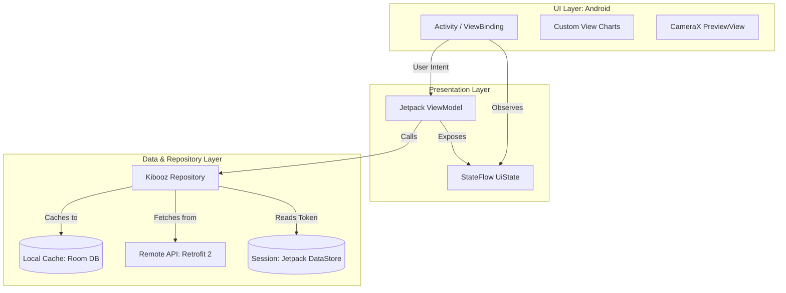

# Roadmap Frontend Android: Arsitektur MVVM, State Management, dan Integrasi Layar

Panduan ini memetakan langkah migrasi UI Kibooz dari prototipe statis menjadi aplikasi Android reaktif. Kode memakai arsitektur Clean MVVM (Model-View-ViewModel).

---

## 1. Arsitektur Target (Clean MVVM)



---

## 2. Kebutuhan Pustaka Tambahan (`build.gradle.kts`)

Tambahkan dependensi berikut ke dalam file [build.gradle.kts](../../app/build.gradle.kts):

```kotlin
dependencies {
    // 1. Networking & Serialization
    implementation("com.squareup.retrofit2:retrofit:2.11.0")
    implementation("com.squareup.retrofit2:converter-moshi:2.11.0")
    implementation("com.squareup.okhttp3:logging-interceptor:4.12.0")
    implementation("com.squareup.moshi:moshi-kotlin:1.15.1")

    // 2. Coroutines & Lifecycle
    implementation("androidx.lifecycle:lifecycle-viewmodel-ktx:2.8.6")
    implementation("androidx.lifecycle:lifecycle-runtime-ktx:2.8.6")
    implementation("org.jetbrains.kotlinx:kotlinx-coroutines-android:1.8.1")

    // 3. Local Database & Cache (Room)
    implementation("androidx.room:room-runtime:2.6.1")
    implementation("androidx.room:room-ktx:2.6.1")
    ksp("androidx.room:room-compiler:2.6.1")

    // 4. Session & DataStore
    implementation("androidx.datastore:datastore-preferences:1.1.1")

    // 5. Image Loading
    implementation("io.coil-kt:coil:2.7.0")

    // 6. CameraX & ML Kit
    implementation("androidx.camera:camera-core:1.3.4")
    implementation("androidx.camera:camera-camera2:1.3.4")
    implementation("androidx.camera:camera-lifecycle:1.3.4")
    implementation("androidx.camera:camera-view:1.3.4")
}
```

---

## 3. Pola Pemodelan State UI (`UiState`)

Setiap ViewModel wajib mengekspos state yang konsisten untuk menghindari kondisi balapan (*race conditions*):

```kotlin
sealed interface UiState<out T> {
    data object Idle : UiState<Nothing>
    data object Loading : UiState<Nothing>
    data class Success<T>(val data: T) : UiState<T>
    data class Error(val message: String, val throwable: Throwable? = null) : UiState<Nothing>
}
```

Implementasi pada Activity menggunakan ekstensi siklus hidup `repeatOnLifecycle`:

```kotlin
lifecycleScope.launch {
    repeatOnLifecycle(Lifecycle.State.STARTED) {
        viewModel.dashboardState.collect { state ->
            when (state) {
                is UiState.Loading -> showShimmerLoading()
                is UiState.Success -> bindDashboardData(state.data)
                is UiState.Error -> showErrorSnackbar(state.message) { viewModel.retry() }
                is UiState.Idle -> Unit
            }
        }
    }
}
```

---

## 4. Matriks Integrasi Layar-ke-API (20 Activity)

| No | Activity File | Sumber Data / Endpoint | Aksi Pengguna Utama |
| :---: | :--- | :--- | :--- |
| **01** | [SplashActivity.kt](../../app/src/main/java/com/nthb/kibooz/ui/splash/SplashActivity.kt) | Cek token di `SessionDataStore` | Jika ada token valid, langsung buka Dashboard sesuai peran; jika tidak ada, buka Onboarding. |
| **02** | [OnboardingActivity.kt](../../app/src/main/java/com/nthb/kibooz/ui/onboarding/OnboardingActivity.kt) | Lokal asset (slide 1-3) | Navigasi antar-slide, tombol "Mulai" membuka Role Selection. |
| **03** | [RoleSelectionActivity.kt](../../app/src/main/java/com/nthb/kibooz/ui/auth/RoleSelectionActivity.kt) | Pemilihan peran | Menyimpan `SELECTED_ROLE` ke intent dan membuka LoginActivity. |
| **04** | [LoginActivity.kt](../../app/src/main/java/com/nthb/kibooz/ui/auth/LoginActivity.kt) | `POST /api/v1/auth/login` | Validasi kredensial, simpan token JWT, arahkan ke Dashboard Guru / Dashboard Wali. |
| **05** | [DashboardGuruActivity.kt](../../app/src/main/java/com/nthb/kibooz/ui/guru/DashboardGuruActivity.kt) | `GET /api/v1/guru/dashboard` | Menampilkan metrik kelas, status kehadiran, dan sebaran mood hari ini. |
| **06** | [StatistikMoodActivity.kt](../../app/src/main/java/com/nthb/kibooz/ui/guru/StatistikMoodActivity.kt) | `GET /api/v1/guru/mood/analytics` | Mengumpan data dinamis ke `DonutMoodChart`, `WeeklyLineChart`, dan `MonthlyBarChart`. |
| **07** | [RuangKelasGuruActivity.kt](../../app/src/main/java/com/nthb/kibooz/ui/guru/RuangKelasGuruActivity.kt) | `GET /api/v1/guru/classes` | Menampilkan daftar kelas, dialog tambah kelas baru (`POST /api/v1/guru/classes`). |
| **08** | [DetailKelasActivity.kt](../../app/src/main/java/com/nthb/kibooz/ui/guru/DetailKelasActivity.kt) | `GET /api/v1/guru/classes/{id}` | Menampilkan ringkasan aktivitas kelas, yaitu jumlah anak, video pembelajaran dan utas forum, beserta kode bergabung kelas. |
| **09** | [VideoPembelajaranActivity.kt](../../app/src/main/java/com/nthb/kibooz/ui/guru/VideoPembelajaranActivity.kt) | `GET & POST /api/v1/classes/{id}/videos`, `PATCH & DELETE /api/v1/classes/{id}/videos/{videoId}`, `POST /api/v1/classes/{id}/videos/upload-url` | Memutar video edukasi streaming dengan kontrol play/pause ExoPlayer. Video berupa alamat https, baik tautan ke tempat lain maupun berkas yang diunggah guru langsung ke penyimpanan lewat alamat bertanda tangan. Guru dapat mengubah rincian dan menghapus video. Berkas yang diunggah menunggu di folder sementara, sehingga aplikasi memutar video dari alamat permanen yang dikembalikan saat video ditambahkan dan bukan dari alamat unggahan. |
| **10** | [PesertaKelasActivity.kt](../../app/src/main/java/com/nthb/kibooz/ui/guru/PesertaKelasActivity.kt) | `GET /api/v1/classes/{id}/students` | Menampilkan daftar murid, perolehan poin sampah, dan tombol input mood personal. |
| **11** | [ForumDiskusiActivity.kt](../../app/src/main/java/com/nthb/kibooz/ui/guru/ForumDiskusiActivity.kt) | `GET & POST /api/v1/classes/{id}/forum`, `GET & POST /api/v1/classes/{id}/forum/{postId}/replies`, `PATCH & DELETE /api/v1/classes/{id}/forum/{postId}` dan `/replies/{replyId}` | Menampilkan utas diskusi kelas, mengirim utas baru, dan membaca serta mengirim balasan. Pembuat dapat mengubah postingannya, dan pembuat atau guru kelas dapat menghapusnya. Postingan yang pernah diubah diberi label "diedit" ketika `editedAt` tidak `null`. |
| **12** | [ProfilGuruActivity.kt](../../app/src/main/java/com/nthb/kibooz/ui/profile/ProfilGuruActivity.kt) | `GET /api/v1/guru/profile` | Menampilkan identitas pendidik, NIP, menu pengaturan, dan tombol logout. |
| **13** | [DetailProfilGuruActivity.kt](../../app/src/main/java/com/nthb/kibooz/ui/profile/DetailProfilGuruActivity.kt) | `GET /api/v1/guru/profile/detail` | Menampilkan data lengkap guru, alamat dinas, dan nomor kontak aktif. |
| **14** | [EditProfilGuruActivity.kt](../../app/src/main/java/com/nthb/kibooz/ui/profile/EditProfilGuruActivity.kt) | `PUT /api/v1/guru/profile`, `POST /api/v1/users/avatar` | Mengubah nomor telepon dan alamat. Foto profil baru diunggah lewat endpoint avatar. |
| **15** | [DashboardWaliActivity.kt](../../app/src/main/java/com/nthb/kibooz/ui/wali/DashboardWaliActivity.kt) | `GET /api/v1/wali/dashboard` | Menampilkan kartu mood harian anak, akumulasi poin sampah, dan pintasan scanner. |
| **16** | [DetailPenangananMoodActivity.kt](../../app/src/main/java/com/nthb/kibooz/ui/wali/DetailPenangananMoodActivity.kt) | `POST /api/v1/wali/guidance/apply` | Membaca 4 langkah penanganan emosi dan mengirim konfirmasi tindakan ke guru. |
| **17** | [StatistikSampahActivity.kt](../../app/src/main/java/com/nthb/kibooz/ui/wali/StatistikSampahActivity.kt) | `GET /api/v1/trash/stats` | Menampilkan rincian statistik pemilahan per kategori (Organik, Anorganik dan B3) beserta total poin dan sisa pindaian hari ini. |
| **18** | [LeaderboardActivity.kt](../../app/src/main/java/com/nthb/kibooz/ui/wali/LeaderboardActivity.kt) | `GET /api/v1/leaderboard` | Mengisi data podium 3D juara 1-3 dan daftar peringkat siswa sekelas. |
| **19** | [ProfilSiswaActivity.kt](../../app/src/main/java/com/nthb/kibooz/ui/wali/ProfilSiswaActivity.kt) | `GET /api/v1/wali/child/{id}` | Menampilkan identitas resmi anak, NISN, kelas, serta nama, email, nomor telepon, WhatsApp, dan alamat rumah wali. |
| **20** | [ReviewScanMoodActivity.kt](../../app/src/main/java/com/nthb/kibooz/ui/camera/ReviewScanMoodActivity.kt) | `POST /api/v1/guru/mood/log/batch` | Meninjau hasil scan multi-wajah, mengonfirmasi hasil di bawah 75% (BR-04) atau mengoreksi emosi, menambah catatan, dan menyimpan batch per 30 siswa. Perubahan emosi dikirim sebagai `MANUAL_INPUT`, dan label Kalem dikirim sebagai `SENANG`. |

---

## 5. Rencana Kerja Tim Frontend (Work Breakdown)

- [x] **FE-01:** Konfigurasi Retrofit Network Client, OkHttp logging interceptor, dan AuthTokenInterceptor.
- [ ] **FE-02:** Pembuatan Room Database (`KiboozDatabase`), Entity (`StudentEntity`, `MoodLogEntity`), dan DAO.
- [x] **FE-03:** Pembuatan `AuthRepository` dan penyimpanan sesi dengan Jetpack Preferences DataStore. Nilai token dienkripsi dengan kunci Android Keystore (DataStore tidak terenkripsi sendiri), file sesi dikeluarkan dari backup, dan pembaruan token penyegar dijalankan satu per satu.
- [x] **FE-04:** Refaktor `LoginActivity` ke `AuthViewModel`, penanganan pesan error jaringan, dan validasi form.
- [ ] **FE-05:** Refaktor `DashboardWaliActivity` ke `WaliViewModel`, menghubungkan kartu mood dan poin nyata.
- [ ] **FE-06:** Refaktor `DashboardGuruActivity` ke `GuruViewModel`, menghubungkan metrik kelas dinamis.
- [ ] **FE-07:** Integrasi data dinamis pada grafik kustom `DonutMoodChart`, `WeeklyLineChart`, dan `MonthlyBarChart`.
- [ ] **FE-08:** Refaktor `LeaderboardActivity` ke `LeaderboardViewModel`, mengisi podium dan recycler view.
- [ ] **FE-09:** Refaktor `DetailPenangananMoodActivity` untuk mengirimkan payload `guidance/apply` ke server.
- [ ] **FE-10:** Pembuatan `Formulir Edit Profil` (Siswa & Guru) dengan validasi masukan dan callback simpan data.
- [ ] **FE-11:** Penambahan efek *Shimmer Loading Placeholder* pada dashboard saat data sedang diunduh dari jaringan.
- [ ] **FE-12:** Penanganan kondisi jaringan putus (*offline banner*) dan tombol aksi coba lagi (*retry button*). Saat server tidak tersedia (gagal terhubung, atau `502`, `503` dan `504` tanpa body JSON), aplikasi menampilkan layar "layanan tidak tersedia" dengan tautan ke halaman status https://status.syafahadyan.com/ dan mencoba lagi dengan jeda yang bertambah, aturannya ada di `docs/client-guide.md` repositori backend.
