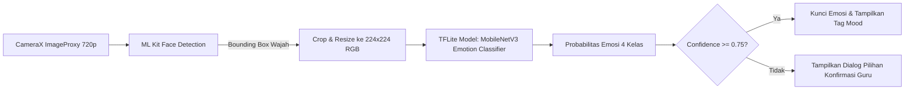
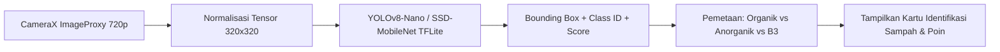

# Pipeline Kecerdasan Buatan (AI/ML) dan Visi Komputer Kibooz

Panduan ini merinci arsitektur computer vision, model edge TensorFlow Lite (TFLite), dan integrasi CameraX untuk deteksi emosi anak serta klasifikasi sampah.

---

## 1. Prinsip Utama dan Privasi Data Anak

1. **Inferensi On-Device Penuh:** Prosesor perangkat (NPU/GPU/CPU) memproses semua frame video kamera langsung di tempat.
2. **Perlindungan Privasi Wajah (Zero-Cloud Face Streaming):** Rekaman video atau foto wajah anak mentah tidak pernah diunggah atau disimpan di server cloud. Yang dikirim ke backend hanyalah label emosi akhir (`SENANG`, `SEDIH`, `MARAH`, `BINGUNG`) beserta skor keyakinan (*confidence score*).
3. **Efisiensi Daya:** Pipeline kamera menggunakan resolusi optimal 720p (1280x720) dengan strategi `STRATEGY_KEEP_ONLY_LATEST` agar perangkat tidak mengalami *thermal throttling* atau pemborosan baterai.

---

## 2. Model 1: Deteksi Emosi Wajah Siswa (Face & Mood Recognition)



### 2.1 Spesifikasi Model Emosi
- **Arsitektur Dasar:** MobileNetV3-Small / EfficientNet-Lite0.
- **Ukuran Input:** Tensor 1 x 224 x 224 x 3 (Tipe data `FLOAT32` atau quantized `INT8`).
- **Kelas Keluaran (4 Kategori):**
  1. `SENANG` (Gembira, antusias, senyum lebar).
  2. `SEDIH` (Menangis, bibir melengkung ke bawah, murung).
  3. `MARAH` (Alis berkerut tajam, tegang).
  4. `BINGUNG` (Ragu, cemas, pandangan tidak fokus, perlu pendampingan).
- **Target Latensi:** < 65 milidetik per frame pada chipset Snapdragon seri 6 atau MediaTek Helio G-series.
- **Format Berkas:** `kibooz_emotion_v1.tflite` (Ukuran file < 8 MB) diletakkan di direktori `app/src/main/assets/`.

---

## 3. Model 2: Klasifikasi Jenis Sampah (Eco-Gamification)



### 3.1 Spesifikasi Model Sampah
- **Arsitektur Dasar:** YOLOv8n (Nano) Object Detector atau SSD-MobileNetV2.
- **Ukuran Input:** Tensor 1 x 320 x 320 x 3 (`FLOAT32`).
- **Label Objek yang Dikenali:**
  - **Organik (10 Poin):** Sisa buah (pisang, apel), daun kering, sisa sayuran, kulit telur, sisa roti.
  - **Anorganik (15 Poin):** Botol plastik (PET), gelas plastik, kaleng aluminium, kemasan snack, sedotan, kardus/kertas.
  - **B3 (Peringatan Khusus):** Baterai bekas, botol pembersih kimia (tidak diberi poin, diarahkan ke kotak khusus).
- **Format Berkas:** `kibooz_trash_classifier_v1.tflite` (Ukuran file < 12 MB) di `app/src/main/assets/`.

---

## 4. Implementasi Blueprint CameraX Analyzer

Berikut contoh kode analyzer Kotlin penghubung CameraX dengan TensorFlow Lite:

```kotlin
class MoodAnalysisAnalyzer(
    private val context: Context,
    private val onMoodDetected: (moodType: String, confidence: Float, faceRect: Rect) -> Unit
) : ImageAnalysis.Analyzer {

    private val faceDetector = FaceDetection.getClient(
        FaceDetectorOptions.Builder()
            .setPerformanceMode(FaceDetectorOptions.PERFORMANCE_MODE_FAST)
            .setLandmarkMode(FaceDetectorOptions.LANDMARK_MODE_NONE)
            .setClassificationMode(FaceDetectorOptions.CLASSIFICATION_MODE_NONE)
            .setMinFaceSize(0.2f)
            .build()
    )

    private val interpreter: Interpreter by lazy {
        val assetFileDescriptor = context.assets.openFd("kibooz_emotion_v1.tflite")
        val fileChannel = FileInputStream(assetFileDescriptor.fileDescriptor).channel
        val mappedBuffer = fileChannel.map(
            FileChannel.MapMode.READ_ONLY,
            assetFileDescriptor.startOffset,
            assetFileDescriptor.declaredLength
        )
        Interpreter(mappedBuffer, Interpreter.Options().apply {
            setNumThreads(4)
            useNNAPI = true
        })
    }

    @androidx.annotation.OptIn(androidx.camera.core.ExperimentalGetImage::class)
    override fun analyze(imageProxy: ImageProxy) {
        val mediaImage = imageProxy.image
        if (mediaImage == null) {
            imageProxy.close()
            return
        }

        val inputImage = InputImage.fromMediaImage(mediaImage, imageProxy.imageInfo.rotationDegrees)
        faceDetector.process(inputImage)
            .addOnSuccessListener { faces ->
                val primaryFace = faces.maxByOrNull { it.boundingBox.width() * it.boundingBox.height() }
                if (primaryFace != null) {
                    val (emotionLabel, confidence) = classifyFaceEmotion(mediaImage, primaryFace.boundingBox)
                    onMoodDetected(emotionLabel, confidence, primaryFace.boundingBox)
                }
            }
            .addOnCompleteListener {
                imageProxy.close()
            }
    }

    private fun classifyFaceEmotion(image: Image, bounds: Rect): Pair<String, Float> {
        // Logika crop, resize ke 224x224, konversi ke ByteBuffer, dan inferensi interpreter TFLite
        return Pair("SENANG", 0.92f)
    }
}
```

> **Catatan implementasi.** Contoh di atas hanya cetak biru untuk satu wajah. `MoodAnalysisAnalyzer` di aplikasi menganalisis sampai 10 wajah per frame dan memakai ID pelacakan ML Kit, sehingga setiap wajah punya label sendiri yang baru diterima setelah 3 frame berturut-turut dan bertahan 300 ms (`EmotionSmoother`). Ambang `setMinFaceSize` di aplikasi adalah 0,1 dan bukan 0,2 karena banyak anak dalam satu frame membuat tiap wajah lebih kecil. Angka ini belum diuji di perangkat. Wajah tidak dikenali: guru mengetuk kotak wajah untuk memasangkannya ke siswa dari daftar kelas (`GET /classes/{classId}/students`).

---

## 5. Penanganan Kondisi Khusus dan Kasus Ekstrem (*Edge Cases*)

| Skenario | Permasalahan | Solusi Sistem Kibooz |
| :--- | :--- | :--- |
| **Cahaya Rendah (Remang)** | Akurasi deteksi wajah menurun drastis. | Sistem mendeteksi rata-rata luminans di bawah ambang batas (Luma < 40) dan memunculkan tombol toggle lampu senter (*torch*) serta peringatan "Arahkan ke tempat terang". |
| **Banyak Wajah di Kelas** | Kamera mendeteksi 5-10 wajah siswa sekaligus. | Semua wajah dianalisis (paling banyak 10 per frame, diambil dari kotak terbesar) dan dilacak dengan ID ML Kit. Guru memasangkan tiap kotak wajah ke siswa, satu siswa hanya untuk satu wajah. Pasangan bertahan 1,5 detik jika wajah hilang dari frame, dan dipindahkan ke ID baru jika kotaknya bertumpuk dengan wajah yang hilang. |
| **Objek Bergerak Cepat** | Gambar blur menghasilkan prediksi acak. | Sistem menerapkan penyaringan kestabilan 3-frame berturut-turut (*temporal smoothing*). Hasil baru dikunci setelah prediksi konsisten selama minimal 300ms. |
| **Klaim Sampah Palsu** | Siswa memindai foto sampah dari layar HP lain. | Rencana: pengecekan kilau layar reflektif (*moire effect*) dan pergerakan objek selama 1 detik sebelum tombol klaim terbuka. **Belum diterapkan di v1.** Perlindungan yang ada saat ini hanya akses khusus Wali dan batas 5 klaim per anak per hari. |

---

## 6. Rencana Kerja Tim AI/ML (Work Breakdown)

**Status implementasi.** Alur kamera sudah lengkap sampai server. Modelnya masih pengganti pra-latih (emosi: DeepFace dari NXP, sampah: EfficientNet-Lite0 ImageNet dengan pemetaan label), bukan model Kibooz hasil pelatihan sendiri. Sumber, lisensi, pemetaan, hasil uji dan keterbatasannya ada di [MODEL_PLACEHOLDERS.md](../MODEL_PLACEHOLDERS.md). Selama modelnya pengganti, kedua layar kamera menampilkan "Model contoh" dan hanya bisa dibuka di build debug atau build internal (`-Pkibooz.allowPlaceholderModels=true`), supaya hasil contoh tidak tersimpan atau diklaim sebagai poin oleh pengguna sungguhan. Gerbang itu terbuka sendiri saat berkas konfigurasi model sungguhan memakai `"placeholder": false`, setelah ML-03 dan ML-06 selesai. Nama berkas model sampah mengikuti dokumen ini (`kibooz_trash_classifier_v1.tflite`).

- [ ] **ML-01:** Kurasi dataset emosi anak (ekspresi senang, sedih, bingung, marah) dengan variasi pencahayaan Asia Tenggara.
- [ ] **ML-02:** Pelatihan model MobileNetV3 Emotion Classifier dengan transfer learning dan validasi akurasi minimal 88%.
- [ ] **ML-03:** Kuantisasi model ke TFLite INT8 dan pengujian latensi di Android Studio Profiler (<70ms).
- [x] **ML-04:** Integrasi Google ML Kit Face Detection pada CameraX di [CameraScanMoodActivity.kt](../../app/src/main/java/com/nthb/kibooz/ui/camera/CameraScanMoodActivity.kt).
- [ ] **ML-05:** Kurasi dataset sampah sekolah (botol plastik, kotak susu, daun, sisa buah) dan pelatihan YOLOv8-nano.
- [ ] **ML-06:** Ekspor dan kuantisasi model deteksi sampah ke format TFLite dengan metadata input/output terdefinisi.
- [ ] **ML-07:** Integrasi deteksi sampah langsung dengan bounding box overlay di [CameraScanSampahActivity.kt](../../app/src/main/java/com/nthb/kibooz/ui/camera/CameraScanSampahActivity.kt).
- [x] **ML-08:** Pembuatan dialog konfirmasi manual saat akurasi prediksi berada di bawah 75%.
