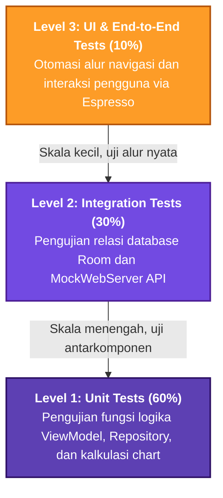

# Strategi Pengujian (QA), Otomasi CI/CD, dan Panduan DevOps Kibooz

Panduan ini memuat piramida pengujian, otomasi UI Espresso, konfigurasi GitHub Actions CI/CD, alur rilis APK, dan aturan git tim.

---

## 1. Piramida Pengujian (Testing Pyramid)

| Tingkatan | Porsi | Sasaran Pengujian | Alat dan Framework | Karakteristik |
| :--- | :---: | :--- | :--- | :--- |
| **UI & E2E** | 10% | Otomasi alur login, presensi mood, dan klaim sampah | Espresso, UI Automator | Menguji alur pengguna nyata, eksekusi lambat |
| **Integration** | 30% | Konsistensi query Room DAO dan serialisasi JSON API | MockWebServer, Room In-Memory DB | Menguji interaksi antarkomponen |
| **Unit** | 60% | Logika bisnis ViewModel, transformasi data Repository, formula chart | JUnit 5, MockK, Turbine | Cepat, terisolasi, berjalan di JVM lokal |

### 1.1 Spesifikasi Pengujian Unit (Unit Testing)
- **Framework:** JUnit 5 / JUnit 4 + MockK + Turbine (untuk pengujian `StateFlow` dan Coroutines).
- **Target Cakupan Kode (Code Coverage):** Minimal 80% pada package `data/` dan `viewmodel/`.
- **Contoh Kasus Uji Kunci:**
  - `AuthViewModelTest`: Memverifikasi transisi state dari `Loading` menuju `Success` saat kredensial valid, dan emisi `Error` saat password salah.
  - `LeaderboardViewModelTest`: Memverifikasi sorting dan pemisahan data 3 besar podium versus daftar peringkat urutan 4 ke bawah.
  - `TrashPointsCalculatorTest`: Memverifikasi kalkulasi poin harian tidak melebihi kuota 5 kali pemindaian per hari.

### 1.2 Spesifikasi Pengujian Integrasi (Integration Testing)
- **Room DAO In-Memory Test:** Memastikan operasi CRUD pada tabel `students` dan `mood_logs` berjalan konsisten tanpa *data leak*.
- **MockWebServer Test:** Memverifikasi serialisasi JSON Retrofit untuk penanganan respons error HTTP 401, 404, dan 500.

### 1.3 Pengujian Antarmuka Pengguna (UI & Espresso Automation)
- **Target Alur Kritis (Critical User Journeys):**
  1. **Journey 1 (Otentikasi & Navigasi):** Onboarding $\rightarrow$ Role Selection $\rightarrow$ Login Guru $\rightarrow$ Dashboard Guru tampil utuh.
  2. **Journey 2 (Pencatatan Mood):** Dashboard Guru $\rightarrow$ Ruang Kelas $\rightarrow$ Peserta $\rightarrow$ Input Mood Siswa $\rightarrow$ Dialog Sukses.
  3. **Journey 3 (Gamifikasi & Poin):** Dashboard Wali $\rightarrow$ Buka Scanner Sampah $\rightarrow$ Konfirmasi Scan $\rightarrow$ Poin bertambah $\rightarrow$ Leaderboard diperbarui.

---

## 2. Matriks Pengujian Manual (Manual QA Test Cases)

| ID Uji | Modul | Skenario Pengujian | Hasil yang Diharapkan |
| :--- | :--- | :--- | :--- |
| **TC-01** | **Jaringan** | Pengguna membuka aplikasi saat perangkat dalam *Mode Pesawat* (*Airplane Mode*). | Aplikasi tidak *crash*; menampilkan banner offline dan memuat data cache terakhir dari Room DB. |
| **TC-02** | **Izin Akses** | Pengguna menolak izin kamera (*Camera Permission Denied*) saat membuka scanner. | Viewfinder kamera menampilkan pesan edukatif dan tombol langsung menuju "Pengaturan Izin Aplikasi". |
| **TC-03** | **Sesi Kedaluwarsa** | Token JWT kedaluwarsa saat pengguna sedang berada di halaman profil. | Interceptor menangkap kode HTTP 401, menghapus token di DataStore, dan menampilkan dialog "Sesi telah berakhir, silakan masuk kembali". |
| **TC-04** | **Rotasi Layar** | Layar dirotasi atau ukuran jendela diubah pada tablet / mode split-screen. | Data form tidak hilang (*retained via ViewModel*), status bar dan bilah navigasi tetap proporsional berkat `InsetsUtil`. |
| **TC-05** | **Input Ekstrem** | Pengguna memasukkan nama anak sepanjang 100 karakter atau simbol khusus. | Tampilan UI memotong teks (*ellipsize end*) tanpa merusak tata letak kartu antarmuka. |

---

## 3. Konfigurasi Otomasi CI/CD (GitHub Actions)

Konfigurasi pipeline ada di [.github/workflows/android-ci.yaml](../../.github/workflows/android-ci.yaml). Pipeline ini menjalankan unit test, *debug build* dan Android lint pada setiap pull request dan push ke `main`. Daftar lengkap workflow dan pengecekan wajib ada di [docs/ci-cd.md](../ci-cd.md).

---

## 4. Standar Alur Kerja Git dan Tinjauan Kode (Code Review Rules)

### 4.1 Format Penamaan Branch
- `feat/<nama-fitur>`: Penambahan fungsionalitas baru (contoh: `feat/wali-dashboard-api`).
- `fix/<nama-bug>`: Perbaikan bug atau kesalahan layout (contoh: `fix/chart-overlap-padding`).
- `chore/<nama-tugas>`: Pembaruan dependensi, konfigurasi Gradle, atau dokumentasi.

### 4.2 Standar Pesan Komit (Conventional Commits)
Gunakan format terstruktur: `<tipe>(<lingkup>): <deskripsi singkat>`
- Contoh: `feat(api): integrasi login endpoint dengan datastore session`
- Contoh: `fix(layout): seimbangkan margin judul profil wali di atas avatar`

### 4.3 Kriteria Wajib Merge (Definition of Done / DoD)
Sebuah pull request baru dapat digabungkan (*merged*) ke branch `main` jika memenuhi:
1. Disarankan sudah disetujui (*Approved*) oleh minimal satu rekan tim pemrogram. Ruleset `main` tidak mewajibkannya.
2. Seluruh tes otomatis pada pipeline GitHub Actions berstatus hijau (*Pass*).
3. Tidak ada penambahan nilai string atau warna *hardcoded* (wajib menggunakan `strings.xml` dan `colors.xml`).
4. Menggunakan `InsetsUtil` untuk penanganan bilah sistem *edge-to-edge*.

---

## 5. Rencana Kerja Tim QA & DevOps (Work Breakdown)

- [ ] **QA-01:** Pembuatan skenario pengujian unit untuk validasi form login dan register.
- [ ] **QA-02:** Pembuatan unit test untuk kalkulasi poin pilah sampah dan penanganan batas harian 5x.
- [ ] **QA-03:** Penulisan script otomasi UI Espresso untuk alur Login $\rightarrow$ Dashboard $\rightarrow$ Logout.
- [ ] **QA-04:** Penulisan script otomasi UI Espresso untuk alur Scanner Sampah $\rightarrow$ Klaim Poin.
- [ ] **QA-05:** Pengujian kompatibilitas pada berbagai resolusi layar (FHD+, HD+, rasio 18:9 s.d. 20:9).
- [ ] **DO-01:** Pembuatan direktori `.github/workflows/` dan implementasi workflow `android-ci.yaml`.
- [ ] **DO-02:** Konfigurasi pengelolaan kredensial rahasia (*Repository Secrets*) untuk Signing Keystore.
- [ ] **DO-03:** Konfigurasi otomatisasi rilis APK berkala (*Nightly Build Artifacts*).
