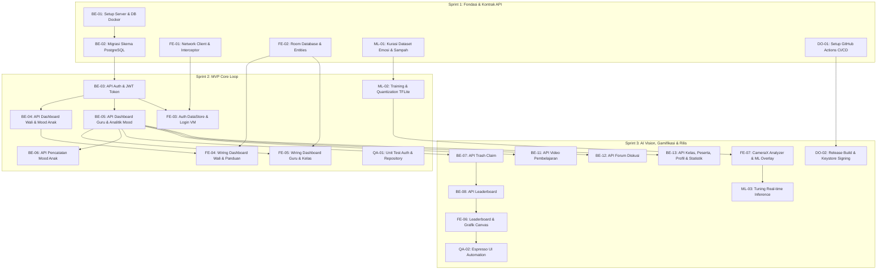

# Work Breakdown Structure (WBS) dan Pembagian Tugas Tim Kibooz

Panduan ini membagi pekerjaan teknis menjadi tiket tugas terukur (*sized tasks*) dengan estimasi *story points*, dependensi masukan, dan luaran konkret. Setiap anggota tim dapat memilih tugas tanpa saling tumpang tindih (*zero-overlap*).

---

## 1. Pemetaan Peran dan Tanggung Jawab (RACI Matrix)

| Kode Peran | Spesialisasi | Fokus Utama Pekerjaan |
| :---: | :--- | :--- |
| **ENG-A** | **Backend & Database Engineer** | REST API, basis data PostgreSQL, cache Redis, autentikasi JWT, dan integrasi cloud storage. |
| **ENG-B** | **Frontend Engineer (Portal Guru & Kamera)** | MVVM Guru (Dashboard, Ruang Kelas, Detail Kelas, Video, Forum, Analisis Mood) dan integrasi CameraX. |
| **ENG-C** | **Frontend Engineer (Portal Wali & Gamifikasi)** | MVVM Wali (Dashboard, Panduan Emosi, Leaderboard, Statistik Sampah, Profil Siswa & Wali). |
| **ENG-D** | **AI / Computer Vision Engineer** | Pelatihan model emosi wajah, model klasifikasi sampah TFLite, dan optimasi inferensi on-device. |
| **ENG-E** | **QA Automation & DevOps Engineer** | Pipeline GitHub Actions CI/CD, unit testing, skrip Espresso UI, dan verifikasi lintas perangkat. |

---

## 2. Diagram Alur Kerja Dependensi (Sprint Dependency Graph)

---

## 3. Matriks Tugas Terperinci per Anggota Tim

### 3.1 Track 1: Backend & Database (Engineer A)

| ID Tiket | Judul Tugas | Bobot (SP) | Dependensi | Luaran / Artefak Konkret |
| :--- | :--- | :---: | :--- | :--- |
| **BE-01** | Setup Environment & Basis Data | 3 SP (1 hari) | - | Berkas `docker-compose.yml` (PostgreSQL 15 + Redis 7) yang berjalan di lokal. |
| **BE-02** | Migrasi Skema DDL Database | 5 SP (2 hari) | BE-01 | File migrasi skema relasional tabel `users`, `students`, `mood_logs`, `trash_scans`. |
| **BE-03** | Modul Autentikasi JWT & Role | 5 SP (2 hari) | BE-02 | Endpoint `POST /api/v1/auth/login`, registrasi, `refresh-token` sekali pakai dan `logout` dengan enkripsi bcrypt. |
| **BE-04** | API Dashboard Wali & Mood Anak | 5 SP (2 hari) | BE-03 | Endpoint `GET /api/v1/wali/dashboard` dan `POST /api/v1/wali/guidance/apply`. |
| **BE-05** | API Dashboard Guru & Analitik Mood | 5 SP (2 hari) | BE-03 | Endpoint `GET /api/v1/guru/dashboard` dan `GET /api/v1/guru/mood/analytics`. |
| **BE-06** | API Pencatatan Mood Anak | 3 SP (1 hari) | BE-05 | Endpoint `POST /api/v1/guru/mood/log` dengan verifikasi peran guru dan validasi enum. |
| **BE-07** | API Klaim Poin Sampah | 3 SP (1 hari) | BE-05 | Endpoint `POST /api/v1/trash/scan-claim` dengan perhitungan poin dan batas 5x/hari. |
| **BE-08** | API Papan Peringkat | 2 SP (1 hari) | BE-07 | Endpoint `GET /api/v1/leaderboard` dengan query terindeks dan cache Redis opsional. |
| **BE-09** | Integrasi Cloud Storage (S3/R2) | 3 SP (1 hari) | BE-03 | Modul upload berkas foto profil dan foto bukti sampah. |
| **BE-10** | Pengujian Otomatis Kontrak API | 3 SP (1 hari) | BE-03 | Rangkaian uji Go (unit dan end to end) yang memeriksa setiap respons terhadap `openapi.yaml`. |
| **BE-11** | API Video Pembelajaran Kelas | 3 SP (1 hari) | BE-05 | Endpoint `GET` dan `POST /api/v1/classes/{classId}/videos` untuk video berupa alamat https, serta `PATCH` dan `DELETE` pada `/videos/{videoId}`. |
| **BE-12** | API Forum Diskusi Kelas | 5 SP (2 hari) | BE-05 | Endpoint utas dan balasan di `/api/v1/classes/{classId}/forum`, termasuk mengubah dan menghapusnya, dengan penanda `editedAt` pada postingan yang diubah. |
| **BE-13** | API Kelas, Peserta, Profil & Statistik | 8 SP (3 hari) | BE-05 | Endpoint `/api/v1/guru/classes`, `/api/v1/guru/profile`, `/api/v1/classes/{classId}/students`, `/api/v1/wali/child/{studentId}` dan `/api/v1/trash/stats`. |
| **BE-14** | Unggah Berkas Video | 5 SP (2 hari) | BE-09, BE-11 | Endpoint `POST /api/v1/classes/{classId}/videos/upload-url` untuk unggah langsung ke bucket lewat alamat bertanda tangan. Berkas menunggu di folder sementara dan disalin ke alamat permanen saat video ditambahkan, atau dihapus seketika dengan `DELETE` pada alamat yang sama jika tidak jadi ditambahkan. |
| **BE-15** | Reset Papan Peringkat Semester | 3 SP (1 hari) | BE-08 | Pengaturan ulang peringkat otomatis di awal semester (BR-03) dengan `season_points` terpisah dari `current_points` dan riwayat peringkat akhir, selesai. |
| **BE-16** | Anak Tambahan, Guru Tambahan & Laporan Panduan | 5 SP (2 hari) | BE-13 | Rute `GET` dan `POST /wali/children`, `GET` dan `POST /guru/classes/{classId}/teachers`, dan `GET /classes/{classId}/guidance-reports`, selesai. |
| **BE-17** | Pemeriksaan Penyimpanan & Antrean Hapus Berkas | 3 SP (1 hari) | BE-09 | Pemeriksaan tulis bucket pada `/healthz` dan antrean penghapusan berkas akun yang dihapus, selesai. |
| **BE-18** | Pemilik Kelas, Pengganti & Riwayat Peringkat | 5 SP (2 hari) | BE-15, BE-16 | Kolom `is_owner` pada guru kelas, rute `DELETE /guru/classes/{classId}/teachers/{teacherId}` dan `PUT /guru/classes/{classId}/owner`, `successorEmail` yang wajib pada `DELETE /users/me` untuk satu-satunya guru sebuah kelas, dan `GET /leaderboard/history`, selesai. |
| **BE-19** | Pencatatan Mood Massal, Waktu Catat & Kunci Idempotensi | 5 SP (2 hari) | BE-06, BE-16 | Rute `POST /guru/mood/log/batch` (paling banyak 30 entri dalam satu transaksi), `recordedAt` opsional pada pencatatan mood tunggal dan massal, header `Idempotency-Key` pada sepuluh rute yang membuat sesuatu dengan tabel `idempotency_keys`, header `Idempotent-Replayed`, serta kode `IDEMPOTENCY_KEY_REUSED` dan `IDEMPOTENCY_IN_PROGRESS`, selesai. |
| **BE-20** | Ganti Kata Sandi & Arsip Kelas Kosong | 3 SP (1 hari) | BE-18 | Rute `PUT /users/me/password` yang mengakhiri semua sesi akun, kolom `classes.archived_at`, dan penghapusan akun guru yang mengarsipkan kelas tanpa anak aktif sehingga `successorEmail` hanya wajib untuk kelas yang punya anak, selesai. |
| **BE-21** | Profil Wali, Kelola Anak & Kelas Tertutup | 5 SP (2 hari) | BE-16, BE-18 | Rute `PATCH /wali/profile`, `PATCH` dan `DELETE /wali/children/{studentId}`, `fullName` pada `PUT /guru/profile`, `DELETE /guru/classes/{classId}/students/{studentId}` dan `PUT /guru/classes/{classId}/joining` dengan `joinOpen`, selesai. |
| **BE-22** | Batas Pemakaian & Identitas Guru | 3 SP (1 hari) | BE-21 | Batas 60 anak per kelas, 20 kelas per guru, 20 catatan mood per anak per hari, 500 karakter untuk catatan, 64 KB untuk isi JSON dan 30 permintaan per menit untuk pencatatan mood massal, `userId` dan `isSelf` pada daftar guru, dan kode bergabung yang diganti saat guru keluar, selesai. |
| **BE-23** | Percakapan Guru dan Wali | 8 SP (3 hari) | BE-18, BE-21 | Tabel `chat_conversations`, `chat_messages` dan `chat_reads`, kontak yang dihitung dari kelas, serta rute di `/api/v1/chat` untuk kontak, percakapan, pesan (kursor `after` dan `before`, hapus pesan sendiri, `Idempotency-Key` saat mengirim) dan tanda baca, dengan kode `CHAT_CONTACT_NOT_ALLOWED`, `CHAT_CONVERSATION_NOT_FOUND`, `CHAT_MESSAGE_NOT_FOUND` dan `CHAT_SENDING_CLOSED`, selesai. |
---

### 3.2 Track 2: Frontend Guru & Kamera (Engineer B)

| ID Tiket | Judul Tugas | Bobot (SP) | Dependensi | Luaran / Artefak Konkret |
| :--- | :--- | :---: | :--- | :--- |
| **FE-G01** | Setup Networking & Session Store | 5 SP (2 hari) | BE-03 | Kelas `KiboozApiClient`, `AuthInterceptor`, dan `SessionPreferencesDataStore` (nilai token dienkripsi dengan kunci Android Keystore). |
| **FE-G02** | Refaktor Login & Role Session | 3 SP (1 hari) | FE-G01 | `LoginActivity` terhubung ke `AuthViewModel`, validasi form, dan token tersimpan. |
| **FE-G03** | Wiring Dashboard Guru ke API | 5 SP (2 hari) | BE-05 | `DashboardGuruActivity` menampilkan metrik kelas riil dari `GuruViewModel`. |
| **FE-G04** | Integrasi Multi-Chart Statistik Mood | 5 SP (2 hari) | BE-05 | `DonutMoodChart` & `WeeklyLineChart` menerima data persentase dinamis dari API. |
| **FE-G05** | Wiring Ruang Kelas & Roster Siswa | 5 SP (2 hari) | BE-06, BE-13 | `RuangKelasGuruActivity` dan `PesertaKelasActivity` fungsional dengan dialog input mood. |
| **FE-G06** | Integrasi CameraX & Analyzer Mood | 8 SP (3 hari) | ML-02 | `CameraScanMoodActivity` menjalankan `MoodAnalysisAnalyzer` dan mengunci emosi anak. |
| **FE-G07** | Wiring Video & Forum Edukasi | 3 SP (1 hari) | BE-11, BE-12 | Pemutar video `VideoPembelajaranActivity` yang memutar dari alamat permanen hasil tambah video, dan recycler view `ForumDiskusiActivity` dengan label "diedit" saat `editedAt` tidak `null`. |
| **FE-G08** | Wiring Laporan Panduan & Guru Kelas | 3 SP (1 hari) | BE-16 | Layar daftar laporan panduan dari `GET /classes/{classId}/guidance-reports` dengan nama anak, judul panduan, catatan wali dan waktu, serta dialog tambah guru dengan email lewat `POST /guru/classes/{classId}/teachers` yang menampilkan `TEACHER_NOT_FOUND` dan `TEACHER_ALREADY_IN_CLASS`. |
| **FE-G09** | Pemilik Kelas, Keluar dari Kelas & Pengganti | 3 SP (1 hari) | BE-18 | Daftar guru kelas menandai pemilik dari `isOwner`, pemilik dapat mengeluarkan guru dan menyerahkan kelas lewat `DELETE` dan `PUT /guru/classes/{classId}/owner`, dan setiap guru dapat keluar dengan id dirinya sendiri. Layar hapus akun meminta email guru pengganti bagi guru yang mengajar sendirian, lalu menampilkan `SUCCESSOR_REQUIRED`, `TEACHER_NOT_FOUND`, `LAST_TEACHER` dan `CLASS_OWNER_REQUIRED`. |
| **FE-G10** | Kelas Tertutup, Keluarkan Anak & Profil Guru | 3 SP (1 hari) | BE-21, BE-22 | Saklar buka atau tutup kelas dari `joinOpen` lewat `PUT /guru/classes/{classId}/joining` di samping kode bergabung, aksi keluarkan anak dari daftar peserta dengan konfirmasi lewat `DELETE /guru/classes/{classId}/students/{studentId}`, formulir nama pada profil guru, dan penanda "Anda" dari `isSelf` pada daftar guru (id akun ada di `userId`). Menampilkan `CLASS_LIMIT_REACHED` dan `MOOD_LOG_LIMIT_REACHED` dengan menyebut anak yang dilewati, dan menganggap `BODY_TOO_LARGE` sebagai kesalahan aplikasi. |
| **FE-G11** | Percakapan Guru dengan Wali | 5 SP (2 hari) | BE-23, FE-W14 | Layar kontak dari `GET /chat/contacts` (nama wali dengan nama anaknya), daftar percakapan dengan pesan terakhir dan jumlah belum dibaca, layar pesan dengan `before` untuk riwayat dan `after` secara berkala untuk pesan baru, kirim dengan satu `Idempotency-Key` per pesan yang diantrekan, hapus pesan sendiri dengan penanda, tanda baca lewat `PUT .../read` dan keadaan `canSend` bernilai `false` dengan keterangan. |

---

### 3.3 Track 3: Frontend Wali & Gamifikasi (Engineer C)

| ID Tiket | Judul Tugas | Bobot (SP) | Dependensi | Luaran / Artefak Konkret |
| :--- | :--- | :---: | :--- | :--- |
| **FE-W01** | Setup Room DB Cache Lokal | 5 SP (2 hari) | - | Entitas `StudentEntity`, `MoodEntity`, dan `KiboozDatabase` untuk mode offline. |
| **FE-W02** | Wiring Dashboard Wali Murid | 5 SP (2 hari) | BE-04 | `DashboardWaliActivity` menampilkan kartu status mood anak dan ringkasan poin nyata. |
| **FE-W03** | Wiring Panduan Emosi 4-Langkah | 3 SP (1 hari) | BE-04 | `DetailPenangananMoodActivity` dengan tombol aksi kirim konfirmasi ke guru. |
| **FE-W04** | Wiring Leaderboard Podium 3D | 5 SP (2 hari) | BE-08 | `LeaderboardActivity` menampilkan podium 1-3 dan recycler view peringkat kelas. |
| **FE-W05** | Wiring Statistik Pilah Sampah | 3 SP (1 hari) | BE-13 | `StatistikSampahActivity` memetakan proporsi tiap kategori sampah (Organik, Anorganik dan B3) dari API. |
| **FE-W06** | Integrasi CameraX & Scanner Sampah | 8 SP (3 hari) | ML-02 | `CameraScanSampahActivity` mendeteksi jenis sampah dan memicu dialog klaim poin. |
| **FE-W07** | Formulir Edit Profil Siswa & Wali | 3 SP (1 hari) | BE-04 | `EditProfilSiswaActivity` dengan validasi NISN, nomor telepon, dan simpan data lewat `PATCH /wali/profile` dan `PATCH /wali/children/{studentId}`, serta pesan untuk `NISN_ALREADY_REGISTERED`. |
| **FE-W08** | Unggah Foto yang Diperkecil | 3 SP (1 hari) | BE-09 | Pembantu bersama yang memperkecil sisi terpanjang foto menjadi sekitar 1600 piksel, menyimpannya sebagai JPEG berkualitas 80 dan memeriksa ukurannya terhadap batas 2 MiB untuk foto profil dan 4 MiB untuk foto sampah, lalu menurunkan dimensi atau kualitas bila melebihi. Menampilkan pesan untuk `INVALID_IMAGE`, `IMAGE_DIMENSIONS_TOO_LARGE` dan `FILE_TOO_LARGE`. Dipakai oleh profil guru, `FE-W07` dan `FE-W06`. |
| **FE-W09** | Foto Kecil dari Host Media | 2 SP (1 hari) | FE-W08 | Menambah pustaka pemuat gambar dan pemuat yang menyusun alamat `/cdn-cgi/image/` dengan `width` 128 atau 256, `quality=80`, `format=webp` dan `onerror=redirect` untuk foto profil pada daftar (leaderboard, roster, forum). Hanya untuk host `kibooz-media`, dengan foto asli sebagai cadangan. |
| **FE-W10** | Poin Semester & Seluruh Semester | 2 SP (1 hari) | BE-15 | Leaderboard dan peringkat memakai `seasonPoints` dan layar profil serta statistik menampilkan `totalPoints` sebagai poin seluruh semester, dengan keterangan bahwa peringkat mulai dari nol di awal semester. |
| **FE-W11** | Pilih & Tambah Anak | 3 SP (1 hari) | BE-16 | Pemilih anak dari `GET /wali/children` yang mengirim `studentId` ke rute lain, dan formulir tambah anak dengan kode kelas lewat `POST /wali/children` yang menampilkan `CHILD_LIMIT_REACHED`, `NISN_ALREADY_REGISTERED` dan `CLASS_CODE_NOT_FOUND`. |
| **FE-W12** | Riwayat Papan Peringkat | 2 SP (1 hari) | BE-18 | Layar atau tab riwayat dari `GET /leaderboard/history` yang menampilkan podium dan peringkat setiap semester dengan nama semester dari `label`, halaman berikutnya lewat `page`, dan keadaan kosong untuk kelas yang belum punya semester berakhir. |
| **FE-W13** | Ganti Kata Sandi | 2 SP (1 hari) | BE-20 | Layar dari tautan ubah sandi di profil (FR-7.1) yang memanggil `PUT /users/me/password`, menampilkan `AUTH_PASSWORD_INCORRECT` dan kegagalan validasi, lalu mengarahkan pengguna masuk lagi karena semua sesi berakhir. |
| **FE-W14** | Antrean Offline yang Aman Diulang | 5 SP (2 hari) | BE-19, QA-03 | Setiap aksi yang diantrekan saat offline menyimpan satu `Idempotency-Key` acak dan mengirimnya pada setiap percobaan, menandai catatan mood dengan `recordedAt` waktu terlihat (paling lama 7 hari), mengirim mood satu kelas lewat rute massal, serta menganggap `Idempotent-Replayed` sebagai keberhasilan dan `IDEMPOTENCY_IN_PROGRESS` sebagai alasan mencoba lagi nanti. |
| **FE-W15** | Hapus Anak & Wali Tanpa Anak | 3 SP (1 hari) | BE-21 | Aksi hapus anak dengan konfirmasi lewat `DELETE /wali/children/{studentId}`, layar tambah anak untuk jawaban `NO_CHILD_REGISTERED` dari dasbor dan statistik sampah, serta pesan untuk `CLASS_JOINING_CLOSED` dan `CLASS_FULL` pada registrasi dan tambah anak. |
| **FE-W16** | Percakapan Wali dengan Guru | 5 SP (2 hari) | BE-23, FE-W14 | Layar yang sama dengan FE-G11 untuk wali, dengan kontak berupa guru dari kelas anak dan nama anak sendiri di samping nama guru, serta pesan untuk `CHAT_SENDING_CLOSED` ketika anak keluar dari kelas dan `CHAT_CONTACT_NOT_ALLOWED`. |

---

### 3.4 Track 4: AI & Computer Vision (Engineer D)

| ID Tiket | Judul Tugas | Bobot (SP) | Dependensi | Luaran / Artefak Konkret |
| :--- | :--- | :---: | :--- | :--- |
| **ML-01** | Kurasi Dataset Emosi & Sampah | 5 SP (2 hari) | - | Dataset teranotasi (wajah 4 emosi anak dan 2 kategori sampah sekolah). |
| **ML-02** | Training Model Klasifikasi Emosi | 8 SP (3 hari) | ML-01 | Model MobileNetV3 dengan akurasi validasi $\ge 88\%$. |
| **ML-03** | Kuantisasi TFLite Model Emosi | 3 SP (1 hari) | ML-02 | Berkas `kibooz_emotion_v1.tflite` (< 8 MB, INT8, latensi < 70ms). |
| **ML-04** | Training Model Objek Sampah | 8 SP (3 hari) | ML-01 | Model YOLOv8n / MobileNetV2-SSD untuk identifikasi botol plastik, kertas, dan organik. |
| **ML-05** | Kuantisasi TFLite Model Sampah | 3 SP (1 hari) | ML-04 | Berkas `kibooz_trash_classifier_v1.tflite` (< 12 MB) dengan metadata tensor. |
| **ML-06** | Evaluasi & Pengujian Benchmark On-Device | 5 SP (2 hari) | ML-03, ML-05 | Laporan uji performa FPS, latensi inferensi, dan konsumsi memori pada HP acuan. |

---

### 3.5 Track 5: QA Automation & DevOps (Engineer E)

| ID Tiket | Judul Tugas | Bobot (SP) | Dependensi | Luaran / Artefak Konkret |
| :--- | :--- | :---: | :--- | :--- |
| **QA-01** | Unit Test Suite ViewModel & Repository | 5 SP (2 hari) | FE-G01 | Pengujian unit JUnit & MockK dengan cakupan kode $\ge 80\%$ pada modul logika. |
| **QA-02** | Otomasi UI Espresso Alur Utama | 5 SP (2 hari) | FE-G02, FE-W02 | Skrip pengujian otomatis Espresso untuk alur Login $\rightarrow$ Dashboard $\rightarrow$ Panduan. |
| **QA-03** | Pengujian Skenario Mode Offline | 3 SP (1 hari) | FE-W01 | Verifikasi aplikasi tetap berfungsi saat jaringan terputus (airplane mode). |
| **QA-04** | Uji Penetrasi & Keamanan Privasi | 3 SP (1 hari) | BE-03 | Audit tidak adanya kebocoran foto wajah anak ke jaringan eksternal. |
| **DO-01** | Pipeline GitHub Actions CI/CD | 5 SP (2 hari) | - | Berkas `.github/workflows/android-ci.yml` yang menjalankan build dan lint otomatis. |
| **DO-02** | Otomasi Rilis & Signing Keystore | 3 SP (1 hari) | DO-01 | Konfigurasi penandatanganan APK/AAB rilis menggunakan GitHub Secrets. |

---

## 4. Lembar Kesepakatan Tim (Assignment Sign-Off)

Gunakan tabel ini untuk mencatat penanggung jawab internal sebelum sprint mulai:

| Peran | Nama Anggota Tim | NIM / Kontak | Status Persetujuan |
| :--- | :--- | :--- | :---: |
| **Lead / Project Manager** | ____________________ | ____________________ | [ ] Disetujui |
| **Track 1: Backend Engineer** | ____________________ | ____________________ | [ ] Disetujui |
| **Track 2: Frontend Guru & Camera** | ____________________ | ____________________ | [ ] Disetujui |
| **Track 3: Frontend Wali & Gamifikasi**| ____________________ | ____________________ | [ ] Disetujui |
| **Track 4: AI/ML Vision Specialist** | ____________________ | ____________________ | [ ] Disetujui |
| **Track 5: QA & DevOps Engineer** | ____________________ | ____________________ | [ ] Disetujui |
