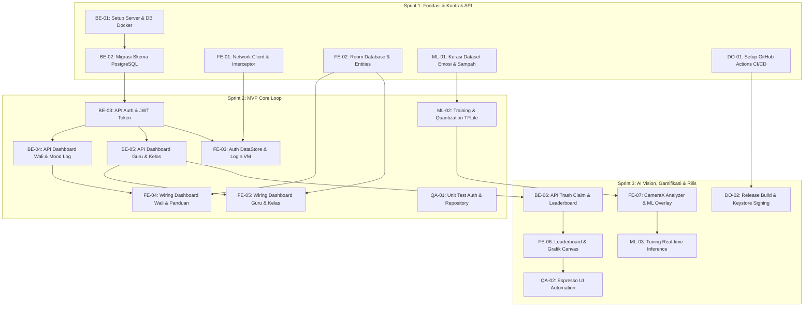

# Work Breakdown Structure (WBS) dan Pembagian Tugas Tim Kibooz

Panduan ini membagi pekerjaan teknis menjadi tiket tugas terukur (*sized tasks*) dengan estimasi *story points*, dependensi masukan, dan luaran konkret. Setiap anggota tim dapat memilih tugas tanpa saling tumpang tindih (*zero-overlap*).

---

## 1. Pemetaan Peran dan Tanggung Jawab (RACI Matrix)

| Kode Peran | Spesialisasi | Fokus Utama Pekerjaan |
| :---: | :--- | :--- |
| **ENG-A** | **Backend & Database Engineer** | REST API, basis data PostgreSQL, cache Redis, autentikasi JWT, dan integrasi cloud storage. |
| **ENG-B** | **Frontend Engineer (Portal Guru & Kamera)** | MVVM Guru (Dashboard, Ruang Kelas, Detail Kelas, Video, Forum, Analisis Mood) dan integrasi CameraX. |
| **ENG-C** | **Frontend Engineer (Portal Wali & Gamifikasi)** | MVVM Wali (Dashboard, Panduan Emosi, Leaderboard, Statistik Sampah, Profil Siswa & Wali). |
| **ENG-D** | **AI / Computer Vision Engineer** | Pelatihan model emosi wajah, model klasifikasi sampah TFLite, dan optimasi inferensi on-device. |
| **ENG-E** | **QA Automation & DevOps Engineer** | Pipeline GitHub Actions CI/CD, unit testing, skrip Espresso UI, dan verifikasi lintas perangkat. |

---

## 2. Diagram Alur Kerja Dependensi (Sprint Dependency Graph)

---

## 3. Matriks Tugas Terperinci per Anggota Tim

### 3.1 Track 1: Backend & Database (Engineer A)

| ID Tiket | Judul Tugas | Bobot (SP) | Dependensi | Luaran / Artefak Konkret |
| :--- | :--- | :---: | :--- | :--- |
| **BE-01** | Setup Environment & Basis Data | 3 SP (1 hari) | - | Berkas `docker-compose.yml` (PostgreSQL 15 + Redis 7) yang berjalan di lokal. |
| **BE-02** | Migrasi Skema DDL Database | 5 SP (2 hari) | BE-01 | File migrasi skema relasional tabel `users`, `students`, `mood_logs`, `trash_scans`. |
| **BE-03** | Modul Autentikasi JWT & Role | 5 SP (2 hari) | BE-02 | Endpoint `POST /api/v1/auth/login` dan `refresh-token` dengan enkripsi bcrypt. |
| **BE-04** | API Dashboard Wali & Mood Anak | 5 SP (2 hari) | BE-03 | Endpoint `GET /api/v1/wali/dashboard` dan `POST /api/v1/wali/guidance/apply`. |
| **BE-05** | API Dashboard Guru & Kelas | 8 SP (3 hari) | BE-03 | Endpoint ringkasan kelas, roster siswa, dan input catatan emosi siswa. |
| **BE-06** | API Gamifikasi & Papan Peringkat | 5 SP (2 hari) | BE-05 | Endpoint klaim poin sampah dengan batas 5x/hari dan query leaderboard terindeks. |
| **BE-07** | Integrasi Cloud Storage (S3/R2) | 3 SP (1 hari) | BE-03 | Modul upload berkas foto profil dan foto bukti sampah. |

---

### 3.2 Track 2: Frontend Guru & Kamera (Engineer B)

| ID Tiket | Judul Tugas | Bobot (SP) | Dependensi | Luaran / Artefak Konkret |
| :--- | :--- | :---: | :--- | :--- |
| **FE-G01** | Setup Networking & Session Store | 5 SP (2 hari) | BE-03 | Kelas `KiboozApiClient`, `AuthInterceptor`, dan `SessionPreferencesDataStore`. |
| **FE-G02** | Refaktor Login & Role Session | 3 SP (1 hari) | FE-G01 | `LoginActivity` terhubung ke `AuthViewModel`, validasi form, dan token tersimpan. |
| **FE-G03** | Wiring Dashboard Guru ke API | 5 SP (2 hari) | BE-05 | `DashboardGuruActivity` menampilkan metrik kelas riil dari `GuruViewModel`. |
| **FE-G04** | Integrasi Multi-Chart Statistik Mood | 5 SP (2 hari) | BE-05 | `DonutMoodChart` & `WeeklyLineChart` menerima data persentase dinamis dari API. |
| **FE-G05** | Wiring Ruang Kelas & Roster Siswa | 5 SP (2 hari) | BE-05 | `RuangKelasGuruActivity` dan `PesertaKelasActivity` fungsional dengan dialog input mood. |
| **FE-G06** | Integrasi CameraX & Layar Review Mood | 8 SP (3 hari) | ML-02 | `CameraScanMoodActivity` dan `ReviewScanMoodActivity` untuk validasi batch. |
| **FE-G07** | Wiring Video & Forum Edukasi | 3 SP (1 hari) | BE-05 | Pemutar video `VideoPembelajaranActivity` dan recycler view `ForumDiskusiActivity`. |

---

### 3.3 Track 3: Frontend Wali & Gamifikasi (Engineer C)

| ID Tiket | Judul Tugas | Bobot (SP) | Dependensi | Luaran / Artefak Konkret |
| :--- | :--- | :---: | :--- | :--- |
| **FE-W01** | Setup Room DB Cache Lokal | 5 SP (2 hari) | - | Entitas `StudentEntity`, `MoodEntity`, dan `KiboozDatabase` untuk mode offline. |
| **FE-W02** | Wiring Dashboard Wali Murid | 5 SP (2 hari) | BE-04 | `DashboardWaliActivity` menampilkan kartu status mood anak dan ringkasan poin nyata. |
| **FE-W03** | Wiring Panduan Emosi 4-Langkah | 3 SP (1 hari) | BE-04 | `DetailPenangananMoodActivity` dengan tombol aksi kirim konfirmasi ke guru. |
| **FE-W04** | Wiring Leaderboard Podium 3D | 5 SP (2 hari) | BE-06 | `LeaderboardActivity` menampilkan podium 1-3 dan recycler view peringkat kelas. |
| **FE-W05** | Wiring Statistik Pilah Sampah | 3 SP (1 hari) | BE-06 | `StatistikSampahActivity` memetakan proporsi organik vs anorganik dari API. |
| **FE-W06** | Integrasi CameraX & Scanner Sampah | 8 SP (3 hari) | ML-02 | `CameraScanSampahActivity` mendeteksi jenis sampah dan memicu dialog klaim poin. |
| **FE-W07** | Formulir Edit Profil Siswa & Wali | 3 SP (1 hari) | BE-04 | `EditProfilSiswaActivity` dengan validasi NISN, nomor telepon, dan simpan data. |

---

### 3.4 Track 4: AI & Computer Vision (Engineer D)

| ID Tiket | Judul Tugas | Bobot (SP) | Dependensi | Luaran / Artefak Konkret |
| :--- | :--- | :---: | :--- | :--- |
| **ML-01** | Kurasi Dataset Emosi & Sampah | 5 SP (2 hari) | - | Dataset teranotasi (wajah 4 emosi anak dan 2 kategori sampah sekolah). |
| **ML-02** | Training Model Klasifikasi Emosi | 8 SP (3 hari) | ML-01 | Model MobileNetV3 dengan akurasi validasi $\ge 88\%$. |
| **ML-03** | Kuantisasi TFLite Model Emosi | 3 SP (1 hari) | ML-02 | Berkas `kibooz_emotion_v1.tflite` (< 8 MB, INT8, latensi < 70ms). |
| **ML-04** | Training Model Objek Sampah | 8 SP (3 hari) | ML-01 | Model YOLOv8n / MobileNetV2-SSD untuk identifikasi botol plastik, kertas, dan organik. |
| **ML-05** | Kuantisasi TFLite Model Sampah | 3 SP (1 hari) | ML-04 | Berkas `kibooz_trash_classifier_v1.tflite` (< 12 MB) dengan metadata tensor. |
| **ML-06** | Evaluasi & Pengujian Benchmark On-Device | 5 SP (2 hari) | ML-03, ML-05 | Laporan uji performa FPS, latensi inferensi, dan konsumsi memori pada HP acuan. |

---

### 3.5 Track 5: QA Automation & DevOps (Engineer E)

| ID Tiket | Judul Tugas | Bobot (SP) | Dependensi | Luaran / Artefak Konkret |
| :--- | :--- | :---: | :--- | :--- |
| **QA-01** | Unit Test Suite ViewModel & Repository | 5 SP (2 hari) | FE-G01 | Pengujian unit JUnit & MockK dengan cakupan kode $\ge 80\%$ pada modul logika. |
| **QA-02** | Otomasi UI Espresso Alur Utama | 5 SP (2 hari) | FE-G02, FE-W02 | Skrip pengujian otomatis Espresso untuk alur Login $\rightarrow$ Dashboard $\rightarrow$ Panduan. |
| **QA-03** | Pengujian Skenario Mode Offline | 3 SP (1 hari) | FE-W01 | Verifikasi aplikasi tetap berfungsi saat jaringan terputus (airplane mode). |
| **QA-04** | Uji Penetrasi & Keamanan Privasi | 3 SP (1 hari) | BE-03 | Audit tidak adanya kebocoran foto wajah anak ke jaringan eksternal. |
| **DO-01** | Pipeline GitHub Actions CI/CD | 5 SP (2 hari) | - | Berkas `.github/workflows/android-ci.yml` yang menjalankan build dan lint otomatis. |
| **DO-02** | Otomasi Rilis & Signing Keystore | 3 SP (1 hari) | DO-01 | Konfigurasi penandatanganan APK/AAB rilis menggunakan GitHub Secrets. |

---

## 4. Lembar Kesepakatan Tim (Assignment Sign-Off)

Gunakan tabel ini untuk mencatat penanggung jawab internal sebelum sprint mulai:

| Peran | Nama Anggota Tim | NIM / Kontak | Status Persetujuan |
| :--- | :--- | :--- | :---: |
| **Lead / Project Manager** | ____________________ | ____________________ | [ ] Disetujui |
| **Track 1: Backend Engineer** | ____________________ | ____________________ | [ ] Disetujui |
| **Track 2: Frontend Guru & Camera** | ____________________ | ____________________ | [ ] Disetujui |
| **Track 3: Frontend Wali & Gamifikasi**| ____________________ | ____________________ | [ ] Disetujui |
| **Track 4: AI/ML Vision Specialist** | ____________________ | ____________________ | [ ] Disetujui |
| **Track 5: QA & DevOps Engineer** | ____________________ | ____________________ | [ ] Disetujui |
